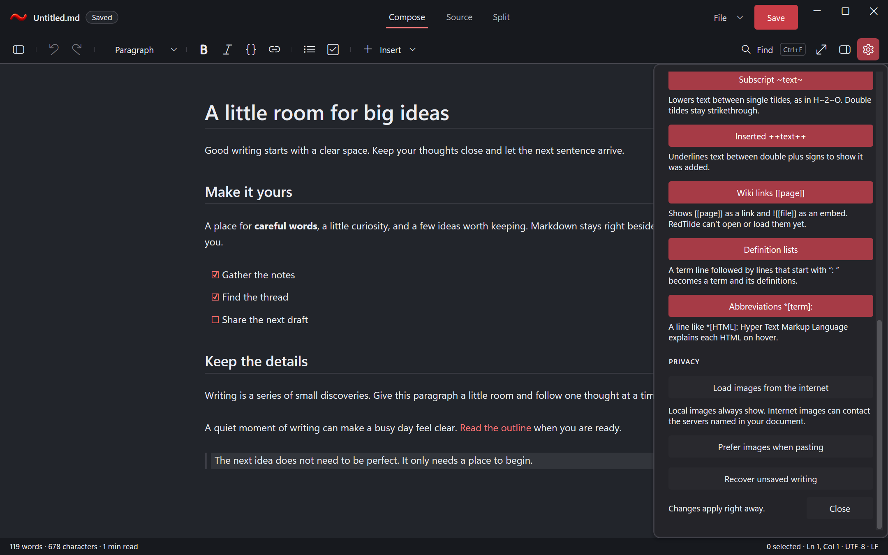
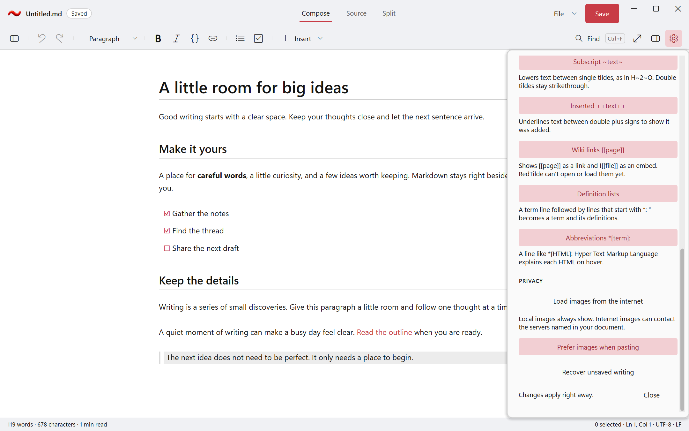

# Owned bitmap paste

At `e08cdb29`, the [local qualification](qualification.json) passes all six builds
without warnings or errors. Every x64 profile passes 139 cases and retains the
actual symbolic-link fixture privilege failure (Win32 1314), 38 hidden captures,
interrupted-write restart and real ASan detection. All 145 original source inputs
and every retained native/SDK/run archive member are independently byte-verified.
ARM64 entries here are cross-builds; full hosted native acceptance remains separate.

The subsequent [hosted Debug/ASan packet](hosted-debug-asan.json) binds main
`4761b264`; the [Release/production packet](hosted-release.json) binds main
`8d68693a`. All six native x64/ARM64 profiles pass 140 cases, including the actual
symbolic-link save, and 38 captures each: 840 passing cases and 228 captures.
Every original GitHub wrapper and canonical payload member is independently
verified. Both version `0.1.378` production ZIPs pass clean-extraction smoke and
all 13 test-entry-point refusals each, after the combined native Release gate.
The original images were verified against the smoke receipts and PE architecture.
No GitHub release was published by these qualification workflows.

The [counterexample](counterfactual.json) retains the original missing-handler
failure, exact images and source. The corrected app uses its owned bounded worker
to validate a DIB, encode PNG and durably create a unique asset. Publication checks
the original document, source, selection and lifetime before inserting one undoable
image reference. Busy, edit/Undo, read-only, Close and session-end paths execute in
the actual hidden application. Tests independently decode output pixels and alpha,
verify full file identity and content, and preserve the ordinary document-size limit.
Controlled DIB callbacks avoid accessing the person's OS clipboard.

The first functional fixture incorrectly expected an unwrapped URI; its original
dirty source, EXE/PDB and canonical run payload remain retained. The first dark
capture changed a setting without applying the real host theme. Its original
captures, sidecars and native/run archives are retained as rejected evidence.
The accepted scenario executes the actual theme command and records the actual
host palette, DPI and preference. Both corrected captures were visually reviewed.

[Capture provenance](captures.json) binds these original harness pixels to the
source, native executable, SDK pin and run. Synthetic fixture content is used;
there is no desktop takeover or physical-monitor acceptance claim.

Text wins when both formats are available unless **Prefer images when pasting** is
enabled. Assets survive Undo/Redo and recovery. Sharing a document requires copying
its images and updating their Markdown references. Automatic asset export, cleanup,
drag/drop, real network locations, physical input, API-5 adoption and
formal performance acceptance retain separate owners.

The lasting contracts belong to [editing](../../Specs/Editor/Editor_Markdown.md),
[file safety](../../Specs/Core/Core_FileSafety.md), [settings](../../Specs/Core/Core_SettingsAndCrashes.md)
and the [usage guide](../../docs/README.md).
