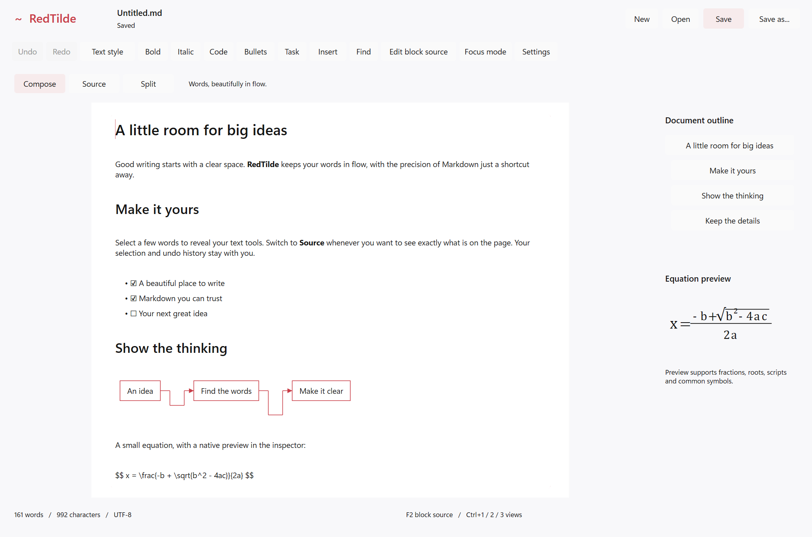

# RedTilde creation evidence — 2026-10-20

This is an **experimental application qualification packet**, separate from upstream DxUi evidence.
Source-tree identity (SHA-256, excluding this evidence directory):
`f371c27f926f9840152596d796c11ceb7bbb8340cc1af366ac1ad610d557ac47`.
DxUi pin: `29fc7897b21db3cd1d27f7ec52d6756fe9af36c0`, API 4, from PR #89.
The x64 Release executable hash is `F067F550068DFA3F7EAAA73FFBECADE9251901AB67AE1358BF6BF69514072A85`.
Build tools reject a source change during compilation; tests/package tooling reject stale source or binary identity.

## Builds and runtime

All six builds share the source identity above. The build receipts include the exact compiler, linker, MSBuild,
SDK/header/import-library, dependency and output hashes. Toolset v145 / MSVC 14.51.36231 / SDK 10.0.26100.0.
Runtime host: x64 Windows 10.0.26300.0, AMD64 Family 26 Model 68, 32 logical processors. No ARM64 runtime was run.

| Platform | Configuration | Evidence |
| --- | --- | --- |
| x64 | Debug | [Build pass](build/x64-Debug.json), [14 cases and shutdown probe](runtime/Debug/receipt.json) |
| x64 | Release | [Build pass](build/x64-Release.json), [14 cases, shutdown, captures and crash probe](runtime/Release/receipt.json) |
| x64 | ASan Debug | [Build pass](build/x64-ASan-Debug.json), [14 cases and real sanitizer detection](runtime/ASan-Debug/receipt.json) |
| ARM64 | Debug | [Cross-build pass](build/ARM64-Debug.json); runtime pending |
| ARM64 | Release | [Cross-build pass](build/ARM64-Release.json); runtime pending |
| ARM64 | ASan Debug | [Instrumented cross-build pass](build/ARM64-ASan-Debug.json); runtime pending |

The 14 unique behavioral cases execute in each x64 configuration: UTF-8/Unicode/BOM/mixed-EOL round trips;
invalid input and capacity rejection; atomic-save failure and external conflict; settings version/field fallback;
coalesced preference writes surviving owner closure; outline fences/Unicode; native TeX parsing/rejection;
view/source/history/dirty preservation; semantic formatting/undo/live theme; native Mermaid local source and
unsupported source retention; ordinary source-draft commit/cancel/stale/close guards; device recreation and local
image decoding/pixels; and save-snapshot preservation of edits made during an asynchronous write.
Exact case results are in each profile's `tests.json`.

Each Core run also launches a hidden child, changes preferences and closes immediately (including a repeated
close request), then verifies the final Paper setting after process exit. The UI closes without joining storage;
a hidden notification window keeps the process alive until the admitted preference write is durable.
ASan's isolated child reports an actual `AddressSanitizer: heap-use-after-free`; see
[the retained diagnostic](runtime/ASan-Debug/asan.stderr.log). An ordinary crash cannot satisfy that gate.
The separate Release crash child produced one MDMP-signature minidump and a pending marker; only hashes are
retained here, not a potentially sensitive dump.

## Actual application captures

These are app-harness renders of the application's own D2D client surface, read back while its window stays
hidden and non-activating. They are **not proposal mockups or desktop screenshots**. Normal captures are
2040x1350 pixels / 1360x900 DIP at 144 DPI; narrow is 1230x1350 pixels. The high-contrast case is an injected
host palette using current system colors, not a physical Windows high-contrast/AT session.

- [Compose, light](captures/compose-light.png), [dark](captures/compose-dark.png), [source](captures/source.png),
  [split](captures/split.png), [selected-text tools](captures/context-selection.png).
- [Local source draft](captures/local-source.png), [settings](captures/settings.png),
  [equation inspector](captures/math.png), [narrow](captures/narrow.png), [high-contrast fixture](captures/high-contrast.png).
- [Local image in the real editor](captures/local-image.png), produced by the resource scenario.

## Initial resource baseline

| Profile | Forced clean renders/sec | Edit/undo plus one forced render, average ms | Private MiB |
| --- | ---: | ---: | ---: |
| Debug | 125.93 | 2.76 | 69.9 |
| Release | 125.86 | 0.32 | 64.9 |
| ASan Debug | 126.14 | 9.64 | 426.5 |

Each fixture measures 60 clean forced native renders and 120 edit/undo forced renders of the same synthetic
sample. Preparation is cooperative; this is not an end-to-end semantic-ready latency or normal presentation FPS
measurement. The profile `performance.json` files retain the exact numbers, dimensions and memory counters.
These are initial app baselines, not paired non-regression evidence or a replacement for the upstream D4c hold.

## Package, tooling and remaining gates

[Package identity](package.json) and [clean-extraction smoke result](package-smoke.json) bind the archive and
executable hashes. The extracted executable ran all 14 cases with its working directory set to the extracted
directory. This was on the current machine, not a fresh VM; the matching VC++ runtime is required and is not bundled.

[Five validators](tooling/validators.txt), [format check](tooling/format-check.txt),
[nine official skill validations](tooling/skill-validation.txt) and
[stale-artifact rejection](tooling/stale-artifact-rejection.txt) passed. Exploratory pre-fix test failures remain
under `.build/tests/initial`; they are not reused as qualification evidence.

The plan remains WIP. Full in-document mathematics/LaTeX, broader Mermaid dialects, larger documents,
per-session recovery, text-scale/font API support, conditional cross-process replacement, accepted paired/WARP/
hidden-resource budgets, native ARM64, physical IME/touch/AT, authorized menu/focus tests and release handoff
remain open. No desktop focus test was authorized or run. No production-release or full-compatibility claim is made.
