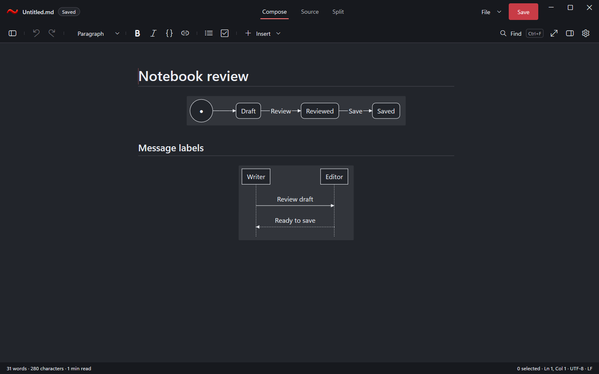
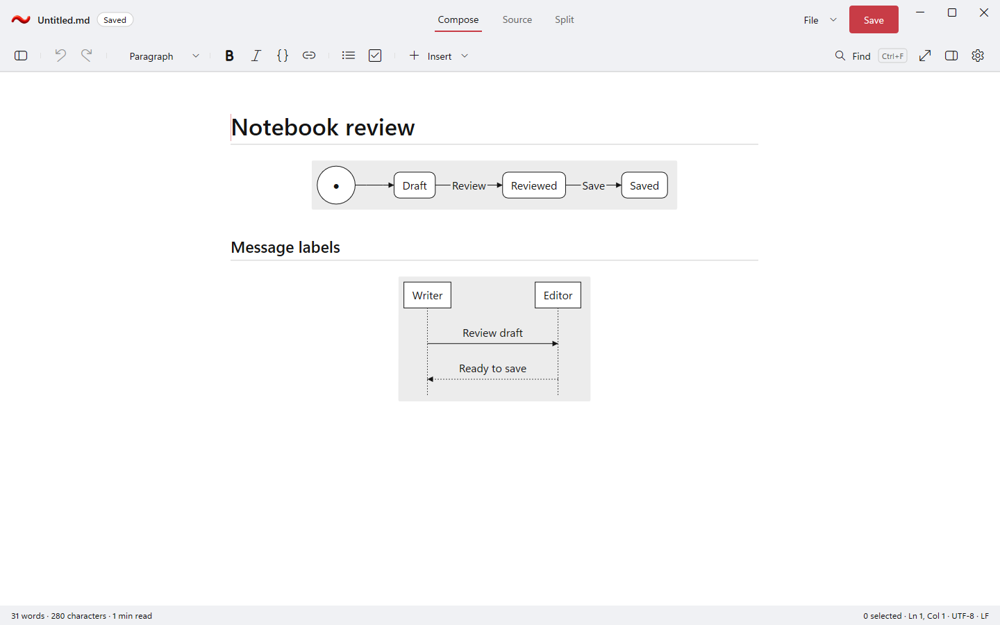

# Diagram label backgrounds and duplicate Close

RedTilde adopts DxUi API 4 at `2a7e7c28f95a70193e4a2f68a89001d54b4d2131`. Ordinary arrow labels and
class/ER cardinalities use the diagram canvas color whenever the retained label ink reaches the library's
4.5 contrast criterion. Otherwise preparation chooses the smallest sufficient darkening or lightening.
Notes and groups retain their separate surfaces. Source text, selection and undo remain authoritative.

The application implementation is `2879d4dc3786866227149d0267d06bedcf6a6cfd`. It also implements the
accepted duplicate-Close choice: keep the existing Save/Discard/Cancel prompt and ignore another window
or command Close. Cancel preserves the document; a later Close can prompt again.

## Actual native rendering

These are original hidden application-harness captures with invented notebook, Writer and Editor fixtures.
No desktop screenshot, image edit or substituted mockup is involved. PNGs keep their original scenario
sidecars; [capture hashes](capture-hashes.json) bind the published bytes. Requested simulated DPI is distinct
from the sidecars' native window DPI. The captures do not establish physical-monitor or native ARM64 support.
Packet-local Git attributes preserve the original fixture, PNG, sidecar and JSON bytes across publication
and checkout. Verification compares both working files and published Git blobs with the original hashes.

## Matched before and after

The unchanged [Notebook review fixture](Notebook-review.md) has SHA-256
`8A78C09EB2A47CE29AAD7507CE5ED97C16C37AC1E11CFD9AF4FFB527ABCDF945`. Theme, view, viewport and requested
DPI match in each comparison. Both Review and Save have independent background samples away from glyphs.
All eight old label samples differ from their neighboring canvas; all eight corrected samples equal it.
The canvas itself is unchanged. [Exact pixel observations](pixel-verification.json) retain coordinates and RGB.

| Theme and DPI | Before | After |
| --- | --- | --- |
| Dark, 96 | [Original](before-dark-96.png) | [Corrected](after-dark-96.png) |
| Dark, 192 | [Original](before-dark-192.png) | [Corrected](after-dark-192.png) |
| Light, 96 | [Original](before-light-96.png) | [Corrected](after-light-96.png) |
| Light, 192 | [Original](before-light-192.png) | [Corrected](after-light-192.png) |

| Identity | Before | After |
| --- | --- | --- |
| Exact API-4 SDK commit | `8c6c2818d084e6124fb2c08eddc00bdba7a9d2aa` | `2a7e7c28f95a70193e4a2f68a89001d54b4d2131` |
| App executable SHA-256 | `32C283265213643ADE3D0A0DD7A5B4730176E2AB3ECBE6A9805CD2763A76ECBE` | `88DEC3AB0CA64F2E2A1BEFBAA9B900646821501DFD3263C9B886BA4019F268D0` |
| Dark label / canvas RGB | `34,37,43` / `50,53,59` | `50,53,59` / `50,53,59` |
| Light label / canvas RGB | `255,255,255` / `236,236,236` | `236,236,236` / `236,236,236` |

## Regression boundaries

The [qualification projection](qualification.json) records six zero-warning/zero-error builds and complete
Release, Debug and ASan Debug native runs at the implementation/pin above. Each x64 profile passes all 75
registered cases, 36 standard captures and its process/recovery/crash/performance-smoke obligations. The real
ASan heap-use-after-free detection probe also passes. These are 225 case executions and 108 standard captures;
the three ARM64 profiles are cross-builds only. The final profile's initial capacity-guard refusal and exact
resume are retained separately from the accepted builds. No native assertion or source input was weakened.

The SDK raster fixture checks nine diagram arrangements, four readable/low-contrast themes, two DPI values
and explicit/default fill calls: 144 native raster renders. Independent checks cover contrast, minimal fallback,
near-black ink, cardinalities, group/note containment and stable preparation/layout counters. A separate
native brush-retirement fixture fails against the preceding `344199d5` library and passes the corrected one:
after host-cache eviction and source revision, an externally retained old brush cannot paint the new layout.

`Recovery.DuplicateCloseKeepsUnsavedPrompt` passes with all six Recovery cases in run
`20261104T131224954Z-52792-694ce801cd684dd9aad2fdfe7495e61f`. Its hidden test-only callback sends both
duplicate Close forms while the first prompt is open, then checks Cancel and a fresh Discard. It preserves
foreground focus and does not substitute for physical dialog/input qualification.

The complete raw runs, first failures, exact executables/symbols and restoration manifests remain retained
in the approved private workspace. Current build/runtime qualification is recorded separately; functional
passes, captures and unpaired smoke observations do not establish paired performance or release acceptance.
Remaining work stays in the [single active plan](../../Specs/Plans/WIP/RemainingWork_2026-11-04.md).
