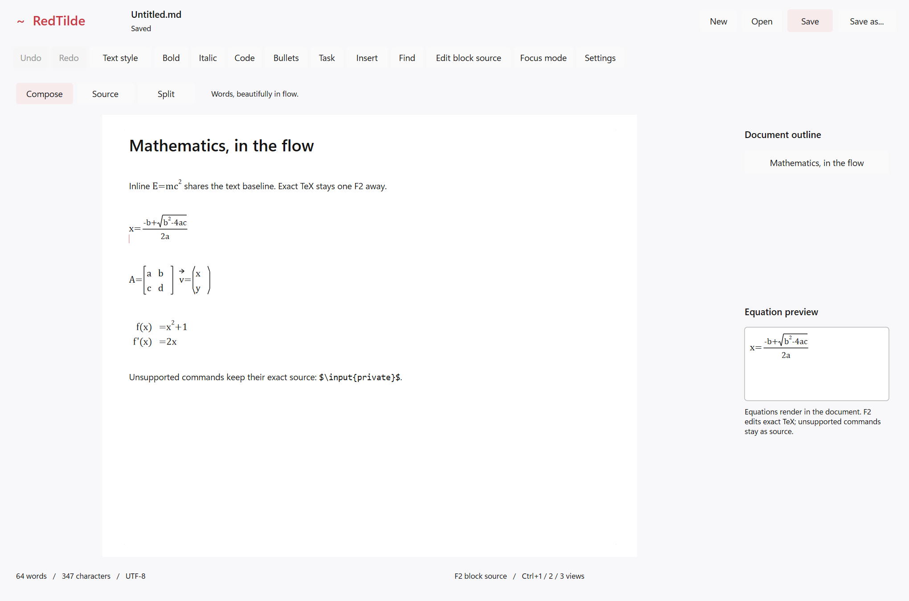
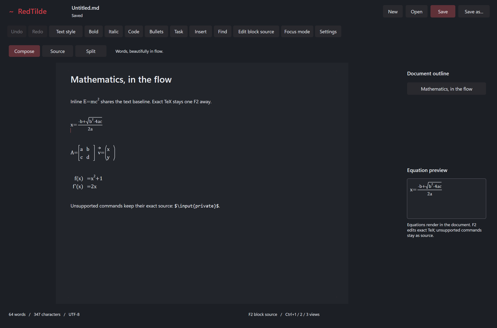
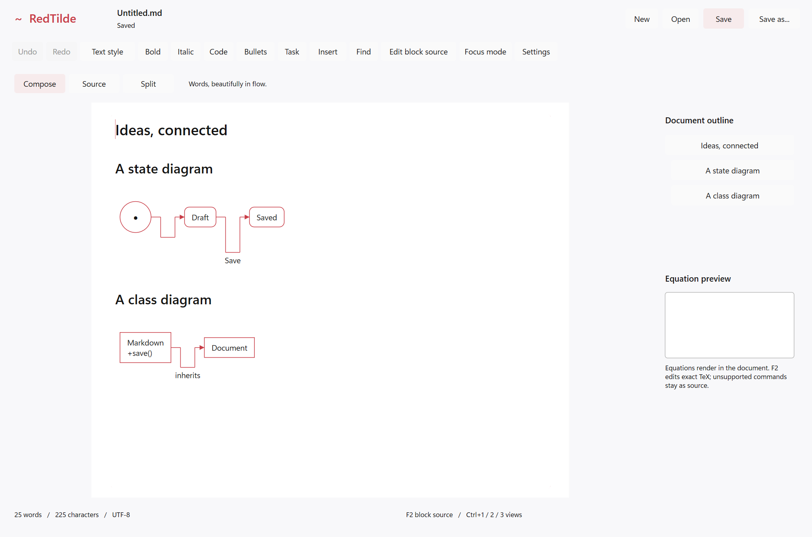
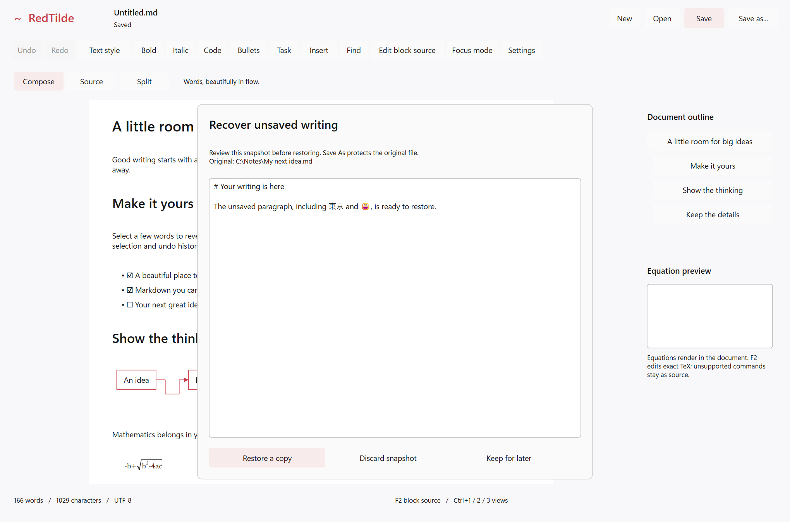

# Native math, broader Mermaid and recovery — 2026-10-20

The bounded feature continuation is implemented and locally validated. The whole application remains experimental
and its creation plan remains WIP. Shared controls belong to [DxUi PR #90](https://github.com/RedSalamanders/DxUi/pull/90),
stacked on PR #89. RedTilde pins runtime source `778e8630392812c65da364c778056ff42b862f36`, API 4, through its normal
single-library dependency adapter. No sibling application's source or settings are build inputs.

## Behavior and validation

| Area | Evidence and practical scope |
| --- | --- |
| Mathematics | Inline/display formulas, fractions, indexed roots, simultaneous scripts, symbols/functions/text, alphabets, accents, scalable delimiters, matrices, cases and aligned/gathered rows. Cached native glyph/line rendering, exact source mapping, F2/undo, theme and device recreation checks. Independent glyph-position oracles distinguish aligned, cases and centered matrices. Unsupported/oversized notation stays literal. |
| Mermaid | Flowcharts plus simple state and class diagrams, transitions, members, associations and inheritance. The original 105 flowcharts and 20-family inventory remain fully accounted for; unsupported grammar retains the exact fence. Native and embedded object/source/history checks pass. |
| Recovery | Versioned checksummed Unicode envelopes, 750 ms quiet-time coalescing, exclusive live-session leases, atomic writes, review/restore/discard/keep, corrupt/newer quarantine, original-file protection and recovered Save As. Includes unapplied drafts, cancel retirement, write/delete failure and retry. A real process crash and separate restart restore the exact Unicode prefix in every x64 profile. |
| RedTilde | 20 behavioral cases in x64 Debug, Release and ASan; 13 actual hidden captures in Debug and Release; crash dump/marker and preference-process durability probes; genuine ASan use-after-free detection in an isolated expected-failure process. All six x64/ARM64 configurations build. |
| DxUi | All 19 noninteractive suites in each x64 profile: 57 passes, zero capability skips. Includes EditorControls, Embedded, Accessibility and Rendering. All six configurations build, with genuine ASan detection. This is local x64 runtime and ARM64 cross-build evidence. |
| Repository | Specifications, capability status, user documentation, design guidance, agents/skills and changelog fragments updated together. Validators, formatting and all nine skill validators pass. |

Fresh closeout build/test records are under `builds/` and `tests/`; `manifest.json` binds the final app source,
dependency and binaries. The earlier successful code-validation receipts remain under `pre-closeout/`, at app
source `8e1f4b246e20fa99e6ddf83ca567574cd0405382f1bed478702245d2c12cb545`. The final documentation/checklist update
changes the conservative app source hash, so closeout uses fresh warm builds and tests rather than relabeling those
receipts. Shared-library raw build/test records and source bindings are under `shared-dxui/`.

## Actual application captures

These are nonactivating application harness captures, never desktop screenshots or proposal mockups.
`captures/provenance.json` retains their exact Release receipt, scenario and PNG hashes. All 13 main scenarios
were reviewed; the additional `math-device-loss.png` comes from the native device recreation test.

| Mathematics | Dark mathematics |
| --- | --- |
|  |  |

| Mermaid state/class | Recovery review |
| --- | --- |
|  |  |

The review capture uses a deterministic synthetic candidate. The separate real crash/restart process check
establishes durable discovery and restored-source behavior; the screenshot alone does not establish recovery.

## Release comparison

All ten raw rounds, both exact build identities and fixture SHA-256 are retained in `performance/`.
Both binaries use `docs/examples/performance-fixture.md`, 144 DPI and a 2040 × 1350 hidden ControlHost on the
same Windows x64 machine. The baseline is the initial application's archived Release executable; the candidate
is the new feature executable. The fixture hash is `B5A59C442AED3DF35CC4D494043AC24D90472E2872032DA03A882B0CA5423497`.

| Median of five processes | Baseline | Candidate |
| --- | ---: | ---: |
| Clean forced render FPS | 125.117 | 125.254 |
| Dirty edit plus forced render | 0.275129 ms | 0.376486 ms |
| Private memory | 70.52 MiB | 69.70 MiB |

The measured dirty-loop increase is **0.101357 ms / 36.84%**. The same input now renders additional math and
diagram objects, compilation/test activity was present, ordering was not alternated, and each dirty iteration
does not wait for full semantic readiness. This is diagnostic evidence, not presentation FPS, equivalent-work
non-regression, causal attribution or production acceptance. S5 remains open. The next performance work should
profile fully prepared edits/cache invalidation with an alternating, idle-host paired fixture, then choose measured
optimization or retain the production deferral; do not silently adopt this candidate as a new baseline.

## Package and remaining gates

`package/` records the exact experimental portable archive and independent extraction smoke test. Runtime
redistributables are not bundled. Generated executables/ZIPs, dumps and private settings data remain in `.build`.

Full LaTeX/package and arbitrary Mermaid compatibility, documents over 65,536 UTF-16 units, conditional
cross-process replacement, native ARM64 app execution, physical IME/touch/assistive technology and agreed-time
focus-taking tests remain open. WARP/clean/dirty/hidden resource acceptance, strict paired performance, upstream
PR #89/#90 merge qualification and release handoff also remain open. No desktop focus test was authorized or run.
CI results belong to their exact merge source; pending jobs are not passes and cannot qualify the different
immutable dependency pin. See the [active plan](../../Specs/Plans/WIP/RedTilde_2026-10-20.md).
