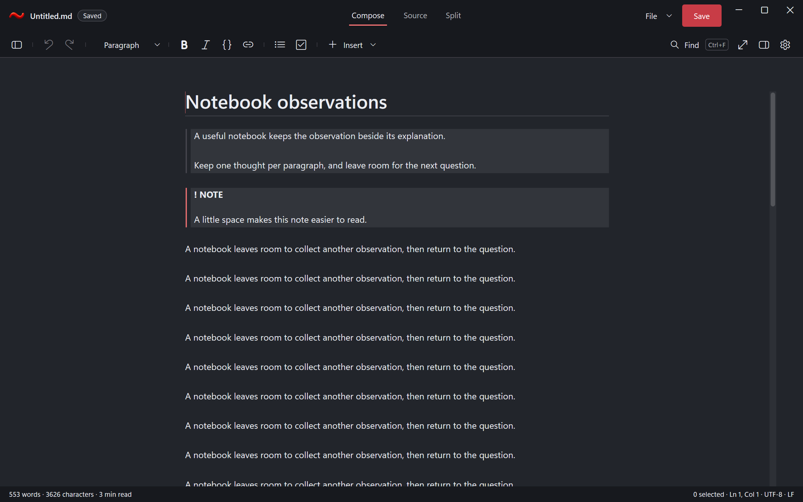
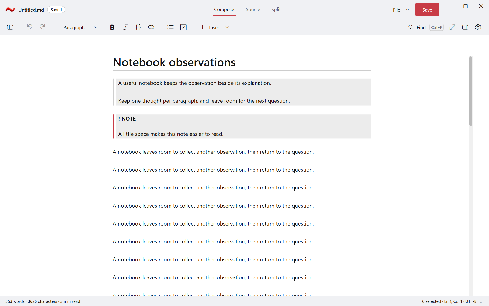

# Quote margins and document scrollbars

The shared DxUi layout reserves six DIP inside both sides of quote/callout surfaces, including nested
containers, lists and tables. RedTilde enables the existing native themed scrollbar in Compose, Source,
the Split mirror and the equation inspector. A fitting document reserves its lane without painting a thumb.

These are actual application-harness captures with invented notebook content. No desktop screenshot or
image editing is involved. Each PNG has its original scenario sidecar. The matched before/after pairs use
the same source fixture, view, theme and requested DPI; simulated DPI is identified separately from native DPI.

## Native Release verification

- The old quote renderer fails `TestRichSemanticQuoteInsets`; the fixed library passes the complete
  EditorControls, Embedded and Accessibility suites with zero capability skips.
- The old app passes 52 Editor cases and fails the new `Rendering.DocumentThemedScrollbars` case.
  The corrected app uses the real view commands and an owned, correctly scaled hidden viewport.
- The exact-pin app passes all 74 registered cases: Storage 12, Settings 4, Recovery 5 and Editor 53.
  It also passes preferences-process exit, recovery crash/restart, performance smoke, isolated crash evidence
  and 34 standard captures. Scrollbar pixels respond to the host theme; paging, thumb capture/drag/release,
  no-overflow behavior and exact source/selection/redo preservation are covered across three views,
  Light/Dark/Paper and 96/144/192 DPI.
- Both Release builds report zero warnings and zero errors. Six library gallery images were regenerated
  and reviewed. The new margin tests also cover both reading directions, narrow widths and source ACP hit testing.

Native run: `20261104T082344801Z-44728-a9c0f4a2f8ab4c478d392c9e464d175f`.
Receipt SHA-256: `6ADAFD758F5916D49DEADD81EA8827C07AA1194CD5BF33C6DCE1B783FD4C71DA`.
The complete raw runs, failed baselines, executables, symbols and original receipts remain in the approved private workspace.

| Identity | Before | After |
| --- | --- | --- |
| Exact DxUi API-4 pin | `703a96c788a79c1e7b28097226a2ca0a735f11bc` | `f498b455776dfec514c50af3c306f3b1f0ea1a8c` |
| App source identity | `b0872fdb835fd00cd914ce83c0ed7b9802e80aaece17eca551aff08be6cf3f37` | `d8d746a4c1194f9725b72c30b6b2a29c11fc256e5a4ab1ccf0215d10face3599` |
| Compiled source identity | `14e372cdb48469028a2560652a7cd67eb952170cf93ccb4b78ec9dbe649d5936` | `95ebf534c41214895fde4608b7e83fc90663badb4b6abeea5fd13fd7e123e4fd` |
| App executable SHA-256 | `A12EEFAEC5FC16512E0F84531F13DCDAFDD8AEE2417A85A2E6A38542D3BCB152` | `DFE4DFCD9FDBC6468876F477DEF36DEEF110640319573189D2216EF2146CDF67` |

These identities describe the retained working-tree candidates based on main `1cd59c0`; a later
documentation/publication receipt does not rewrite them. Functional passes and unpaired performance smoke
do not establish performance acceptance, physical-input coverage or native ARM64 qualification. Remaining
delivery and platform work stays in the [single active plan](../../Specs/Plans/WIP/RemainingWork_2026-11-04.md).

## Current native rendering

The final API-4 adoption at `8c6c2818d084e6124fb2c08eddc00bdba7a9d2aa` includes the Debug sequence-label
allocation repair and explicit viewport fixtures for the two historical ARM64 failures. Its x64 Release run
`20261104T090859180Z-45360-b0f3f358029c4666be37e662e6e241e9` passes the same 74 native cases and all 34 captures,
plus preferences, recovery restart, crash and performance-smoke scopes. The executable SHA-256 is
`32C283265213643ADE3D0A0DD7A5B4730176E2AB3ECBE6A9805CD2763A76ECBE`.
[Exact final-pin capture and receipt identities](sdk8c6/verification.json) accompany the original PNG/sidecar pairs.
Earlier matched comparisons above retain their original `f498b455` identity; they are not retagged as this run.

## Matched comparisons

| Theme and DPI | Before | After |
| --- | --- | --- |
| Dark, 96 | [Original](before-dark-96.png) | [Fixed](after-dark-96.png) |
| Dark, 192 | [Original](before-dark-192.png) | [Fixed](after-dark-192.png) |
| Light, 96 | [Original](before-light-96.png) | [Fixed](after-light-96.png) |
| Light, 192 | [Original](before-light-192.png) | [Fixed](after-light-192.png) |

## Published capture hashes

| File | SHA-256 |
| --- | --- |
| [after-dark-192.png](after-dark-192.png) | `CF8D050049BC3EE09EFF9BD3258E2DD4D4E3D4B262D7A45222A907BB253FEC32` |
| [after-dark-192.png.scenario.json](after-dark-192.png.scenario.json) | `55B79132C3D990589C179B18C197F5C3D936C8DB06A456583DE6C96C78C25020` |
| [after-dark-96.png](after-dark-96.png) | `90B20325FDC9DADF27A396E80795A3FB09CB47D605F71FE18C51C740485560CF` |
| [after-dark-96.png.scenario.json](after-dark-96.png.scenario.json) | `6E018A66CBB925FDB4368059891555DBE5000A8D02BCD29501A96D7476158129` |
| [after-light-192.png](after-light-192.png) | `4DF3A72A315AB7338D8E58BCC4008118FB974E45117B1158ABE87B422FD401D2` |
| [after-light-192.png.scenario.json](after-light-192.png.scenario.json) | `D38CE7E72DF4CD9A6BAC2DF86ED4C3AF3E68BB9D03C3AFE21AF9DD2FC4402134` |
| [after-light-96.png](after-light-96.png) | `F891E38F7A1470C551D8CF65364E64FBE127140F4D8E14C9ACD4B36D1E2139E0` |
| [after-light-96.png.scenario.json](after-light-96.png.scenario.json) | `F878617918937DCCB741AC72C6EAEB3537024F304E616D5D72C62C4E9A8679CB` |
| [before-dark-192.png](before-dark-192.png) | `70DE2E2102ABAC0F194661C3EF36C6EAED5379373C11ADBA883C8AEE559E4E07` |
| [before-dark-192.png.scenario.json](before-dark-192.png.scenario.json) | `55B79132C3D990589C179B18C197F5C3D936C8DB06A456583DE6C96C78C25020` |
| [before-dark-96.png](before-dark-96.png) | `795C4B28C794B808C609A6CF58AB867F2F388E828106ABC66538134BEC3A2FA6` |
| [before-dark-96.png.scenario.json](before-dark-96.png.scenario.json) | `6E018A66CBB925FDB4368059891555DBE5000A8D02BCD29501A96D7476158129` |
| [before-light-192.png](before-light-192.png) | `086F565480EB112994541B5EA32E6BDAED7E1F6144BD3E2EBBD3F1DDF084737A` |
| [before-light-192.png.scenario.json](before-light-192.png.scenario.json) | `D38CE7E72DF4CD9A6BAC2DF86ED4C3AF3E68BB9D03C3AFE21AF9DD2FC4402134` |
| [before-light-96.png](before-light-96.png) | `F9DE90BEE95ED6E48002F52B8AE3B5BC1E7958FC38FF159D97B5C0819947F05C` |
| [before-light-96.png.scenario.json](before-light-96.png.scenario.json) | `F878617918937DCCB741AC72C6EAEB3537024F304E616D5D72C62C4E9A8679CB` |
| [quote-scroll-dark.png](quote-scroll-dark.png) | `F56C3B02831FCD413E6EAA35F78F10C87AE677B70AA1A4C87EE39F24BF0C4670` |
| [quote-scroll-dark.png.scenario.json](quote-scroll-dark.png.scenario.json) | `E87CBEFB420033ABC6EBD98D99D18DB1BAB81086367F85688A2245717859220E` |
| [quote-scroll-light.png](quote-scroll-light.png) | `DC66434692EA529C82AA0679C0EDE82AB01ABC06B5D6F7740C0BC1EB493AEC2F` |
| [quote-scroll-light.png.scenario.json](quote-scroll-light.png.scenario.json) | `787D8171EDC747C38D34EA2824B5204D0CA9F51253BBE72D84101E6F6679B781` |
