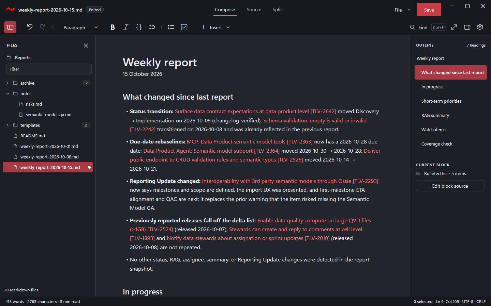

# Image-2 visual fidelity, 2026-10-23

Actual RedTilde renders for the owner's second reference image. These are hidden application-harness captures,
not proposal art or desktop screenshots. The comparison uses a 1440x900-DIP viewport, dark Compose, a 280-DIP
Files pane, the same visible weekly-report content and tree, seven outline headings and the same current section.
The canonical 96-DPI image is exactly 1440x900 pixels. Higher-DPI images preserve the DIP viewport.

The [reviewed fixture](../../docs/examples/weekly-report-2026-10-15.md) transcribes the visible reference and supplies
invented continuation below it; the original full report was not supplied. Links use example.invalid. Document
totals and line/column reflect this actual source rather than the reference's illustrative totals. The document
retains CRLF. A real edit produces the Edited chip and file dot. File/folder counts come from the seeded model.

The implementation uses canonical DxUi quiet/outline/tab buttons, decorated command content, frameless trees,
aligned disclosure lanes, neutral badges, edited-state dots, a thin splitter seam, source-preserving semantic
spacing and an optional decorative editor focus indicator. RedTilde owns its layout, theme policy and fixture.
The change retains source/history, keyboard commands, UI Automation and high-contrast focus/selection behavior.

[150% capture](captures/reference-dark-dpi-144.png) | [200% capture](captures/reference-dark-dpi-192.png) |
[Capture provenance](capture-manifest.json) | [Build/native verification](verification.json) |
[Documentation continuation](documentation-continuation.json) | [Literal visual checks](visual-comparison.json)

## Comparison

- Header: inline filename/state, underlined view commands, primary Save and compact native caption glyphs.
- Commands: quiet tool groups and dividers, Find icon/hint, checked Files toggle and optional overflow.
- Files: section/close, folder/filter, aligned tree icons, collapsed-folder counts and actual Edited dot.
- Document: continuous canvas, matched heading/body scale, heading/list margins and visible next section.
- Outline: frameless hierarchy, heading count, current section and block tools immediately after short outlines.

The accepted target is [proposal art](../../Specs/Plans/Done/DesignRefresh_2026-10-22/compose-dark.html).
Native Fluent glyph strokes, text rasterization and line wrapping can differ from its browser SVG/text rendering;
no pixel-equivalence claim is made. The reference's hovered-link decoration is an interaction state, separately
covered by shared link tests. Every actual PNG retains its scenario sidecar and build/source/pin identity.
Both images are exactly 1440x900 pixels. Eight literal representative samples match the header, Files/canvas/outline
grounds, status bar, Save and current file/heading fills. These samples establish those colors, not a global image score.

## Evidence and limits

The accompanying verification manifest records actual profile/suite outcomes and hashes. Raw build/test output,
initial failures and intermediate captures remain private under `.build/visual-fidelity-*` and
`.build/evidence/test-runs/`. They are not silently replaced by the final result.

All six application builds pass. Debug, Release and ASan Debug each pass 53 behavioral cases, 23 capture scenarios,
process-exit/recovery/crash checks, and the ASan configuration detects a real intentional heap-use-after-free.
The archived native runs execute source `0bb249e4f97c16a3110a937918fd6501efcd357d2ce108ade0ba0516aa1c7eae`.
The final prose/checklist state is source `dee218d40874284ec9f4fee7b1edc1102c76ab37c67ab8d09fc76bb444c85772`.
Fresh build receipts prove the same dependency, compiled inputs, environment and complete native artifact identity
in all six profiles. This documentation continuation retains the earlier native observations without claiming
new execution of later prose. Formatting, changelog folding/check and all RedTilde validators pass separately.

The first SDK continuation failed because the canonical tree hit-test call omitted its host; it was corrected
and a regression checks the widened expander's painted edge and hidden-lane behavior. Earlier tests also caught
an eager header measurement warming typography during cold initialization; title measurement now waits for the
host's first typography preparation and caches text/width/DPI/revision. The cold-resource assertions remain enabled.
Earlier app fixture assertions for responsive overflow, wrapping footer text, caption size and syntax readiness
were corrected to test their independent contracts. All original failed records remain retained.

DPI simulation verifies hidden layout, not a physical monitor. ARM64 builds are cross-compilation, not native
runtime acceptance. No desktop input, clipboard, focus-taking lease, physical IME/touch or assistive-technology
qualification is performed here. Existing performance/policy, CI and release gates remain separate. In particular,
the parent design-refresh R10 cohort's eight recorded regressions remain open; unpaired smoke observations cannot
erase them or establish non-regression for this change.

The exact SDK code revision separately passes six builds and 57 normal noninteractive suite executions, with
zero capability skips and real ASan detection. Its five-theme gallery is refreshed. Two additional unpaired SDK
Default-fixture diagnostics require advice: the first memory flag does not repeat, while the repeat flags timing
differences. Those records remain with the SDK's existing performance-qualification owner; they supply no accepted
cost or consumer performance verdict. The SDK packet is in its separate Measurements/VisualFidelity_2026-10-23 folder.
