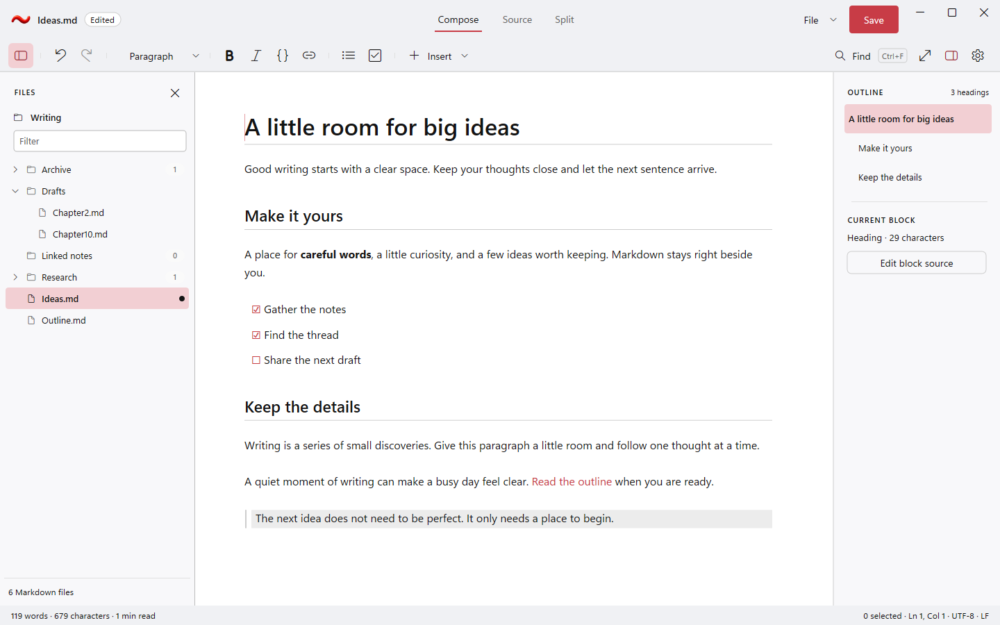

# RedTilde

**Words, beautifully in flow.** A native Windows Markdown editor in the RedSalamander, RedXe, and RedPrism family.

Source repository: [RedSalamanders/RedTilde](https://github.com/RedSalamanders/RedTilde).


RedTilde keeps a single authoritative UTF-8 Markdown source and undo history while you switch between **Compose**, **Source**, and **Split** views. Select text for contextual tools, edit blocks or equations in place (`F2`), browse multi-folder workspaces and open documents (plus optional read-through GitHub repositories via `Ctrl+Shift+G`), check prose with Windows Spell Checking and portable custom dictionaries, protect unsaved edits with in-window save confirmation (**Keep & Exit**), preview and print formatted pages (`Ctrl+P`), insert local or pasted images, draw eight bounded native Mermaid diagram families (flowchart, state, class, sequence, pie, ER, Gantt, and mind map), and render inline or display LaTeX math natively. All editing stays local.

> **Start here:** Read the [**User Guide**](docs/README.md), [**Portable & Installer Guide**](docs/Portable.md), [**Screenshot Gallery**](docs/screenshots/README.md), and [**Per-User Installer**](Installer/Install-RedTilde.ps1).



## Status

RedTilde `1.0.0` is a **production release** built against an exact DxUi API-5 pin (`0c371a6197eb8c6b876b4b2843d75078bc21035c` in [Dependencies/DxUi.lock.json](Dependencies/DxUi.lock.json)). Documents remain bounded to `65,536` UTF-16 units and `128` undo steps; deferred post-1.0 work and future milestones are tracked in [capabilities.json](capabilities.json) (`deferred`) and the [active plan index](Specs/Plans/WIP/README.md).

Expected refusals retain your edits; unexpected C++ failures record local minidumps and `.record` sidecars under `%LOCALAPPDATA%\RedTilde\Crashes` without uploading anything (see [Diagnostics](docs/Diagnostics.md)).

## Features & Documentation

- **User Guide & Shortcuts:** [docs/README.md](docs/README.md) covers Compose/Source/Split/Focus views, contextual selection tools, in-place `F2` editing, multi-folder Files & context menu, **Keep & Exit** save confirmation, optional read-through GitHub repositories, Spell checking & Proofing, Find & Replace (`Ctrl+F`), Print Preview (`Ctrl+P`), Themes (`System`, `Light`, `Dark`, `Paper`, High Contrast), crash recovery, and the full shortcut table.
- **Portable & Per-User Install:** [docs/Portable.md](docs/Portable.md) covers running from a portable ZIP or installing per user with [Installer/Install-RedTilde.ps1](Installer/Install-RedTilde.ps1) (including optional `.md` / `.markdown` HKCU file associations).
- **Sample Documents:** [docs/examples/README.md](docs/examples/README.md) provides starter notes, the [Markdown showcase](docs/examples/markdown-showcase.md), [local images](docs/examples/local-images.md), [syntax options](docs/examples/syntax-options.md), [Mermaid family gallery](docs/examples/mermaid-supported-families.md), [complex math](docs/examples/complex-math.md), and [intentional fallback cases](docs/examples/rendering-fallback-cases.md).
- **Hidden Harness Screenshots:** [docs/screenshots/README.md](docs/screenshots/README.md) documents all 28 deterministic hidden-window captures.

## Build and Test

Requires Windows 11 (`10.0.22000.2600`+), PowerShell 7, Git, Visual Studio 2026 (`v145` / MSVC `14.52.x`), and Windows SDK `10.0.26100`. Build scripts discover Visual Studio and restore pinned DxUi/WIL into this repository's private `.build` tree. Native launchers also require a clean `.ci-engine` checkout at the exact `.ci/project.json` engine commit (`https://github.com/RedSalamanders/.github.git`).

```powershell
.\build.ps1 -Platform x64 -Configuration Debug
.\.build\x64\Debug\RedTilde.exe
.\.build\x64\Debug\RedTilde.exe C:\Notes\idea.md
.\Test-Changes.ps1 -Explain
.\test.ps1
.\test.ps1 -Full
```

- **Configurations and platforms.** `build.ps1` supports x64 and ARM64 with Debug, Release and ASan Debug. Use `-EnableTests` for a Release test or benchmark build. Use `package.ps1` for a production portable ZIP. ARM64 runtime tests require native ARM64 Windows.
- **Native Test Catalog:** `241` behavioral cases (`Storage` `40`, `Settings` `25`, `Recovery` `24`, `Editor` `152`), plus Preferences, RecoveryRestart, Performance, Captures, Crash, Sanitizer, and Tooling suites. See [Tests/README.md](Tests/README.md) and [Specs/Testing/Testing_Validation.md](Specs/Testing/Testing_Validation.md).
- **Validation & Formatting:** `.\validate.ps1` checks specifications, links, skill packages, resource strings, build policies, and PowerShell tests; `.\format.ps1 -Check` checks C++ formatting.

## Specifications, Measurements & Contributing

- [Specifications Index](Specs/README.md) · [Editor Contract](Specs/Editor/Editor_Markdown.md) · [Design System](Specs/UI/UI_DesignSystem.md) · [Development Guidance](AGENTS.md)
- [Measurements Index](Measurements/README.md) · [Performance Contract](Specs/Testing/Testing_Performance.md) · [Unified CI Contract](Specs/Build/Build_UnifiedCI.md)
- [Changes Workflow](Changes/README.md): each code or docs change adds one dated fragment under `Changes/` without hand-editing `CHANGELOG.md`.
