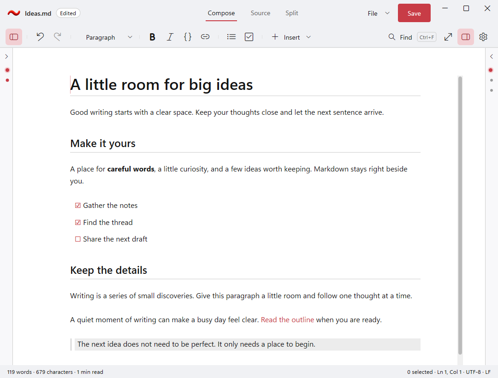
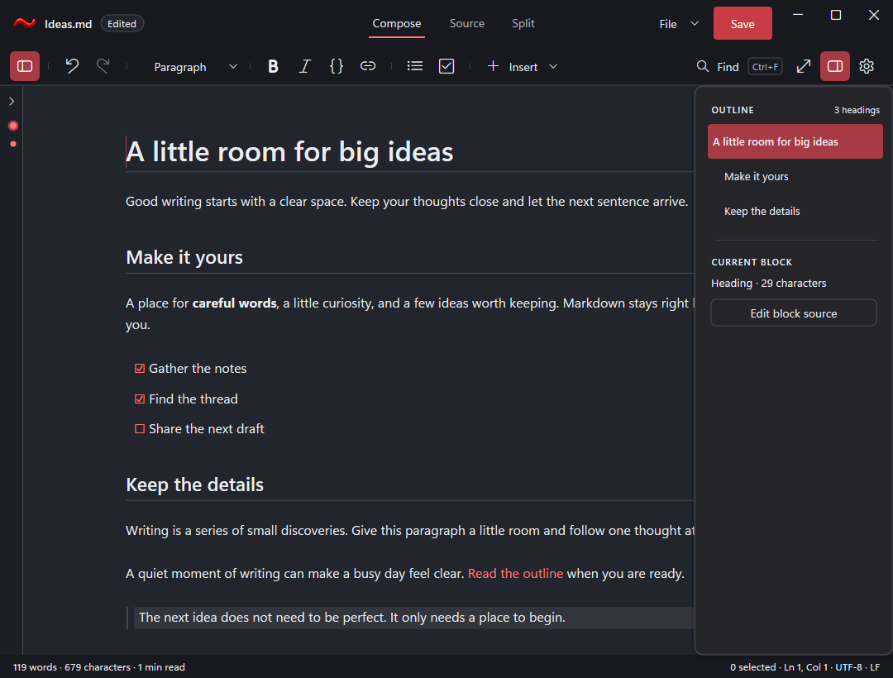
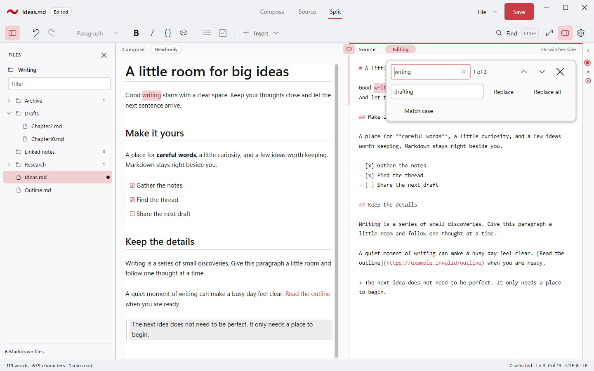
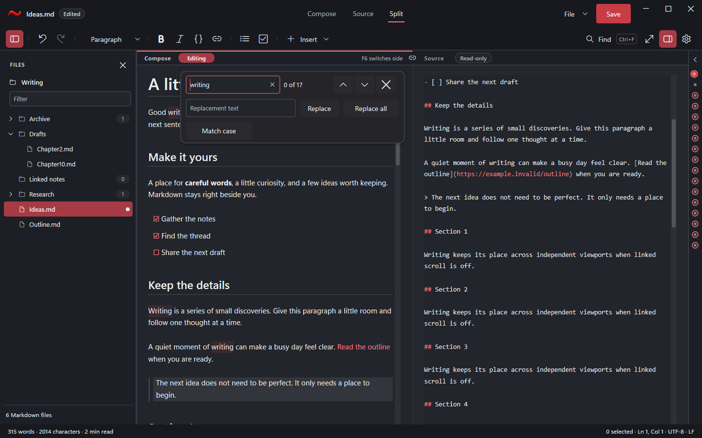
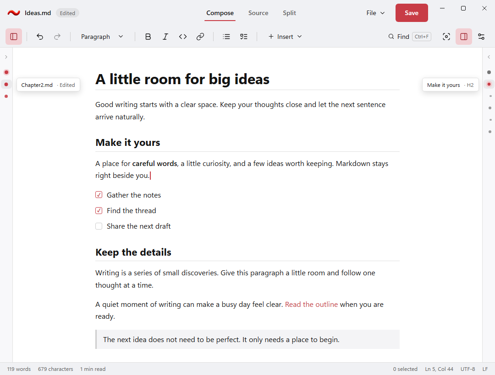
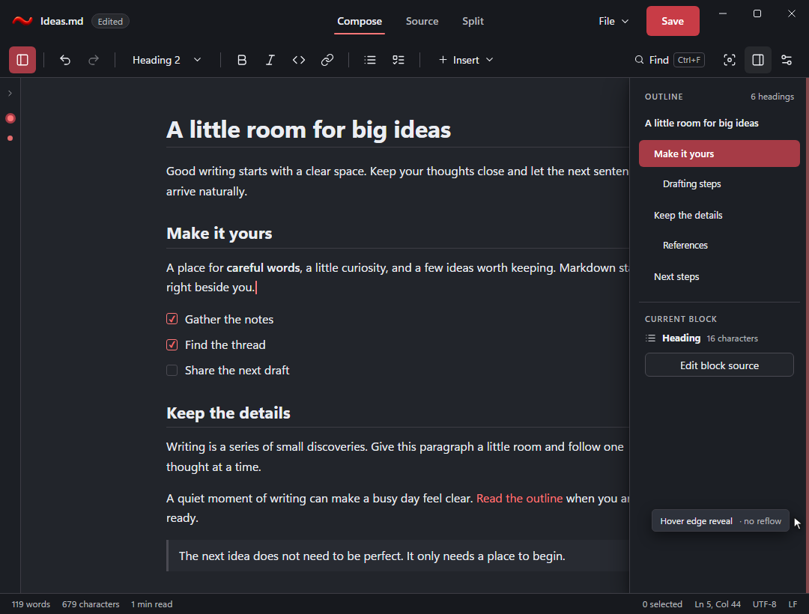
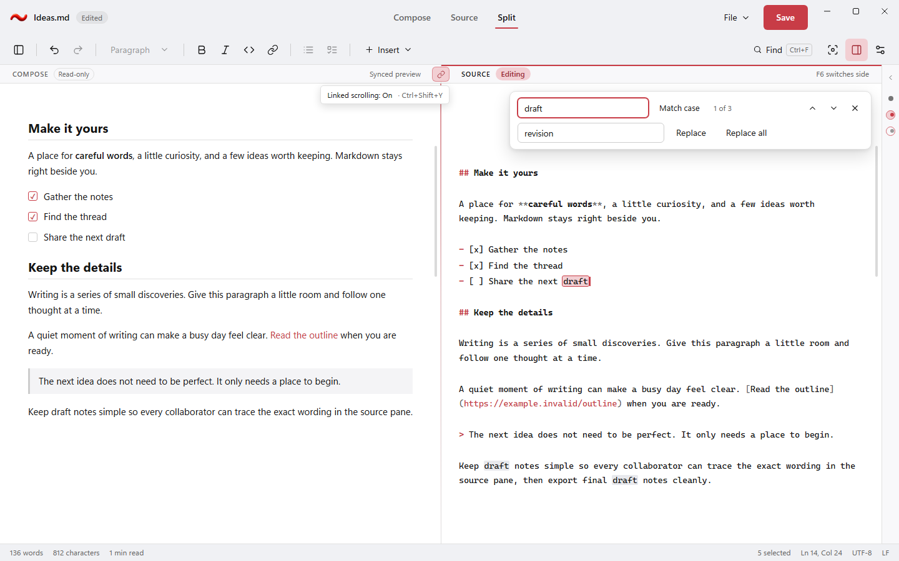
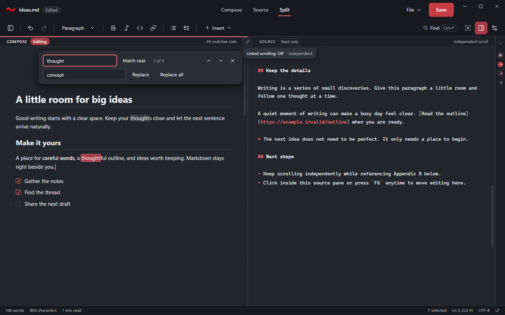

# Responsive side panes, collapsed dot rails, and bidirectional Split editing

## Metadata

- **Status**: `DONE`
- **Created / Completed**: `2026-11-22`
- **Pinned DxUi baseline**: `0c371a6197eb8c6b876b4b2843d75078bc21035c` (API 5, [Dependencies/DxUi.lock.json](../../../Dependencies/DxUi.lock.json)) — `P1`–`P4` shipped against the current pin; optional future upstream `DxUi` simplifications remain isolated in [Section 7](#7-planned-upstream-dxui-improvements-dx-split-1dx-split-2).
- **Companion active plans**: [Remaining work and qualification](../WIP/RemainingWork_2026-11-04.md), [Version 1.0 release readiness](../WIP/V1ReleaseReadiness_2026-11-21.md), [Dictionary and spell checking](../WIP/DictionaryAndSpellChecking_2026-11-21.md)
- **Normative contracts updated**:
  - [UI_DesignSystem.md](../../UI/UI_DesignSystem.md)
  - [Editor_Markdown.md](../../Editor/Editor_Markdown.md)
  - [Core_Settings.md](../../Core/Core_Settings.md)
  - [Core_Architecture.md](../../Core/Core_Architecture.md)
  - [Testing_Validation.md](../../Testing/Testing_Validation.md)
  - [docs/README.md](../../../docs/README.md)
- **Machine/runtime contracts updated**:
  - [SettingsStore.schema.json](../../../SettingsStore.schema.json) (`splitScrollSync` field)
  - [res/RedTilde.rc](../../../res/RedTilde.rc) (`STRINGTABLE` entries `IDS_TIP_PANEL 440`..`IDS_FIND_IN_SOURCE 460`)
  - [capabilities.json](../../../capabilities.json) (5 shipped capability IDs promoted; external hardware/interactive/paired-perf gates kept in `pending`)

---

## 1. Root-cause diagnosis: right pane button (`_panelToggle`) hover and toggle chrome

### Verified causes in the codebase

In [Application.Chrome.cpp](../../../RedTilde/Application.Chrome.cpp), the command bar previously initialized the left (`_filesToggle`) and right (`_panelToggle`) pane buttons inconsistently, and both interacted with a pinned-DxUi `Subtle` paint rule:

1. **Primary defect (`ButtonVariant::Disclosure` early return)**:
   - `_filesToggle` used `ButtonVariant::IconOnly` with `ButtonAppearance::Subtle` (`IDS_TIP_FILES`), whereas `_panelToggle` called `_panelToggle->SetVariant(DxUi::ButtonVariant::Disclosure);` without any shortcut hint.
   - In DxUi's `Button::Paint()` (`DxUi/src/Controls/DxUi.Controls.cpp:3900-3916`), `ButtonVariant::Disclosure` returns early before `DrawRoundedRect(host, GetBounds(), style.fill, ...)` at line 3918, so `theme.buttonHotFill`, `theme.buttonPressedFill`, and `theme.selectionFill` never painted on `_panelToggle`.
2. **Secondary defect discovered during verification (pinned DxUi `Subtle` checked hover)**:
   - On pinned `DxUi` (`0c371a61`), `ResolveButtonAppearanceVisualStyle` paints `ButtonAppearance::Subtle` toggles whose `toggleState == true` using flat `theme.selectionFill` regardless of `hoverStrength` or `IsPressed()`. Because `_settings.showOutline` defaults to `true`, removing `Disclosure` alone left resting vs. hovered `_panelToggle` frames pixel-identical.

### Implemented repair (`Slice P1`)

- Removed `_panelToggle->SetVariant(DxUi::ButtonVariant::Disclosure);` so `_panelToggle` retains `ButtonVariant::IconOnly` with `ButtonAppearance::Subtle`, added localized `IDS_TIP_PANEL` (`"Document outline · Ctrl+Shift+L"`), and registered `!alt`-guarded `Ctrl+Shift+L` in `Application::RouteShortcut`.
- Added `SubtleToggleButton` in [UiControls.h](../../../RedTilde/UiControls.h) and `MakeSubtleToggle` in [Application.Chrome.cpp](../../../RedTilde/Application.Chrome.cpp) for `_filesToggle`, `_panelToggle`, and `_splitScrollSyncButton` so checked `Subtle` icon toggles paint translucent hover/pressed pill feedback and an accent border (or `focusStroke` ring in High Contrast) when hovered or pressed.
- Added headless pixel-comparison capture `panel-toggle-hover` (`test.ps1` SHA-256 diff vs. `compose-light.png`) plus `Window.PanelToggleMatchesFilesToggleHoverAndTooltip` covering both checked and unchecked states.

---

## 2. Visual design boards (actual Release captures & proposal art)

> [!IMPORTANT]
> **Actual captures vs. proposal art**: All renders linked under `docs/screenshots/` are **actual `RedTilde.exe` (`x64 Release`) renders** captured by RedTilde's hidden headless harness at `96` DPI on DxUi pin `0c371a61` ([screenshots README](../../../docs/screenshots/README.md)). The four boards under [SidePanesAndSplitEditing_2026-11-22/](SidePanesAndSplitEditing_2026-11-22/proposal.css) are the archived pre-implementation **proposal art** mockups.

### Verified actual Release captures (`96` DPI)

| Actual Capture (`docs/screenshots/`) | Scenario | What It Verifies |
| --- | --- | --- |
| [`compose-light.png`](../../../docs/screenshots/compose-light.png) | `compose-light` (`1440×900`) | Resting Light compose view with matching active `Files` (`Ctrl+Shift+E`) and `Outline` (`Ctrl+Shift+L`) toggle chrome. |
| [`panes-collapsed-rails-light.png`](../../../docs/screenshots/panes-collapsed-rails-light.png) | `panes-collapsed-rails-light` (`1080×820`) | Both panes auto-collapsed into `28`-DIP edge rails with 2 left modified-file dots (`Ideas.md`, `Chapter2.md`), 3 hierarchical right heading dots, and toggle parity. |
| [`pane-hover-reveal-dark.png`](../../../docs/screenshots/pane-hover-reveal-dark.png) | `pane-hover-reveal-dark` (`1080×820`) | Floating right Outline inspector (`Surface::Kind::Floating`) slid over the Dark canvas with zero text reflow and left dirty-file dots intact. |
| [`split.png`](../../../docs/screenshots/split.png) | `split` (`1440×900`) | Light Split view with Compose `Editing` chip/hairline, passive Source `Read-only` wash, centered linked-scroll toggle (`Ctrl+Shift+Y`), seam glow, and right dot rail. |
| [`split-dark.png`](../../../docs/screenshots/split-dark.png) | `split-dark` (`1440×900`) | Dark Split view with Compose `Editing`, linked seam toggle, and collapsed right Outline dot rail. |
| [`split-source-active-light.png`](../../../docs/screenshots/split-source-active-light.png) | `split-source-active-light` (`1440×900`) | Bidirectional Split with Source active (`Editing`), Compose passive (`Read-only`), and `FindBar` + highlights anchored on the Source side. |
| [`split-unlinked-dark.png`](../../../docs/screenshots/split-unlinked-dark.png) | `split-unlinked-dark` (`1440×900`) | Dark Split with linked scroll off (dashed seam), Source independently scrolled to `## Section 1..4`, Find highlighting Compose, and right dot match rings. |









### Archived target proposal boards (proposal art)

| Proposal Board (`1080×820` / `1440×900`, `1×` scale) | Source HTML | Scope Illustrated |
| --- | --- | --- |
| [`panes-collapsed-rails-light.png`](SidePanesAndSplitEditing_2026-11-22/panes-collapsed-rails-light.png) | [`panes-collapsed-rails-light.html`](SidePanesAndSplitEditing_2026-11-22/panes-collapsed-rails-light.html) | Scope A: Both panes auto-collapsed into `28`-DIP rails with left modified-file dots (`Chapter2.md · Edited` tooltip), right hierarchical heading dots (`Make it yours · H2` tooltip), and Subtle chrome parity on `_panelToggle`. |
| [`pane-hover-reveal-dark.png`](SidePanesAndSplitEditing_2026-11-22/pane-hover-reveal-dark.png) | [`pane-hover-reveal-dark.html`](SidePanesAndSplitEditing_2026-11-22/pane-hover-reveal-dark.html) | Scope A: Hovering the right trigger edge slides open the `240`-DIP Outline/Inspector as a floating overlay (`Surface::Kind::Floating`) with zero canvas reflow, while `_panelToggle` displays Subtle hover chrome. |
| [`split-bidirectional-linked-light.png`](SidePanesAndSplitEditing_2026-11-22/split-bidirectional-linked-light.png) | [`split-bidirectional-linked-light.html`](SidePanesAndSplitEditing_2026-11-22/split-bidirectional-linked-light.html) | Scope B: Clicking Source moves editing authority there (`SOURCE Editing` pill + `2`-DIP scarlet top hairline), center `Linked scrolling: On` pill aligns both panes at `## Make it yours`, Find/Replace operates exclusively on the active Source pane, and the Outline dot rail exposes per-section match rings. |
| [`split-unlinked-independent-dark.png`](SidePanesAndSplitEditing_2026-11-22/split-unlinked-independent-dark.png) | [`split-unlinked-independent-dark.html`](SidePanesAndSplitEditing_2026-11-22/split-unlinked-independent-dark.html) | Scope B: Unlinking Split scroll (`Linked scrolling: Off`) lets Compose stay at heading 1 (`Editing`) while Source independently scrolls down to `## Keep the details` / `## Next steps`, with Find/Replace anchored to the active Compose side. |









To re-render the proposal art locally under the repository's `.build/` folder after CSS/HTML edits:

```powershell
$dir = (Resolve-Path 'Specs/Plans/Done/SidePanesAndSplitEditing_2026-11-22').Path
$edge = "${env:ProgramFiles(x86)}\Microsoft\Edge\Application\msedge.exe"
$boards = @(
  @{ Name = 'panes-collapsed-rails-light'; Size = '1080,820' },
  @{ Name = 'pane-hover-reveal-dark'; Size = '1080,820' },
  @{ Name = 'split-bidirectional-linked-light'; Size = '1440,900' },
  @{ Name = 'split-unlinked-independent-dark'; Size = '1440,900' }
)
foreach ($b in $boards) {
  & $edge --headless=new --disable-gpu --hide-scrollbars --no-first-run --force-device-scale-factor=1 `
    "--window-size=$($b.Size)" "--user-data-dir=$PWD\.build\proposal-render" `
    "--screenshot=$dir\$($b.Name).png" ('file:///' + ($dir -replace '\\', '/') + "/$($b.Name).html") | Out-Null
}
```

---

## 3. Scope A — Animated collapsible side panes, hover-reveal zone, and dot rails

### 3.1 State machines (`SidePaneController`)

Side-pane presentation replaces ad-hoc width threshold flags with explicit per-side state (`PaneSide::Left`, `PaneSide::Right`) inside `Application`:

```cpp
enum class PaneSide : std::uint8_t { Left, Right };

enum class PaneDisplayMode : std::uint8_t
{
    Hidden,        // User toggled pane off (_settings.showFiles / _settings.showOutline == false) OR Focus mode active
    Docked,        // Full 200..400 DIP (Left) or 240 DIP (Right) docked beside the canvas
    CollapsedRail, // Auto-collapsed 28-DIP edge rail keeping dot summary + hover trigger zone
    HoverOverlay   // Floating Surface::Kind::Floating overlay revealed over canvas without text reflow
};

enum class PaneAnimationPhase : std::uint8_t
{
    Settled,       // At target width/translation; Tick() returns false (zero idle CPU)
    Collapsing,    // 200 ms FastDecelerate shrink from Docked -> CollapsedRail (or width 280->28)
    Expanding,     // 200 ms PointToPoint slide from CollapsedRail -> HoverOverlay / Docked
    HoverDwell,    // 180 ms dwell after pointer enters edge trigger zone before opening HoverOverlay
    LeaveGrace     // 300 ms grace after pointer exits overlay+rail before animated close
};
```

### 3.2 Responsive thresholds, collapse priority, and hysteresis

Preserving [UI_DesignSystem.md](../../UI/UI_DesignSystem.md) reading-width precedence (`readingWidth` default `760` DIP, range `480–1040` DIP):

1. **Focus mode (`F11`)**: Forces both panes to `PaneDisplayMode::Hidden` (zero rails, zero hover triggers).
2. **Right pane (`Outline`) auto-collapse**:
   - When `_settings.showOutline == true`:
     - In `Compose` and `Source` views, docks at `240` DIP while remaining width after left pane supports `readingWidth + 96 + 240` DIP (`readingWidth + 336`, where `96` DIP is `2 × 48`-DIP horizontal canvas gutter).
     - When available width drops below the threshold (or always in **`Split` view**, so Split preserves balanced 50/50 document columns while retaining Outline dot navigation), automatically transitions `Docked -> CollapsedRail` (`28` DIP) with a `200 ms` `FastDecelerate` collapse animation (instant `0 ms` snap when `host.GetTheme().reducedMotion` or during initial cold layout).
   - **Resize hysteresis (`24` DIP)**: Once auto-collapsed to `CollapsedRail`, restoring `Docked` requires crossing `threshold + 24` DIP so window-edge dragging near the breakpoint never chatters between `Docked` and `CollapsedRail`.
3. **Left pane (`Files`) auto-collapse**:
   - When `_settings.showFiles == true`:
     - Collapses **after** the Right pane (preserving Right-before-Left collapse priority): docks at `_settings.filesWidth` (`200–400` DIP, default `280`) while `width >= readingWidth + filesWidth + 96 + 6` DIP (counting `28`-DIP right rail if present).
     - Below threshold, transitions `Docked -> CollapsedRail` (`28` DIP) with `200 ms` animation.
4. **Minimum `800×560` DIP guarantee**: Even with both panes enabled on an `800`-DIP window, both occupy at most `28 + 28 = 56` DIP total, leaving `744` DIP for the writing canvas and guaranteeing zero overlap with the `480`–`1040`-DIP reading measure.

### 3.3 Hover trigger zone, dot non-interference rule, and zero-polling animation

1. **Collapsed rail geometry (`CollapsedPaneRail` in `RedTilde/SidePaneRail.{h,cpp}`)**:
   - Fixed `28`-DIP rail width, full vertical height between `_commandBar` (`top`) and status bar (`bottom`), `Surface::Kind::Sidebar` fill (`theme.surfaceBackground`), and crisp `1`-DIP inner seam (`borderRight` on left rail, `borderLeft` on right rail).
   - **Expand/open handle**: Top `28×28`-DIP button centered at `y = top + 8` displaying a Subtle chevron (`\xE76C` on left rail, `\xE76B` on right rail) plus full tooltip (`IDS_RAIL_EXPAND_FILES` / `IDS_RAIL_EXPAND_OUTLINE`). Clicking toggles full `HoverOverlay` immediately.
   - **Dot hit targets vs. trigger zone (critical usability invariant)**:
     - Dots occupy `24×20`-DIP hit targets spaced on a `22`-DIP vertical pitch below the expand handle.
     - **Outer `6`-DIP edge strip** (screen-facing edge `x in [0, 6)` on left rail, `x in [width - 6, width)` on right rail), the **top expand handle**, and **unoccupied rail background** act as the **hover-reveal trigger zone**.
     - **Non-interference rule**: Hovering directly over a **dot** displays that dot's localized tooltip (`ControlHost::SetTooltipDelayed`), sets its subtle hover ring, and **cancels/suppresses** the `HoverDwell` timer so the user can smoothly scan dots and read tooltips or click dots without the full drawer sliding over and obscuring them. Moving the pointer onto the outer `6`-DIP edge strip, the expand handle, or open background arms the `180 ms` `HoverDwell` timer and slides open `HoverOverlay`.
2. **Hover-reveal overlay (`PaneDisplayMode::HoverOverlay`)**:
   - Renders the full `240`-DIP Outline/Inspector or `_settings.filesWidth` (`200–400`-DIP) Files pane inside a `Surface::Kind::Floating` surface with elevated border and shadow sliding smoothly (`200 ms`, `DxUi::EasingCurve::PointToPoint`) over the canvas edge **without changing `_editor` / `_mirror` layout widths or triggering text reflow**.
   - **Leave grace & dismissal**: When the pointer leaves both the floating overlay and its rail trigger zone, a `300 ms` `LeaveGrace` hold prevents accidental flicker on small cursor slips before sliding closed (`180 ms`). Pressing `Esc`, clicking inside the document canvas, or opening a conflicting `OverlayKind` (`SettingsDrawer`, `BlockDraftModal`, `RecoveryModal`, `FindBar`) dismisses `HoverOverlay` immediately back to `CollapsedRail`.
3. **Zero-polling animation architecture**:
   - Animations drive exclusively via `Control::Tick(ControlHost& host, uint64_t nowTickMs)` and `host.RequestAnimation()` (no `WM_TIMER` polling loops, `0` ticks when settled, matching DxUi's `Button` / `PageHost` animation contract and `idleProcessCpu100ns == 0` under [Core_PerformanceAndResources.md](../../Core/Core_PerformanceAndResources.md)).
   - Elapsed-time steps clamp per frame (`maxStepMs = 100u`) like `Button::AdvanceDisclosureTransition`, and `host.GetTheme().reducedMotion` resolves every collapse/open/close transition instantaneously in `0 ms` (`progress = target`).
   - Hidden or minimized hosts pause animation progression cleanly (`OnHidden()` snaps to settled target).

### 3.4 Dot summaries, tooltips, and click-to-jump behavior

| Aspect | Right Rail — Outline Summary ("Plan") | Left Rail — Modified Files Summary |
| --- | --- | --- |
| **Data source** | `_documentInfo.headings` (`0..128` ATX headings outside code/math fences) | Active `_session` (included when `Dirty()`) + dirty entries in `_inactiveDocuments` (`0..64`, stable workspace opening order) |
| **Dot visual encoding** | Hierarchical size & right-edge indent:<br>- H1: `8`-DIP circle, `0` DIP offset<br>- H2: `6`-DIP circle, `+2` DIP offset<br>- H3–H6: `4.5`-DIP circle, `+4` DIP offset<br>Inactive: `theme.subduedText` at `65%` alpha.<br>Active `_currentHeading`: `14`-DIP `theme.selectionFill` halo + `theme.accent` center dot.<br>Find active: thin `1.5`-DIP `theme.accent` outer ring when section has `>= 1` match. | Modified-file accents:<br>- Active dirty document: `8`-DIP `theme.accent` dot inside `14`-DIP `theme.selectionFill` halo.<br>- Inactive dirty workspace document: `7`-DIP `theme.accent` dot.<br>- Clean workspace (`0` dirty files): zero dots shown; rail retains expand chevron + centered empty-state tooltip (`IDS_RAIL_NO_MODIFIED`). |
| **Tooltip on hover** | Heading text (sanitized, truncated to `<= 80` chars) + level hint (e.g., `Make it yours · H2`, or `Make it yours · 2 matches` while Find is active). Positioned left of the rail, vertically aligned with the dot. | Filename + `IDS_FILESEDITED` (e.g., `Chapter2.md · Edited`), or relative parent disambiguator (`Drafts/Chapter2.md · Edited`) when two open workspace files share a basename; `Untitled.md · Edited` for unsaved buffers. Positioned right of the rail. |
| **Click / Enter / Space** | Selects heading offset `{offset, offset}`, calls `ActiveEditor()->ScrollSourceRangeIntoView(_host, offset, offset, true)`, restores editor focus, keeps pane collapsed in `CollapsedRail`. | Calls `SwitchWorkspaceDocument(index)` (for inactive dirty slots; zero prompt per multi-document workspace contract) or focuses `ActiveEditor()` (for the already-active dirty file). Guarded identically against `_files.Busy()`, `HasBlockDraft()`, `HasActiveModalPrompt()`, and active IME; keeps pane collapsed in `CollapsedRail`. |
| **Overflow handling** | Supports mouse wheel scrolling over the dot stack when headings exceed viewport height; auto-centers `_currentHeading` within visible dot window; subtle `+N` badge at bottom of stack (`IDS_RAIL_MORE_ITEMS`). | Supports mouse wheel scrolling if `> ~25` workspace documents are simultaneously dirty; shows `+N` overflow badge. |

### 3.5 Accessibility & High Contrast invariants

- Each visible dot is exposed as an interactive child element (or lightweight virtual UIA fragment item under `CollapsedPaneRail`) reachable via keyboard (`Tab` into rail -> `Up`/`Down` across dots -> `Enter`/`Space` to jump/open, `Right`/`Left` or `Alt+Enter` on expand handle to open `HoverOverlay`), exposing `InvokePattern`, localized `AccessibleName`, `ItemStatus` (active section / `"Edited"` / match count), and standard keyboard focus ring.
- High Contrast replaces accent dot fills/halos with system `Highlight`/`HighlightText`/`Hotlight`/`WindowText` colors and distinct double-ring outlines for the active dot so state is never communicated by hue alone.

---

## 4. Scope B — Bidirectional Split editing, linked scrolling, and active-view Find/Replace

### 4.1 Bidirectional Split active-side state & zero-loss authority transfer

Split view moves from a Compose-only editor + read-only Source mirror to **symmetric active-side editing**:

```cpp
enum class SplitActivePane : std::uint8_t
{
    Compose, // Left pane (_composeEditor) holds authoritative RichText::Document; right pane (_mirror) is read-only Source mirror
    Source   // Right pane (_mirror) holds authoritative RichText::Document; left pane (_composeEditor) is read-only Rich preview mirror
};
```

1. **Helper accessors in `Application`**:
   - `_splitActivePane` (`SplitActivePane::Compose` by default on entering Split).
   - `Editor* ActiveEditor() noexcept` returns `(_settings.view == EditorView::Split && _splitActivePane == SplitActivePane::Source) ? _mirror : _editor`.
   - `Editor* MirrorEditor() noexcept` returns `(_settings.view == EditorView::Split && _splitActivePane == SplitActivePane::Source) ? _editor : _mirror`.
2. **Transferring authoritative editing on click or `F6` (`SwitchSplitActivePane`)**:
   - `SplitPaneEditor` (subclass of `DxUi::RichTextEditor` replacing `SourceMirrorEditor` for both panes) intercepts `OnMouseDown(ControlHost& host, D2D1_POINT_2F point, bool rightButton, UINT modifiers)`:
     - **Scrollbar exclusion rule**: Inspects `GetTextInputViewportRect()`; if `point.x >= viewport->right` (vertical scrollbar track/thumb) or outside the text viewport, lets scrolling proceed **without** changing `_splitActivePane` or stealing focus!
     - If pointer clicks inside the passive pane's text viewport: invokes `onActivateSplitPane(pane)` *before* forwarding `DxUi::RichTextEditor::OnMouseDown(...)`, so the very first click seamlessly promotes that pane to editable and places the caret or begins a drag selection in one natural gesture!
   - `SwitchSplitActivePane(SplitActivePane target)`:
     1. **Safety guards**: Rejects cleanly with existing `Status(IDS_BLOCKPENDING)` / `IDS_BUSY` if `HasBlockDraft()`, `_editor->GetSemanticSourceRegion()` / active native TSF IME composition, `_files.Busy()`, `HasActiveModalPrompt()`, or `_switchingDocument`.
     2. **Flush & extract**: Captures `active->GetScrollInfo()` and `passive->GetScrollInfo()`.
     3. **Atomic document & history transfer**: Calls `DxUi::RichText::Document temp;` -> `active->ExchangeDocumentState(temp)` -> `passive->ExchangeDocumentState(temp)` (or direct document move into a temporary `RichText::Document` and swap into the new active editor). Because `ExchangeDocumentState` moves `source_`, `selection_`, `revision_`, `selectionEpoch_`, and **all `128` Undo/Redo stack entries** atomically without creating an edit (`DxUi.RichTextEditor.cpp:676-694`), the unified undo/redo stack survives arbitrary switches between Compose and Source!
     4. **Role swap**:
        - Old active pane -> `SetReadOnly(true)` (stays in its existing `ViewMode::Rich` or `ViewMode::Source`).
        - New active pane -> `SetReadOnly(false)` + updates document file path (`TrySetDocumentFilePath(_session.path.native())`) and image permission (`SetRemoteImagesEnabled(_settings.allowRemoteImages || _session.remoteImagesAllowed)`).
        - Re-binds `SetOnTextChanged`, `SetOnSelectionChanged`, `SetBitmapPasteHandler`, `SetOnContextMenu`, `SetOnLinkActivated` (only active editable editor notifies document changes; passive mirror callbacks are unbound/no-op).
     5. **Preserve viewports & sync**: Restores the newly-active pane's vertical scroll offset (`SetScrollOffsetDip`) so switching sides never jumps the clicked pane away from the user's cursor, transfers Find highlights (see §4.3), refreshes toolbar command enablement (`Changed()` / `SelectionChanged()`), updates Split pane headers, and focuses the newly-active editor (`_host.SetFocusControl(ActiveEditor(), MayRequestNativeFocus())`).
   - **Leaving Split view or switching workspace documents**:
     - Before switching away from Split to `Compose` (`Ctrl+1`) or `Source` (`Ctrl+2`), or before `SwitchWorkspaceDocument()` / `CloseActiveDocument()` / `SetDocument()`, if `_splitActivePane == SplitActivePane::Source`, unconditionally transfers the authoritative `Document` back to `_editor` (`SwitchSplitActivePane(SplitActivePane::Compose)`) so `_editor` always holds the canonical workspace document outside Split view.

### 4.2 Bidirectional display synchronization

| Direction | Sync Mechanism (Current Pin `0c371a61`) | Planned Simplification (`DX-SPLIT-1`) |
| --- | --- | --- |
| **Compose active -> Source mirror** | Existing zero-copy `SynchronizeReadOnlySourceSnapshot(source, selection)` + `SourceMirrorEditor::PrepareContent` sharing immutable `MarkdownSyntax` via `TryAdoptReadOnlyMarkdownSyntax`. | Already zero-copy. |
| **Source active -> Compose mirror** | `SynchronizeMirror()` detects `!target->SynchronizeReadOnlySourceSnapshot(...)` (because target is `ViewMode::Rich`), preserves target's scroll offset and `TrySetDocumentFilePath`, calls `target->TrySetText(source.Text())` + `TrySetSelection(selection)`, and restores `SetRemoteImagesEnabled` (clearing undo history on the read-only Compose mirror only, since authoritative history lives on `_mirror`). Coalesced per UI edit and aborted on stale revision/lifetime tokens. | Add `SynchronizeReadOnlyRichSnapshot` in `DxUi` so Compose mirrors also share immutable `SourceSnapshot` + `MarkdownSyntax` + decoded image cache with zero `SetText` string copy. |

### 4.3 Split pane headers and visual active cue

- A slim **`30`-DIP header strip** spans across the top of the Split canvas (immediately below `_commandBar`), split cleanly at the `50%` vertical divider (`mid`):
  - **Active pane header**: `2`-DIP `theme.accent` top hairline along that half, high-contrast label (`COMPOSE` or `SOURCE`), active pill (`Editing` in `theme.selectionFill` / `theme.selectionText`), and subtle shortcut hint (`F6 switches side` on wide viewports).
  - **Passive pane header**: Subdued label, quiet outlined chip (`Read-only`), `0`-DIP top hairline, and faint `6%` surface tint on the passive pane body so the eye immediately knows which side has typing focus without introducing heavy nested frames.
  - **Dynamic accessible names**: Active pane exposes `"Markdown document (editing)"` or `"Markdown source (editing)"`; passive pane exposes `"Read-only Markdown preview mirror"` or `"Read-only Markdown source mirror"`.

### 4.4 Bidirectional linked scrolling & subtle toggle (`SplitScrollSynchronizer`)

1. **Subtle indicator & toggle (`_splitScrollSyncButton`)**:
   - Centered directly on the `50%` seam inside the `30`-DIP Split header (`28×24`-DIP `ButtonVariant::IconOnly`, `ButtonAppearance::Subtle`, Fluent link icon `\xE71B`):
     - **Linked (`true`, default)**: Soft `theme.selectionFill` / `theme.selectionText` tint, `ToggleState == true`, tooltip `IDS_TIP_SPLIT_SCROLL_ON` (`"Linked scrolling: On · Ctrl+Shift+Y"`), plus a delicate `2`-DIP accent-tinted gradient hairline along the top `120` DIP of the Split vertical divider seam (falling back to subtle `1px` dashed/solid contrast cue in High Contrast).
     - **Unlinked (`false`)**: Un-tinted subdued icon (`theme.subduedText`), `ToggleState == false`, tooltip `IDS_TIP_SPLIT_SCROLL_OFF` (`"Linked scrolling: Off · Ctrl+Shift+Y (scroll independently)"`), neutral subtle dashed seam divider (`1` DIP).
   - Keyboard accessible via `Ctrl+Shift+Y` (no `Alt`), `Tab` stop in the Split header, and UIA `TogglePattern`.
   - Persisted in `_settings.splitScrollSync` (`bool`, default `true`) via `SettingsWriter` and live-reloaded by `SettingsWatcher`.
2. **Scroll synchronization algorithm (`SyncSplitScroll(Editor* driver, float driverOffsetDip)`)**:
   - Attached via `SetOnScrollChanged` on both `_editor` and `_mirror`.
   - Guarded by RAII `_splitScrollSyncInProgress` boolean to prevent `Compose <-> Source` infinite ping-pong loops.
   - Only runs when `_settings.view == EditorView::Split && _settings.splitScrollSync`.
   - **Scope alignment**:
     1. Edge clamps: If `driverOffsetDip <= 1.0f`, sets `follower->SetScrollOffsetDip(0.0f)`. If `driverOffsetDip >= driverMaxScroll - 1.0f`, sets `follower->SetScrollOffsetDip(followerMaxScroll)`.
     2. Anchor source-offset resolution: Calls `driver->GetVisibleSourceRange(_host)` to obtain the top-visible source offset `topSourceOffset` (plus next-block anchor offset `[a0, a1)` from `_documentInfo` / `MarkdownSyntax` blocks so scrolling *inside* a tall paragraph/fence/diagram interpolates smoothly rather than snapping only at block boundaries!).
     3. Follower scroll placement:
        - Uses `follower->GetTextInputRangeRects` / `GetTextInputCaretRect` (or `ScrollSourceRangeIntoView(_host, topSourceOffset, topSourceOffset, true)` when `DX-SPLIT-2` is absent) to align `topSourceOffset` to the same top viewport band in `follower` (preserving `~8` DIP top padding).
        - If `follower`'s layout is pending after a fresh resize or edit (`!GetVisibleSourceRange`), queues deferred scroll alignment on `PostPreparePlacement` (`ReconcilePostPreparePlacement()`) keyed by `(sourceSnapshot, driverOffsetDip)` rather than scrolling inside `WM_PAINT`.
   - **Independent scrolling when unlinked (`splitScrollSync == false`)**:
     - `SetOnScrollChanged` immediately returns without touching the follower pane.
     - Additionally, `SelectionChanged()` **suppresses** automatic `mirror->ScrollSourceRangeIntoView(...)` on ordinary edits/cursor moves when `splitScrollSync == false`, so typing or moving the caret in one pane never yanks the independently scrolled opposite pane out of place! (Explicit Outline dot click or `F3` Find jump still reveals the target inside the active pane.)

### 4.5 Find / Replace, toolbar formatting, and `F2` routing on the active pane

1. **Active-view Find / Replace (`FindController`)**:
   - All Find/Replace operations target `auto* active = ActiveEditor()` instead of hardcoded `_editor`:
     - `RefreshFind()` calls `active->TrySetSourceHighlights(highlights)` and explicitly calls `MirrorEditor()->ClearSourceHighlights()` so matches never duplicate on the passive mirror.
     - Switching Split active side (`Compose <-> Source` via click or `F6`) while `OverlayKind::FindBar` is open **reuses `FindController::table`** without rescanning text, clears highlights on the newly-passive pane, applies cached highlights to the newly-active pane, and calls `Layout()` to re-anchor `_findBar` to the upper-right of the **active pane's bounds** (`activePaneRect.right - 16`, clamping to pane width so wide `628`-DIP vs compact `460`-DIP adapts to the single half-pane width!).
     - `FindNext(previous)` calls `active->TrySetSelection(...)` and `active->ScrollSourceRangeIntoView(...)`.
     - `ReplaceFind(all)` calls `active->ApplySourceEdits(...)` on the editable pane, triggers `Changed()`, and live-synchronizes the passive mirror (`SynchronizeMirror()`).
     - Closing Find clears highlights from **both** `_editor` and `_mirror`.
2. **Command row & contextual routing in Split**:
   - Format commands (`Bold`, `Italic`, `Code`, `Strike`, `Heading`, `Bullets`, `Numbered`, `Task`, `Insert`, `LocalSource`, `Quote`, `Fence`) check `ActiveEditor()->GetViewMode()`:
     - When `Compose` is active (`ViewMode::Rich`): uses semantic commands (`ExecuteMarkdownCommand`), enables `Paragraph` dropdown & list buttons, and shows `FloatingSelectionTools` on text selection.
     - When `Source` is active (`ViewMode::Source`): uses source-mode formatting (`ActiveEditor()->ToggleFormatting(marker)` for Bold/Italic/Strike/Code, `WrapSelectionInMarkdownBlock` for Quote/Fence, direct snippet insertion for Mermaid/Math/Image/Link), disables Rich-only structural buttons (`Heading`, `Bullets`, `Numbered`, `Task`), and suppresses `FloatingSelectionTools` (matching standalone Source view).

---

## 5. Settings schema, shortcuts, and localization resources

### 5.1 Settings persistence (`Common/Settings.{h,cpp}`, `SettingsStore.schema.json`)

Add one boolean setting (`P3`):

```json5
{
  splitScrollSync: true // Link Compose and Source vertical scrolling in Split view (default: true)
}
```

- Follows RedTilde's `yyjson` JSON5 contract ([Core_Settings.md](../../Core/Core_Settings.md)): missing/non-boolean values fall back independently to `true`; `SettingsWatcher` live-reloads `splitScrollSync` without writing to disk and immediately updates `_splitScrollSyncButton` toggle state and Split seam chrome.

### 5.2 Keyboard shortcuts (`Application::RouteShortcut`)

All shortcuts protect AltGr by requiring `!alt`:

| Shortcut | Command | Scope & Action |
| --- | --- | --- |
| `Ctrl+Shift+L` | `Command::Outline` | Toggle right Outline / Inspector pane (pairs with `Ctrl+Shift+E` for Files pane) |
| `F6` | `Command::SwitchSplitPane` | Toggle active editing pane (`Compose <-> Source`) when in Split view; no-op with quiet handling otherwise |
| `Ctrl+Shift+Y` | `Command::ToggleSplitScrollSync` | Toggle Linked Scrolling in Split view (`splitScrollSync`) |

### 5.3 Planned `STRINGTABLE` entries (`res/RedTilde.rc`, `Common/Resources.h`)

All UI strings use UTF-8 (`#pragma code_page(65001)`) and positional `{0}` placeholders:

| Resource ID | Planned English Text | Role |
| --- | --- | --- |
| `IDS_TIP_PANEL` | `"Document outline · Ctrl+Shift+L"` | Right pane button tooltip (matches `IDS_TIP_FILES`) |
| `IDS_RAIL_EXPAND_FILES` | `"Expand Files pane"` | Left collapsed rail expand handle & hover hint |
| `IDS_RAIL_EXPAND_OUTLINE` | `"Expand Document outline"` | Right collapsed rail expand handle & hover hint |
| `IDS_RAIL_NO_MODIFIED` | `"No unsaved changes"` | Left rail tooltip when zero files are dirty |
| `IDS_RAIL_MORE_ITEMS` | `"+{0}"` | Collapsed rail overflow count badge |
| `IDS_SPLIT_COMPOSE_EDITING` | `"Compose · Editing"` | Active left Split pane accessible label / header |
| `IDS_SPLIT_COMPOSE_PREVIEW` | `"Compose · Read-only"` | Passive left Split pane header / accessible name |
| `IDS_SPLIT_SOURCE_EDITING` | `"Source · Editing"` | Active right Split pane accessible label / header |
| `IDS_SPLIT_SOURCE_MIRROR` | `"Source · Read-only"` | Passive right Split pane header / accessible name |
| `IDS_SPLIT_SCROLL_SYNC` | `"Link Split scrolling"` | Center seam toggle accessible name |
| `IDS_TIP_SPLIT_SCROLL_ON` | `"Linked scrolling: On · Ctrl+Shift+Y"` | Center toggle tooltip when linked |
| `IDS_TIP_SPLIT_SCROLL_OFF` | `"Linked scrolling: Off · Ctrl+Shift+Y (independent)"` | Center toggle tooltip when unlinked |
| `IDS_FIND_IN_COMPOSE` | `"Find and replace in Compose"` | Accessible label for FindBar when Compose is active |
| `IDS_FIND_IN_SOURCE` | `"Find and replace in Source"` | Accessible label for FindBar when Source is active |

---

## 6. Phased implementation plan (`P1`–`P4`)

| Slice | Status | Scope & Deliverables | Required Validation |
| --- | --- | --- | --- |
| **Slice P1 — Right Pane Button Hover Parity & Animated Auto-Collapse / Dot Rails** | Done | 1. Fixed `_panelToggle` in `Application.Chrome.cpp` (`IconOnly` + `SubtleToggleButton`, `IDS_TIP_PANEL`, `Ctrl+Shift+L`, accurate `ToggleState`).<br>2. Implemented `CollapsedPaneRail` / `RailDotButton` (`RedTilde/SidePaneRail.{h,cpp}`) with `PaneDisplayMode`/`PaneAnimationPhase`, `200 ms` `FastDecelerate`/`PointToPoint` `Control::Tick` animations, `reducedMotion` snap, `24`-DIP hysteresis (`Left` priority over `Right`), `180 ms` edge dwell + `300 ms` leave grace, dot-hover non-interference, Right Outline heading dots + Find rings + jump, Left modified-files dots + zero-prompt workspace switch.<br>3. Added `--capture` scenes (`panel-toggle-hover`, `panes-collapsed-rails-light`, `pane-hover-reveal-dark`) & 6 native tests in `Tests/Application.Tests.Panes.cpp`. | `validate.ps1`, `format.ps1 -Check`, x64 Debug/Release/ASan `test.ps1` (`panel-toggle-hover` pixel diff & animation/dot regressions), 6-profile zero-warning compilation. |
| **Slice P2 — Bidirectional Split Editing & Active-Side Find/Replace** | Done | 1. Implemented `SplitActivePane`, `ActiveEditor()` / `MirrorEditor()`, and `SwitchSplitActivePane()` using callback-guarded `ExchangeDocumentState` (preserving `128`-step Undo/Redo, scrollbar click exclusion, `F6` shortcut, IME/draft/busy guards, round-trip back to `_editor` on view leave/workspace switch).<br>2. Added `30`-DIP Split pane headers (`Editing` vs. `Read-only` chip, `2`-DIP active top hairline, dynamic UIA names) and command/toolbar/`FloatingSelectionTools` routing.<br>3. Updated `FindController` to target `ActiveEditor()`, clear `MirrorEditor()`, transfer highlights without `MatchTable` rebuild on side click, and re-anchor `_findBar` within the active Split half.<br>4. Added `split-source-active-light` capture & tests in `Tests/Application.Tests.SplitEditing.cpp`. | All `P1` checks + bidirectional undo/redo round-trip, scrollbar non-steal, image/EOL/dirty preservation, and active-pane Find/Replace tests across x64 Debug/Release/ASan. |
| **Slice P3 — Bidirectional Linked Scrolling, Center Toggle & Settings Persistence** | Done | 1. Added `splitScrollSync` (`bool`, default `true`) to `Common/Settings.{h,cpp}`, `SettingsStore.schema.json`, and `SettingsWatcher` live reload.<br>2. Implemented `_splitScrollSyncInProgress`-guarded scroll alignment, edge clamps, `GetVisibleSourceRange` + block interpolation + `PostPreparePlacement` deferral, suppressing mirror selection auto-scroll when unlinked.<br>3. Added centered `28×24`-DIP `SubtleToggleButton` `_splitScrollSyncButton` (`\xE71B`, `Ctrl+Shift+Y`, subtle linked glow vs. dashed unlinked seam).<br>4. Added `split-unlinked-dark` capture & scroll/settings behavioral tests (`5` total cases in `Application.Tests.SplitEditing.cpp`). | All `P2` checks + `Settings` JSON5 schema/live-reload tests, anti-ping-pong scroll invariance, and unlinked independent-scroll regressions across x64 Debug/Release/ASan. |
| **Slice P4 — Qualification, Documentation Promotion & Evidence** | Done (local x64 & 6-build gates) | 1. Promoted the 5 implemented capabilities in `capabilities.json`, updated normative specs & [docs/README.md](../../../docs/README.md), and captured actual `96`-DPI Release screenshots under `docs/screenshots/`.<br>2. Executed full `x64 Debug`/`Release`/`ASan Debug` test suites (including real ASan heap-use-after-free detection, crash/recovery, and 45 captures per config), `validate.ps1`, and `format.ps1 -Check`; external hardware/interactive/paired-perf gates remain tracked separately below. | `format.ps1 -Check`, `validate.ps1`, `Tools/Test-Changelog.ps1`, all 6 zero-warning builds, and full 3-config x64 `test.ps1 -Full`. |

---

## 7. Planned upstream `DxUi` improvements (`DX-SPLIT-1`, `DX-SPLIT-2`)

While `P1`–`P4` ship cleanly on the pinned `DxUi` API-5 commit (`0c371a61`), two small upstream additions in `DxUi` will eliminate remaining consumer adaptation overhead:

| Upstream Item | Current RedTilde Adapter (`P2`–`P3`) | Simplification After Pin Bump |
| --- | --- | --- |
| **`DX-SPLIT-1`** — Read-only Rich snapshot adoption (`SynchronizeReadOnlyRichSnapshot` + `TryAdoptReadOnlyMarkdownSyntax` for `ViewMode::Rich`) | When the right `Source` pane is active in Split, updating the left read-only `Compose` mirror calls `TrySetText` + re-runs Markdown parsing/layout independently (`§4.2`). | Zero-copy shared `SourceSnapshot` and immutable `MarkdownSyntax` from Source to Compose mirror, eliminating redundant parse/string copy per keystroke. |
| **`DX-SPLIT-2`** — Direct viewport-Y / source-offset queries (`GetScrollOffsetForSourceOffset(host, size_t)` + `HitTestTopVisibleSourceOffset(host)`) | `SplitScrollSynchronizer` resolves top-visible range via `GetVisibleSourceRange` plus `TryGetTextInputRangeRects` / `ScrollSourceRangeIntoView` + `_documentInfo` anchor interpolation. | Single `O(log N)` query maps exact vertical DIP offset between Rich and Source layouts without intermediate range allocations. |

**Producer-first rule**: Neither `DX-SPLIT-1` nor `DX-SPLIT-2` blocks `P1`–`P4`. Any upstream change lands and qualifies in `DxUi` first before an explicit `Dependencies/DxUi.lock.json` bump PR in RedTilde.

---

## 8. Verification and qualification gates

1. **Button chrome & pixel parity**: `panel-toggle-hover` hidden capture proves resting vs. hovered `_panelToggle` PNG hashes differ and paint Subtle hover/selection fills matching `_filesToggle`; checked and unchecked hover pixels and `ToggleState` verified natively (`Window.PanelToggleMatchesFilesToggleHoverAndTooltip`).
2. **Side-pane responsiveness, animations, and dot rails**:
   - Hysteresis bounds prevent chatter across `[threshold - 24, threshold + 24]` resize sweeps (`Window.SidePaneCollapsePriorityAndHysteresis`).
   - `Control::Tick` reaches `Settled` in `<= 200 ms` (`0` subsequent animation requests); `reducedMotion == true` snaps in `0` intermediate frames (`Window.SidePaneAnimationZeroPollingAndReducedMotion`).
   - Dot hover cancels/suppresses `HoverDwell` so tooltips appear without triggering `HoverOverlay`; outer `6`-DIP edge/handle hover opens `HoverOverlay` without changing `_editor` / `_mirror` width (`0` text reflow); `300 ms` `LeaveGrace` holds overlay open before `180 ms` close (`Window.SidePaneDotHoverNonInterferenceAndDismissal`).
   - Left dot click switches retained workspace document (`SwitchWorkspaceDocument`) with zero modal save prompt and refuses safely under `HasBlockDraft()` (`Editor.FilesCollapsedLeftRailDirtyDotsSwitchAndGuards`); right dot click jumps caret and reveals heading without expanding the pane (`Outline.CollapsedRightRailDotsJumpFindRingsAndOverflow`).
3. **Bidirectional Split editing & Undo/Redo continuity**:
   - Clicking Compose -> edit -> clicking Source -> edit -> `Ctrl+Z` twice undoes cleanly across both edits in reverse chronological order with identical `128`-step unified history (`Editor.SplitBidirectionalClickF6AndUnifiedUndoHistory`).
   - Clicking the passive vertical scrollbar scrolls without transferring active edit focus; switching to Compose or workspace documents restores authority cleanly (`Editor.SplitScrollbarClickDoesNotStealEditFocusAndExitRestoresAuthority`).
4. **Linked vs. independent scrolling**:
   - With `splitScrollSync = true`, scrolling either Compose or Source moves the opposite pane without ping-pong loops; with `splitScrollSync = false` (toggle button, `Ctrl+Shift+Y`, or live JSON5 settings reload), panes scroll independently and edits never yank the opposite viewport (`Editor.SplitLinkedAndUnlinkedScrollSync`, `Settings.SplitScrollSyncPersistenceAndLiveReload`).
5. **Active-view Find/Replace**:
   - Opening Find (`Ctrl+F`) highlights matches strictly on `ActiveEditor()`, switches highlights and `_findBar` bounds immediately on `F6` without rebuilding `MatchTable`, replaces on active Source with live mirror sync, and clears both panes on close (`Editor.SplitActivePaneFindReplaceWithoutRebuild`).

---

## 9. Local qualification receipts and remaining separate gates

### Executed & verified locally (2026-11-22)

- **Six-profile `/Wall` compilation (`0 warning(s), 0 error(s)`)**:
  - `x64 Debug`, `x64 Release` (`EE48C6F17F42984719899D763C2636488EF54158C1D78A2170A07321D99CD9A2`), `x64 ASan Debug`
  - `ARM64 Debug`, `ARM64 Release` (`12E6541E72EAD8E2372453C3106E3134BE2BE9C4CEF033AE9E576ADB98C57651`), `ARM64 ASan Debug`
- **Full `x64` test & tooling qualification (`test.ps1 -Full -SkipBuild`)**:
  - **`x64 Debug`** (`binSha`: `3917FFF3826AAFE645D39E4F80B9C4F7C67711F5925D7BAFFD2A588FD6FAB1B7`, receipt `.build\evidence\test-runs\20261122T152120483Z-56584-75392082355547fea3b8071207a3c2eb\payload\receipt.json`): `validate.ps1` passed, `199/199` behavioral tests passed (`32` Storage, `19` Settings, `23` Recovery, `60` EditorContent, `31` EditorWorkspace, `28` EditorMedia, `3` EditorPerformance, `3` EditorRendering), `FailureReportRouting` (exit `3`), initial app baseline `124.3` FPS / `80.7` MiB, `45/45` hidden captures, isolated local crash dump + marker verified.
  - **`x64 Release`** (`binSha`: `EE48C6F17F42984719899D763C2636488EF54158C1D78A2170A07321D99CD9A2`, receipt `.build\evidence\test-runs\20261122T152626131Z-78120-d7064e1d78024eadbbded0b2f5dc0bb4\payload\receipt.json`): `validate.ps1` passed, `199/199` behavioral tests passed, `FailureReportRouting` (exit `0`), initial app baseline `124.6` FPS / `67.5` MiB, `45/45` hidden captures, isolated local crash dump + marker verified.
  - **`x64 ASan Debug`** (`binSha`: `5809052A84323925FCEAA04B8E9C9F7357868C94950773AE3647B7241035387B`, receipt `.build\evidence\test-runs\20261122T153117492Z-72716-51de77c7c807482f865d45fd50808fb7\payload\receipt.json`): `validate.ps1` passed, `199/199` behavioral tests passed, `FailureReportRouting` (exit `3`), initial app baseline `126.4` FPS / `354.4` MiB, `45/45` hidden captures, crash dump + marker verified, real AddressSanitizer heap-use-after-free detection verified.
- **Formatting & changelog validation**: `format.ps1 -Check` (`77` files), `validate.ps1`, and `Tools/Test-Changelog.ps1` passed.

### Separate unexecuted external/hardware/interactive gates (remain tracked in companion WIP plans)

- **Physical ARM64 execution**: `ARM64` binaries compiled across all three profiles (`Debug`, `Release`, `ASan Debug`), while runtime execution requires a physical ARM64 Windows device ([V1ReleaseReadiness_2026-11-21.md](../WIP/V1ReleaseReadiness_2026-11-21.md)).
- **Owner-agreed interactive desktop & Assistive Technology acceptance**: `test-interactive.ps1` real foreground focus/hover/Narrator UIA inspection requires interactive agreement to the time and was not run silently ([Testing_Validation.md](../../Testing/Testing_Validation.md)).
- **Quiet-host paired Release performance study**: `performance-paired.ps1` comparison (`idleProcessCpu100ns == 0` paired benchmark against a pinned baseline on a quiet host) remains tracked separately.
- **Hosted CI / release packaging**: Hosted GitHub Actions workflow runs and portable ZIP packaging remain outside this local completion change.
