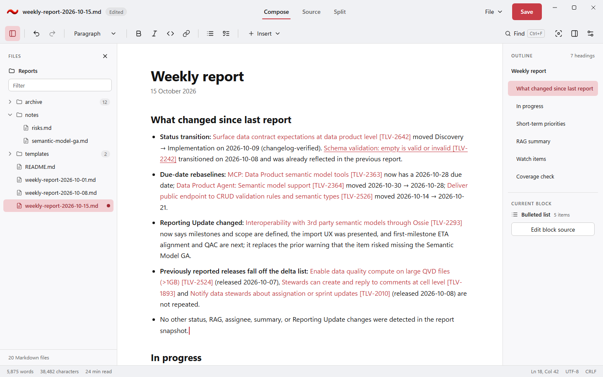

# Design refresh — 2026-10-22

The [24 October completion coordinator](RedesignCompletionAndRendering_2026-10-24.md) now sequences the
remaining review, correction, compatibility and R10 qualification work. This plan retains the accepted design,
implemented R/V history and its R10 summary gate; do not open a second optimization backlog here.

Status: IMPLEMENTED; owner requested publication and merge on 2026-10-24 with the disclosed performance and qualification holds. The final production-code `138a648` comparison reports five original-UI regression flags; the source-derived starting-redesign comparison has none and four improvements. Both baselines use the same exact SDK and common-harness overlays. Performance optimization/advice and final-source qualification remain OPEN. WIP retained. Owner: RedTilde application UI (layout, commands, theme adapter, Files pane),
with DxUi owning shared controls and rich-text link rendering. Implementation, dependency adoption and qualification are tracked below.

The owner judged the previous window "not nice" and requested this design and its complete implementation.
Accepted lasting rules now live in [the design system](../../UI/UI_DesignSystem.md) and the owning Editor,
Core and Testing specifications. This plan retains the self-contained proposal, implementation decisions and
qualification record; it is not the sole normative home for implemented behavior.

## Proposal art

The folder [DesignRefresh_2026-10-22](DesignRefresh_2026-10-22/proposal.css) holds one static HTML page per board,
their shared stylesheet and a PNG rendered from each page. The pages work offline from a checkout: plain
HTML/CSS, Segoe UI Variable chrome, 6-DIP controls, 10-DIP overlays and the theme values below, with the shipped
icon loaded from [res/RedTilde.png](../../../res/RedTilde.png). They are proposal art, not application captures,
and must never be presented as captures ([C11](RedTilde_2026-10-20.md)); actual evidence comes from the
deterministic harness with scenario/build provenance.

| Board | Picture | Page |
| --- | --- | --- |
| Compose, light, Files pane open | [compose-light.png](DesignRefresh_2026-10-22/compose-light.png) | [compose-light.html](DesignRefresh_2026-10-22/compose-light.html) |
| Compose, dark, Files pane open | [compose-dark.png](DesignRefresh_2026-10-22/compose-dark.png) | [compose-dark.html](DesignRefresh_2026-10-22/compose-dark.html) |
| Split view | [split.png](DesignRefresh_2026-10-22/split.png) | [split.html](DesignRefresh_2026-10-22/split.html) |
| Selection toolbar and Find/Replace | [find-selection.png](DesignRefresh_2026-10-22/find-selection.png) | [find-selection.html](DesignRefresh_2026-10-22/find-selection.html) |
| Focus mode | [focus.png](DesignRefresh_2026-10-22/focus.png) | [focus.html](DesignRefresh_2026-10-22/focus.html) |
| Settings drawer | [settings.png](DesignRefresh_2026-10-22/settings.png) | [settings.html](DesignRefresh_2026-10-22/settings.html) |
| Equation editing (F2) | [equation.png](DesignRefresh_2026-10-22/equation.png) | [equation.html](DesignRefresh_2026-10-22/equation.html) |



The PNGs were rendered on 2026-10-22 by headless Microsoft Edge 155.0.4283.62 at a 1440×900 viewport and device
scale 1. After editing a page, re-render it from the repository root; the profile stays under ignored `.build`:

```powershell
$dir = (Resolve-Path Specs/Plans/WIP/DesignRefresh_2026-10-22).Path
$edge = "${env:ProgramFiles(x86)}\Microsoft\Edge\Application\msedge.exe"
foreach ($name in 'compose-light','compose-dark','split','find-selection','focus','settings','equation') {
    & $edge --headless=new --disable-gpu --hide-scrollbars --no-first-run --force-device-scale-factor=1 `
        --window-size=1440,900 "--user-data-dir=$PWD\.build\proposal-render" "--screenshot=$dir\$name.png" `
        ('file:///' + ($dir -replace '\\', '/') + "/$name.html") | Out-Null
}
```

An earlier interactive draft was made on a private web canvas. It is not needed to read or implement this plan,
and these files supersede it wherever they differ.

## Checklist

- [x] V1 (2026-10-23): reproduce the owner's image 2 with the same visible weekly-report source, 1440x900 pixels, 96 DPI, dark theme and Files/outline panes. Use actual hidden harness captures; preserve truthful document totals and label unseen fixture continuation.
- [x] V2: add shared DxUi subtle/outline/tab button presentation, decorated text buttons, frameless trees and opt-out editor focus chrome while preserving high contrast, keyboard and UI Automation.
- [x] V3: adopt an exact SDK commit, correct header/command/pane geometry and review the matched capture alongside the target. Recheck 150/200% DPI and narrow layouts.
- [x] V4: archive source-bound native/capture evidence, six build profiles, focused SDK checks and documentation. Keep prior R10 performance and broader input/platform/release gates explicit.

The [visual-fidelity packet](../../../Measurements/VisualFidelity_2026-10-23/README.md) retains the actual matched
report, three DPI variants, six application builds and three complete x64 53-case/23-capture runs, including real
ASan detection. The SDK pin is `903643b4a2bc2f6d75250ff5e6834513c96432c4`; the original full report was not supplied,
so unseen continuation is invented and totals remain truthful. Native glyph/text rendering is not pixel-identical
to browser proposal art. V1–V4 complete this visual correction; R10 and the parent plan's qualification holds remain open.

- [x] R0: implementation authorized on 2026-10-22; D1–D5 resolved below.
- [x] R1: merged document bar (identity, dirty state, view selector, File menu, Save, caption buttons).
- [x] R2: one grouped command row; file commands leave it; Files toggle at its start.
- [x] R3: writing surface without nested frames; 760-DIP measure and document type scale.
- [x] R4: optional left Files pane for Markdown in the document's folder and subfolders.
- [x] R5: right panel with real outline hierarchy, current section and contextual block/equation tools.
- [x] R6: status bar content and placement of transient messages.
- [x] R7: contextual tools: selection toolbar and docked Find/Replace; the current nine-stage app keyboard slice passes, with broader C5 acceptance separate.
- [x] R8: Focus mode, Settings drawer and F2 equation editor presentation.
- [x] R9: link presentation (DxUi rich text upstream, then pin adoption).
- [ ] R10: resolve the performance optimization/advice gate and final qualification before scoped closeout. The [final production-code comparison](../../../Measurements/RedesignCompletion_2026-10-24/performance-138a648/README.md) retains five original-UI regression flags, mixed controls and loaded-host observations. The source-derived starting-redesign comparison has zero regressions and four improvements. Both common-SDK baseline lineages are disclosed in the packet. The earlier `fd24623` collection, [2026-10-24 checkpoint](../../../Measurements/DesignRefresh_2026-10-24/README.md), seven-flag `fa0757d` cohort and eight-flag v5r3 cohort remain historical evidence. Publication accepts no cost. Late source changes need their own qualification; RedTilde hosted ARM64 remains explicitly open by the owner's decision. Retain this plan in WIP and keep parent requirements open.

## Observed problems before implementation

Observed in the owner's 2026-10-22 screenshot of Compose (dark) with `weekly-report-2026-10-15.md`:

- Identity appears twice: the native title bar and the app document bar both show the file name and dirty state.
- Four chrome rows (title, document bar, command row, view row) sit above the document, about 200 DIP.
- New/Open/Save/Save as compete with formatting commands; every command has the same visual weight.
- Compose/Source/Split sit on their own row next to the product tagline.
- The document is a panel inside a darker frame inside the window; the text column is offset and boxed.
- The outline shows empty entries and centered labels, with no hierarchy or current-section indicator.
- The equation preview reserves an empty box when the caret is not in an equation.
- Every link is underlined, so link-dense reports read as noisy.
- Transient status ("Match selected in the document.") is centered far from what it describes.
- There is no way to see or switch between the other Markdown files next to the open document.

## Layout

All sizes in DIP at 100% scale; nothing overlaps or leaves the window at 100/150/200% DPI.

| Region | Size | Content |
| --- | --- | --- |
| Document bar | 56 tall | Brand icon (28), file name, "Edited" text chip, centered view selector, File menu, Save, caption buttons |
| Command row | 48 tall | Files toggle · Undo/Redo · Text style · Bold/Italic/Code/Link · Bullets/Task · Insert · (spacer) · Find, Focus, Panel, Settings |
| Files pane (optional) | 280 wide, resizable 200–400 | Folder name, filter, Markdown tree of the document's folder and subfolders, file count |
| Canvas | remaining | Page surface; 760 maximum measure, 48 side gutters, 56 top padding |
| Right panel | 240 wide | Outline, Current block, contextual Equation inspector |
| Status bar | 28 tall | Left: words, characters, reading time. Right: selection, Ln/Col, encoding, line endings |

- Document bar: the brand icon is the shipped red tilde. The dirty state is text ("Edited"), never color alone.
  The view selector stays visible and mutually exclusive with UIA names per mode and keeps Ctrl+1/2/3. File (New,
  Open, Save as…, with the existing Ctrl+N/Ctrl+O/Ctrl+Shift+S) is a menu button next to the primary Save (Ctrl+S,
  40 tall). The native window title text still follows the file name and dirty marker for the taskbar and Alt+Tab
  (see D1).
- Command row: groups are separated by 20-DIP dividers. Icon buttons are 36×36 (compact minimum 32) and carry
  tooltip names with shortcuts. Ctrl+E (inline code) and Ctrl+K (link) shown in the pages are proposed new
  shortcuts; Ctrl+B/Ctrl+I/Ctrl+F/Ctrl+Comma/F2/F11/Alt+F10 exist today. Find is a labeled button showing "Ctrl+F".
  Toggle buttons (Files, Panel, Settings, active inline format) show a pressed state with the selection tint and
  expose it through UIA. Redo is disabled when unavailable. In an equation, inline formatting is disabled and
  Text style reads "Equation".
- Canvas: one page surface, no nested card or frame. Narrow windows first collapse the right panel (contract
  order), then show an opened Files pane as an overlay above the canvas instead of beside it, and only then reduce
  the measure. At the 800×560 minimum, command groups move into an overflow menu instead of wrapping or clipping.
- Right panel: section labels are 11-DIP semibold uppercase with 0.08em tracking. Outline rows are left-aligned,
  at least 36 tall, indented by level, and the current section has the selection tint plus a semibold label and
  `aria-current`-equivalent UIA state. Empty headings never produce blank rows. "Current block" names the block
  type and count and hosts "Edit block source". The Equation section appears only while the caret is in an
  equation and shows the read-only rendering with a "Read-only" chip.
- Status bar: transient feedback moves next to its source (find count in the Find bar, errors in the document
  footer per the contract); the status bar keeps persistent facts only.

## Files pane

Requested by the owner on 2026-10-22: an optional left pane that can be opened and closed, listing the Markdown
files in the current document's folder and its subfolders.

- Toggle: the first command-row button and Ctrl+Shift+E (unused today). Opening moves keyboard focus into the tree;
  Esc or closing returns focus to the editor with the source selection intact. Open/closed state and width persist
  in settings and apply immediately; the default is closed.
- Root: the folder that contains the current document, shown by name with the full path as its tooltip and UIA
  help text. An untitled document shows "Save the document to see the Markdown files in its folder." When Save As
  or Open changes the document's folder, the tree re-roots.
- Content: `*.md` and `*.markdown`, the same Markdown types the Open dialog accepts. Folders appear only when they
  contain Markdown at some depth; folders come first, then files, each in Explorer-style natural order. The
  current document's ancestors are expanded and other folders start collapsed; a collapsed folder shows its
  Markdown file count. Hidden and system entries are excluded, and reparse points (junctions, symbolic links) are
  listed but never traversed.
- Current file: selection tint, semibold name and an "Edited" dot while dirty; UIA exposes the state as text.
- Filter: a name filter above the tree keeps matching files and their ancestor folders; Esc clears it first.
- Opening: click or Enter opens the file in this window through the normal Open path, which prompts before
  discarding unsaved changes and keeps every file-safety rule. Arrow keys move, Left/Right collapse/expand,
  Home/End and type-ahead work; the tree exposes UIA Tree/TreeItem with ExpandCollapse and SelectionItem.
- Work: enumeration runs on an application worker, never the UI thread, with bounded results (depth 8 and 5,000
  entries by default; the footer then says "Showing the actual Markdown count (5,000 examined-entry traversal limit)"). Publish on the UI owner,
  cancel by request/root identity and reject stale completions. Refresh is event-driven from directory change
  notifications, coalesced; no polling timer. Access errors and offline paths show inline in the pane and never
  block editing.

## Theme and typography

Colors come from the RedTilde theme adapter ([Application.cpp](../../../RedTilde/Application.cpp)) over DxUi palette
defaults; high contrast overrides all of them. Chrome = `windowBackground`, Files pane and right panel =
`surfaceBackground`, page = `cardBackground`.

| Role | Light | Paper | Dark |
| --- | --- | --- | --- |
| Chrome / panes / page | `#F0F1F4` / `#F8F8FA` / `#FFFFFF` | `#EDE6D8` / `#F3EDDF` / `#FFFAEF` | `#17191E` / `#1C1F25` / `#22252B` |
| Dividers / control borders | `#E0E0E0` / `#CDCDCD` | same | `#3D3D45` / `#4A4A52` |
| Text / subdued text | `#141414` / `#666666` | same | `#EBEDF2` / `#B3B5BA` |
| Accent, focus stroke, link | `#C83C46` | `#C83C46` | `#FF7778` |
| Accent hover / pressed | `#B6303C` / `#A12A34` | same | `#FF999A` / `#FFABAC` |
| Filled primary button | `#C83C46`, white text | same | `#C83C46`, white text (`#FF7778` fails 4.5:1 with white) |
| Selection, current row, pressed toggle | `#F2CFD3`, label `#A12A34` | same | `#A63B46`, white label |
| Find: other matches | neutral subtle fill, distinct in lightness from selection | same | same |

- The proposal originally used DxUi `b69f452f` theme values; implemented role bindings now use canonical exact pin `38ec36be42bf693dc649f1fe6b1dfc6cf34d4064` and current three-profile app tests/captures. Headings and strong text use the document text ink, not a lighter gray.
- Document scale: H1 34/1.2 bold, H2 23/1.3 bold, body 16/1.65, list items 10 apart, paragraph bottom margin 1 line.
  Split preview uses 15 body. Focus mode uses 18 body in a 680 measure. Source uses the monospace role at
  13.5/1.75, with subdued delimiters, accent heading/list markers and link-colored URLs.
- Chrome text: 14 labels, 13 tree/outline and secondary labels, 12 status, 11 keyboard hints in a 1-DIP bordered chip.
- Icons: 18-DIP line icons with consistent stroke, from the host's Fluent icon font where it has the glyph.

## Contextual states

- Selection toolbar: appears above the selection after pointer release (never follows pointer movement), stays in
  the viewport, is an overlay with 10-DIP corners and a soft shadow. Contents: Text style, Bold, Italic, Code, Link
  and an "Alt+F10" hint. Tab/Esc/Enter behave per the contract and return focus to the editor with the selection.
- Find/Replace: docked at the top-right of the canvas over the document, 460 wide. Row 1: query field, "n of m",
  previous (Shift+F3), next (F3), close (Esc). Row 2: replace field, Replace, Replace all. The current match is the
  selection; other matches use a subtle neutral fill. While Find is open, outline rows show per-section match counts.
- Focus mode: hides the command row, both panes and the status bar; a 40-DIP top strip keeps the dimmed file name
  and dirty state, "Exit focus" with an "Esc" hint and caption buttons. Blocks other than the current one use the
  subdued text color (a setting may disable dimming). A bottom status pill shows word count and save state.
- Settings drawer: docks at the right, about 380 wide, non-modal so changes are visible immediately. Appearance:
  theme tiles (System, Light, Dark, Paper) with previews, Reading width, Text size. Writing: Focus mode.
  Privacy: "Load images from the internet", off by default, with "Local images always show." Footer:
  "Changes apply right away." The drawer body scrolls when it does not fit. Esc and the close button return focus
  to the editor.
- Equation (F2): the rendered block gets a subtle selected fill; directly below it an attached panel shows
  "Equation source", the exact TeX with delimiters in the monospace role with an accent focus stroke, and Cancel
  (Esc) and Apply (Ctrl+Enter). Unsupported commands stay visible as source.

## Link presentation

Requested by the owner on 2026-10-22: color alone marks a link; the underline appears on hover.

- Rich text draws links in the theme link color without underline. The underline appears while the pointer
  hovers the link and while keyboard focus or the caret is inside it, so a non-color cue exists for keyboard users
  (WCAG 2.x technique G183). This matches the existing DxUi `ButtonVariant::Hyperlink` ("accent color, underline
  on hover").
- Contrast: light `#C83C46` is 5.0:1 on `#FFFFFF` and 3.7:1 against `#141414` text; Paper is 4.8:1 on `#FFFAEF`.
  Both meet G183's 3:1 link-to-text minimum. Dark `#FF7778` is 6.0:1 on `#22252B` but only about 2.2:1 against
  `#EBEDF2` text, so dark needs D3.
- High contrast keeps the system hyperlink color and a persistent underline.
- Source view is unchanged: link syntax stays visible, delimiters subdued, URL in the link color, no underline.
- Canonical DxUi at the current exact pin implements opt-in hover/caret link decoration, current UIA underline state, high-contrast defaults and stable source geometry/history. The app adopts those shared APIs; no DxUi sources are copied or patched locally.

## Resolved implementation decisions

- D1: use the merged document bar. RedTilde owns non-client HWND sizing, drag/resize regions, system caption hit targets and taskbar identity. Shared controls, UIA and text services stay in canonical DxUi. Preserve the maximize hit target for the Windows 11 snap flyout.
- D2: the 2026-10-23 image-2 correction uses three mutually exclusive underlined view commands with named UIA toggle state. Ctrl+1/2/3 and ordinary keyboard navigation remain available.
- D3: the 2026-10-23 image-2 correction uses hover/caret-dependent decoration in ordinary themes, including Dark. High contrast retains persistent underlines. Shared rendering stays in DxUi with exact-pin adoption here.
- D4: retain the 240-DIP document panel; narrow layouts collapse it before reducing the reading measure.
- D5: Files is listing/opening only. File creation, rename, delete and external navigation are separate future work.

## Acceptance

- Recapture `compose-light`, `compose-dark`, `source`, `split`, `context-selection`, `settings`, `math`, `math-dark`,
  `narrow` and `high-contrast`. Add deterministic `find`, `focus` and `files` scenarios; `files` uses a seeded
  fixture folder with nested, hidden, reparse-point and non-Markdown entries. All are actual harness renders.
- Layout tests for region sizes, both panes open, minimum window and 100/150/200% DPI without overlap or
  off-screen commands.
- Files pane tests: Markdown-only filtering, natural ordering, empty-folder pruning, limits, reparse points not
  traversed, re-rooting after Save As/Open, change-notification refresh, cancellation and stale-completion
  rejection, and the unsaved-changes prompt when opening another file.
- UIA names for the view selector, File menu, formatting commands, Files tree items, outline rows and
  current-section/current-file state.
- Keyboard and focus behavior for the Files pane, selection toolbar, Find, Settings drawer, Focus mode and F2
  editing under [C5](RedTilde_2026-10-20.md) with the person's agreement to the desktop time; hidden invocation does
  not qualify.
- Link hover/caret underline in Compose and Split preview, unchanged source and history, and UIA link exposure.
- Icon legibility and alpha at 16/24/32 DIP in the document bar and taskbar.

## Implementation and evidence record

The implementation is split between RedTilde's application composition and canonical DxUi controls. `Application.Chrome.cpp` owns layout and command composition; `Application.Navigation.cpp` adapts document/path models and source Find/Replace; `Common/Files.*` owns bounded enumeration and event-driven refresh. Editor typography, borderless focus, source highlights, focus dimming, link decoration and accessible toggle/single-click control behavior are shared DxUi APIs rather than consumer paint workarounds.

The Files service starts only while a saved document's Files pane is open. It retains one worker, latest request and result, rejects stale generations, closes its notification binding before teardown and drains owned I/O away from the UI thread. The 5,000 limit counts examined entries, including irrelevant names; the footer reports the actual returned Markdown count and any depth/entry/error limitation. Find matches cache one immutable source/query identity; section totals use sorted range queries rather than rescanning all matches for every heading on caret moves. Search/history stay source-exact.

The original baseline executable/build receipt and observations remain retained locally. A separate original-UI worktree carries the common 1440x900-DIP completed-frame harness and exact candidate dependency; its first instrumented baseline commit is `19a0f88`. The original requirement for a replacement final-pin baseline is historical: baseline v8 now carries the common harness and exact current pin; the fixed v5r3 primary study has completed with eight recorded regressions and an open optimization/advice gate. Passing compile probes or historical upstream tests do not establish candidate runtime, physical keyboard/IME/AT or ARM64 acceptance. Source-bound evidence is retained in [the design-refresh packet](../../../Measurements/DesignRefresh_2026-10-22/README.md).

Internet images are an explicit persisted opt-in. Canonical DxUi owns request admission/cancellation and source identity; the application image worker owns bounded anonymous HTTP(S) transport and decode publication. Loopback tests exercise default refusal, opt-in, failures and teardown without live internet requests.

Historical first warned real-keyboard run: it passed editor typing/undo, Files, Find, Settings and Focus, then found a canonical input ownership defect: a button activation returns editor focus before its already translated Enter/Space character is dispatched, allowing a second editor insertion. The failed lease restored foreground/focus and preserved the cursor. A hidden native TranslateMessage/DispatchMessage regression independently reproduces the failure. That repair was implemented in canonical DxUi and adopted; current v5r3 functional and app keyboard results are recorded below. The original failure remains unchanged; broader physical/clipboard/IME/AT, native ARM64 and performance gates remain separate.


## Current v5r3 qualification and pending closeout

Exact app source `538dd84941293cff8e7ecc6d2f8535cb597f0c0baea295e560cd795a0a221873`, compiled inputs `fde0747ac8b8100d67949d68a20e58fa2103e9b375f17fb0f22791b829c68270`, exact canonical DxUi pin `38ec36be42bf693dc649f1fe6b1dfc6cf34d4064`.

All six app build receipts pass: x64/ARM64 Debug, Release and ASan Debug. ARM64 entries are cross-builds, not native execution. Each of three x64 Full runs passes 52 cases and 20 harness captures. Real sanitizer detection and isolated crash dump/marker probes pass as separate obligations in the ASan run. These observations identify the original runtime source; a later documentation continuation does not constitute another native execution.

The app keyboard receipt records nine stages and 168 injected events passing under the approved AutoStart=true, 30-second countdown. Actual Confirmation is `started` because the user clicked Start during that countdown. Foreground and focus are `unchanged`; cursor is `restored`. Do not relabel it `autostarted` or claim broader clipboard/physical IME/touch/AT acceptance.

All 60 capture bytes equal the previously reviewed images. The current visual record is an exact-file review continuation, not new direct inspection. The private runtime/source inventory records 117 preserved physical copies. Current selected archive member counts are 130/130/132 for ordinary profiles and 5 keyboard files. Each ordinary archive withholds exactly one preserved private refusal payload (3 total); keyboard withholds zero. These are selected publication counts, not exhaustive producer-set publication. Historical ten exclusions, 2f-v3's three omissions and v4's three omissions are distinct preserved sets.

| Current profile | Run ID | Original receipt SHA-256 |
| --- | --- | --- |
| `38ec-v5r3-x64-Debug` | `20261023T103625474Z-42592-f8f60c78ecfa4007991ee83faa8674f7` | `6649260AC561911982DA55EAD8980AA21A58AECEB89C3636419EA81A4E484F76` |
| `38ec-v5r3-x64-Release` | `20261023T103707729Z-42592-fa085c4e66d54c7f8233c8ded75f0efc` | `A45D18040D84F2FA6678C1E7C70714223FD11DAF48598A45D383C0C34C6D81AC` |
| `38ec-v5r3-x64-ASan-Debug` | `20261023T103748474Z-42592-055ff651355343829ac26ca9fa8683e2` | `288A3F786ABF716786F8F67B45C6E0F1ED1E8C8D57BDC8D65458913053AEB060` |
| `38ec-v5r3-keyboard-x64-Release` | `20261023T104103480Z-49464-29b64c11682946e995ffbd68d338c84c` | `D8CBF79234917E9345CF4B91D172FD4924DCE05E31F61F5B21EF32E9A3B67D76` |

## History and open decisions

V5 first Full Debug's remote-image close combined assertion failed (32/33 Editor cases), despite an earlier focused 33-case pass. Timing and focus were subsequently split without weakening the <500ms or full-case focus assertions; the original failure remains unattributed. V5r2's x64/ARM64 Debug C2664 diagnostic-authoring compile failures remain preserved. V5r3 correction has the passing current receipts above; no later pass rewrites those failures. Prior v4/e62/1cff/2f packets and all unfavorable performance cohorts remain unchanged.

Exact-pin SDK owner results are six builds, 62 ordinary + 12 foreground zero-skip suites, three separate expected ASan failures and reviewed gallery continuation/publication. They do not close application or shared SDK performance, physical-input/AT, native ARM64, CI or release gates.

SDK documentation commit `9dec55676ac60332315d898f75af49250d952b96` normally continues the exact 38ec producer; its four final checks and private exact docs-only continuation pass. [SDK draft PR #99](https://github.com/RedSalamanders/DxUi/pull/99) is open. No SDK merge, app execution or performance acceptance is implied by that documentation continuation.

## Completed fixed v5r3 primary cohort — performance gate open

The predeclared fixed AA/AB collection completed successfully with no observer
failure. AA ran 2026-10-23 10:52:47–10:59:11 UTC and AB 10:59:11–11:05:36 UTC:
96 native slots per study, 192 total, 12 blocks per view, 64 cycles, seed 20261022.
This is the retained original cohort, unpooled with predecessors. The independent
typed C# numerical/integrity audit matches all 7,988 checks; it does not self-approve
the performance policy or establish improvement causality.

AA resolves no directional change in its twelve metrics. Command/CPU/private-memory
controls remain unstable; working-set and completed-frame controls are stable.
AB reports eight regressions. Completed-frame medians remain about 16.6 ms and clean
preparation about 17 ms without a resolved directional finding. Functional success
and these frame observations do not remove command CPU or retained-memory findings.

The following is a derived Markdown projection of the two original comparison
records. Values retain the stored metric units; change is the stored paired estimate,
not the ratio of displayed medians. No raw receipt or judge metadata is rewritten.

| Study | View | Metric | Baseline median | Candidate median | Paired change % | Adjusted p | Controls stable | Finding |
| --- | --- | --- | ---: | ---: | ---: | ---: | --- | --- |
| AA | Compose | `commandUs` | 301.65 | 311.9 | 0.8844797646 | 1 | False | no-resolved-change |
| AA | Compose | `ownerCpuCycles` | 7657952 | 7672373.75 | -0.347941491917 | 1 | False | no-resolved-change |
| AA | Compose | `completedEditUs` | 16584.675 | 16591.5 | 0.0904913819598 | 1 | True | no-resolved-change |
| AA | Compose | `cleanCompletedUs` | 16918.75 | 16901.775 | -0.124341330497 | 1 | True | no-resolved-change |
| AA | Compose | `privateBytes` | 45338624 | 45287424 | -0.163753009681 | 1 | False | no-resolved-change |
| AA | Compose | `workingSetBytes` | 54198272 | 54298624 | 0.15589751985 | 1 | True | no-resolved-change |
| AA | Split | `commandUs` | 353.7 | 352.4 | 0.448994836606 | 1 | False | no-resolved-change |
| AA | Split | `ownerCpuCycles` | 9848463 | 9965377.75 | 0.473884705704 | 1 | False | no-resolved-change |
| AA | Split | `completedEditUs` | 16527.275 | 16540.5 | 0.0332943403101 | 1 | True | no-resolved-change |
| AA | Split | `cleanCompletedUs` | 17042.075 | 16975.4 | -0.262824201514 | 1 | True | no-resolved-change |
| AA | Split | `privateBytes` | 45551616 | 45076480 | -0.722468221115 | 1 | False | no-resolved-change |
| AA | Split | `workingSetBytes` | 54548480 | 54501376 | -0.160295476382 | 1 | True | no-resolved-change |
| AB | Compose | `commandUs` | 304.2 | 351.8 | 15.3122496301 | 0.005859375 | False | regressed |
| AB | Compose | `ownerCpuCycles` | 7634151 | 8142184 | 5.80605185096 | 0.009765625 | False | regressed |
| AB | Compose | `completedEditUs` | 16574.125 | 16563.6 | -0.00361137085094 | 1 | True | no-resolved-change |
| AB | Compose | `cleanCompletedUs` | 16908.25 | 17023.55 | 0.140640804956 | 1 | True | no-resolved-change |
| AB | Compose | `privateBytes` | 44883968 | 49682432 | 10.427869688 | 0.005859375 | False | regressed |
| AB | Compose | `workingSetBytes` | 54200320 | 56166400 | 3.55054340712 | 0.005859375 | True | regressed |
| AB | Split | `commandUs` | 360.05 | 390.575 | 9.7936920256 | 0.005859375 | False | regressed |
| AB | Split | `ownerCpuCycles` | 9704452.75 | 11301005 | 16.6372233743 | 0.005859375 | False | regressed |
| AB | Split | `completedEditUs` | 16589.7 | 16521.8 | -0.332573419995 | 0.228515625 | True | no-resolved-change |
| AB | Split | `cleanCompletedUs` | 16922.875 | 16943.875 | -0.130491614825 | 1 | True | no-resolved-change |
| AB | Split | `privateBytes` | 45305856 | 50378752 | 11.3333101601 | 0.005859375 | False | regressed |
| AB | Split | `workingSetBytes` | 54544384 | 57016320 | 4.60329047642 | 0.005859375 | True | regressed |

Both host records have complete 378-sample coverage. AA maximum sample gap is 1.0328 s, mean total busy 9.0984%, maximum 29.1866%; AB maximum gap is 1.0307 s, mean 9.3312%, maximum 36.8269%. Neither window is verified quiet or exclusive. Selected-process observations are incomplete measures of competing work; GPU activity and physical occlusion are unmeasured. These limitations do not erase the recorded regression findings or establish their cause.

The reviewed [derived v5r3 projection](../../../Measurements/DesignRefresh_2026-10-22/performance/observed-38ec-v5r3/README.md) retains the safe numeric samples and integrity references. Original metadata stays private at `.build/paired-design-refresh-38ec36be-app-v5r3-20261023/{aa,ab}/comparison.json`, `.build/paired-design-refresh-38ec36be-app-v5r3-20261023/collection.json` and `.build/paired-design-refresh-38ec36be-app-v5r3-20261023/host-summary.json`. The independent audit is `.build/design-refresh/performance-investigation-38ec-v5r3/independent-audit.json`. These private paths are source-bound evidence references, not links to absent checkout payloads.

**Disposition: performance optimization/advice gate OPEN; R10 and this plan remain WIP.** No cost acceptance, threshold relaxation, silent rebaseline, quiet-host claim, improvement attribution or trusted non-regression verdict is recorded. Current code may be published for review in a DRAFT PR while deeper memory diagnosis continues. An ablation/diagnostic is not this fixed primary cohort and cannot replace or be pooled with it.

## Documentation continuation contract

The native and performance records identify tested source `538dd84941293cff8e7ecc6d2f8535cb597f0c0baea295e560cd795a0a221873`, compiled inputs `fde0747ac8b8100d67949d68a20e58fa2103e9b375f17fb0f22791b829c68270` and DxUi pin `38ec36be42bf693dc649f1fe6b1dfc6cf34d4064`. They are not execution of a later documentation commit. Documentation changes alter the full source identity: obtain fresh source-bound receipts for all six build profiles and prove the relevant compiled inputs, dependency, harness, compiler, native binaries, environment, profile and scope identical before retaining native observations. Run changed documentation/format/link/changelog tools separately. Record the actual continuation and check results in [the evidence summary](../../../Measurements/DesignRefresh_2026-10-22/README.md). A documentation continuation supplies no new native execution or CI qualification; hosted six-Full-step continuation remains a separate contract.

Creation-plan C1–C12 and S5/S6, broader C5 keyboard/menu/clipboard/physical IME/touch/AT, native ARM64 runtime, shared SDK policy, CI and release requirements remain open under their owning conditions. No parent checklist or active plan link changes here.
