# RedTilde User Guide

**RedTilde** is a native Windows Markdown editor built with Win32, Direct2D, DirectWrite, and DxUi. It keeps a single authoritative UTF-8 Markdown source, selection, and undo/redo history across **Compose**, **Split**, and **Source** views—with native LaTeX mathematics, bounded Mermaid diagrams, local crash recovery, and Windows printing. All editing stays local and requires no account.

> [!NOTE]
> RedTilde is currently an **experimental 0.1** preview (`capabilities.json`). Documents are bounded to `65,536` UTF-16 units and `128` undo steps; full LaTeX/Mermaid parity and several platform qualifications remain tracked in [the capability status](../capabilities.json).

## Contents

- [Editing Views](#editing-views)
- [Contextual Formatting & In-Place Semantic Editing](#contextual-formatting--in-place-semantic-editing)
- [Mathematics & Supported Mermaid Diagrams](#mathematics--supported-mermaid-diagrams)
- [Images, Clipboard Paste & Network Privacy](#images-clipboard-paste--network-privacy)
- [Files Pane, Workspace & Open Documents](#files-pane-workspace--open-documents)
- [Find & Replace](#find--replace)
- [Printing & Print Preview](#printing--print-preview)
- [Themes, Typography, Zoom & Accessibility](#themes-typography-zoom--accessibility)
- [Automatic Crash Recovery & Safe File Saving](#automatic-crash-recovery--safe-file-saving)
- [Command-Line Options & Portable Installation](#command-line-options--portable-installation)
- [Keyboard Shortcuts](#keyboard-shortcuts)
- [Related Documentation](#related-documentation)

---

## Editing Views

Switch between **Compose**, **Source**, and **Split** from the document bar or with `Ctrl+1`, `Ctrl+2`, and `Ctrl+3`. Every view shares the exact same Markdown source, selection, and undo/redo history—switching views never re-serializes your document.

- **Compose (`Ctrl+1`):** Distraction-free rich Markdown rendering with subtle separators, shaded blockquotes, compact tables, task checkboxes, syntax-colored fenced code (`C/C++`, `JSON`, `PowerShell`, `diff`), inline and display math, and Mermaid diagrams.
- **Split (`Ctrl+3`):** Editable **Compose** on the left paired with a **read-only Source mirror** on the right that highlights syntax and follows your selection.
- **Source (`Ctrl+2`):** Monospace exact-source editor with syntax coloring, preserved `LF`/`CRLF`/`CR`/mixed line endings, and optional UTF-8 BOM preservation.
- **Focus Mode (`F11`):** Collapses toolbars and side panes into a minimal top strip with `Exit focus · Esc`, dims inactive blocks (configurable in Settings), and displays a bottom word-count pill.

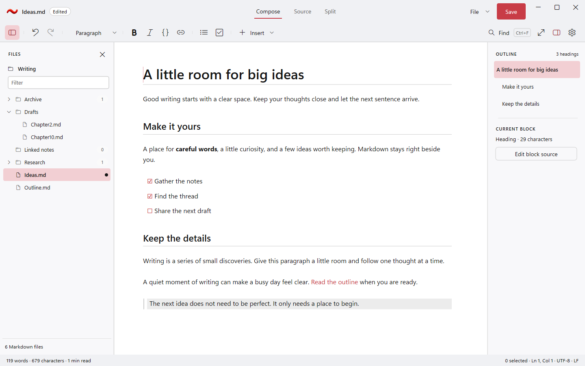

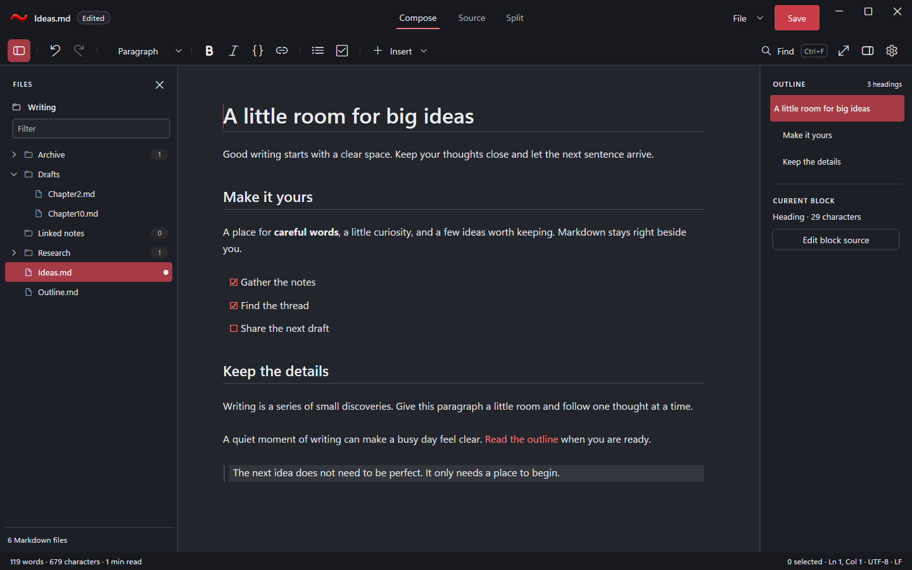

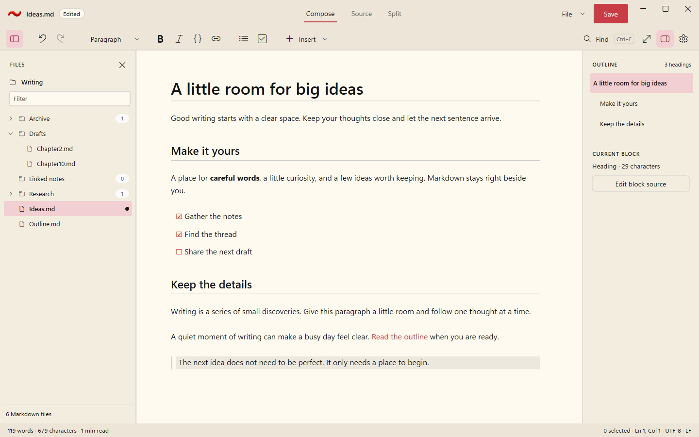

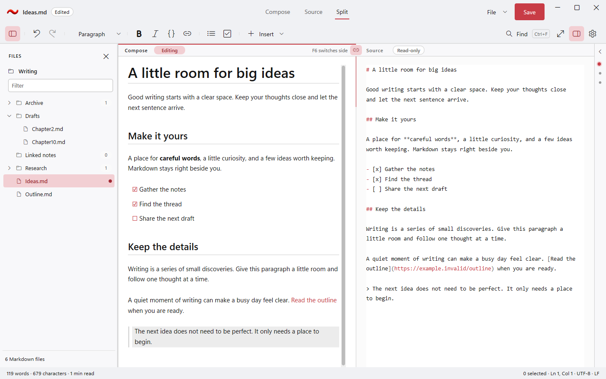

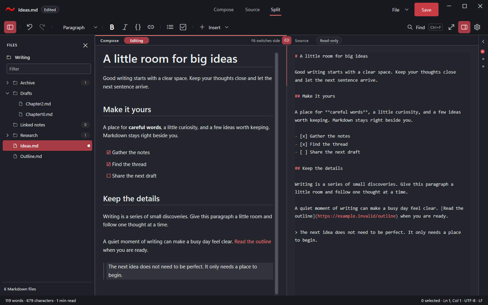

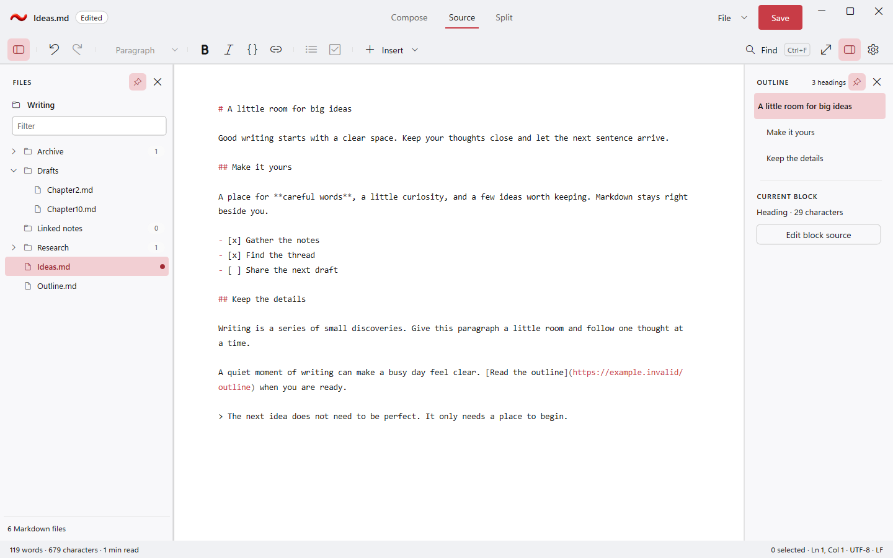

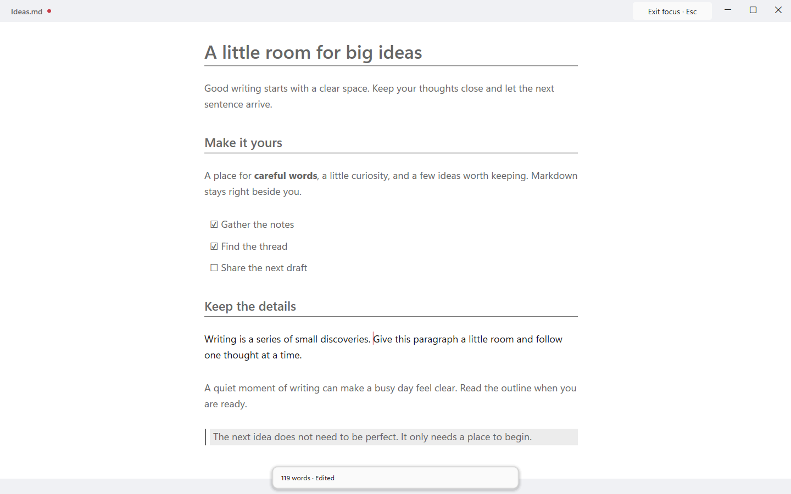

---

## Contextual Formatting & In-Place Semantic Editing

- **Floating Selection Toolbar:** Selecting text in **Compose** or **Split** displays a contextual toolbar right above the selection (`Text style`, `Bold`, `Italic`, `Code`, `Link`, and the `Alt+F10` keyboard hint). Press `Alt+F10` to move keyboard focus into the toolbar, or `Esc` to dismiss it.
- **Command Row & Context Menu:** The top toolbar provides Undo/Redo, Text style (`Paragraph`, `Heading 1–3`), Bold (`Ctrl+B`), Italic (`Ctrl+I`), Inline code (`Ctrl+E`), Link (`Ctrl+K`), Bulleted/Task lists, and **Insert** (Link, Image from file, Table, Mermaid flowchart, Equation, Quote, Code block). Right-clicking (or pressing the context-menu key) also exposes Strikethrough, Numbered lists, table row/column actions, **Edit block source (`F2`)**, and **Open link** when on a link.
- **Wrap Selection in Quote or Code Block:** Selecting prose and choosing **Insert → Quote** or **Insert → Code block** wraps the selected lines directly in Compose, Source, or Split as a single undoable edit while preserving original line endings.
- **In-Place Semantic Source (`F2`):** Pressing `F2` inside a code block, Mermaid diagram, HTML/metadata block, or inline/display equation opens its exact delimited source **in place** while the rest of the document stays rendered. Press `F2`, `Esc`, or `Ctrl+Enter` to return to the rendered block. For ordinary prose, `F2` opens a local source draft (`Ctrl+Enter` or **Apply source** commits one undoable transaction; `Esc` cancels).

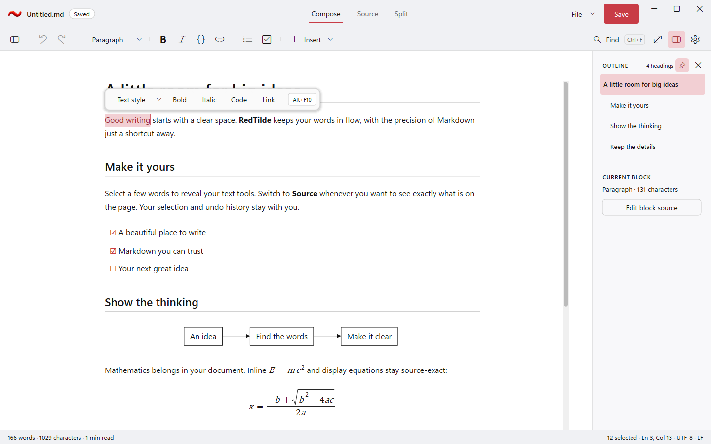

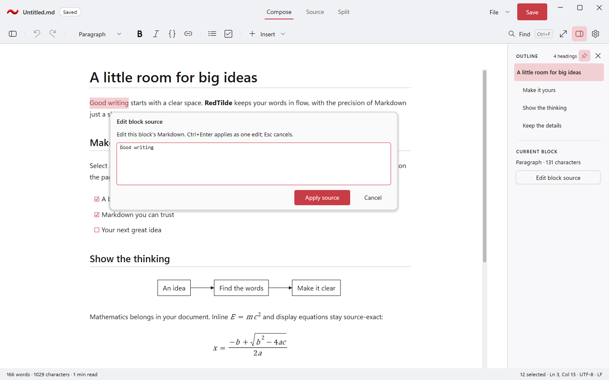

---

## Mathematics & Supported Mermaid Diagrams

### Native LaTeX Mathematics

RedTilde renders mathematics natively in the document and in the read-only **Equation** inspector in the right sidebar without any external TeX installation or network fonts:

- **Inline math:** `$...$` (non-space content edges, does not close before a digit) or `\(...\)`.
- **Display math:** Put `$$` or `\[` / `\]` on lines of their own above and below the formula, or use a closed `math` / `latex` fenced code block. A single-line `$$x$$` remains literal text.
- **Supported notation:** Fractions (`\frac`), indexed roots (`\sqrt`), simultaneous sub/superscripts, Greek symbols and operators, named functions, upright `\text{...}`, alphabets, accents, scalable paired delimiters, matrices (`&` cells and `\\` rows), `cases`, and `aligned` / `gathered` blocks.
- **Bounds & Fallback:** Bounded to `16,384` source units, `4,096` AST nodes, `64` nesting levels, `64` rows/columns, and `1,024` matrix cells per equation (`32,768` total math records and `128` combined native objects per document). Unsupported or malformed notation stays exact editable source with an accessibility diagnostic.

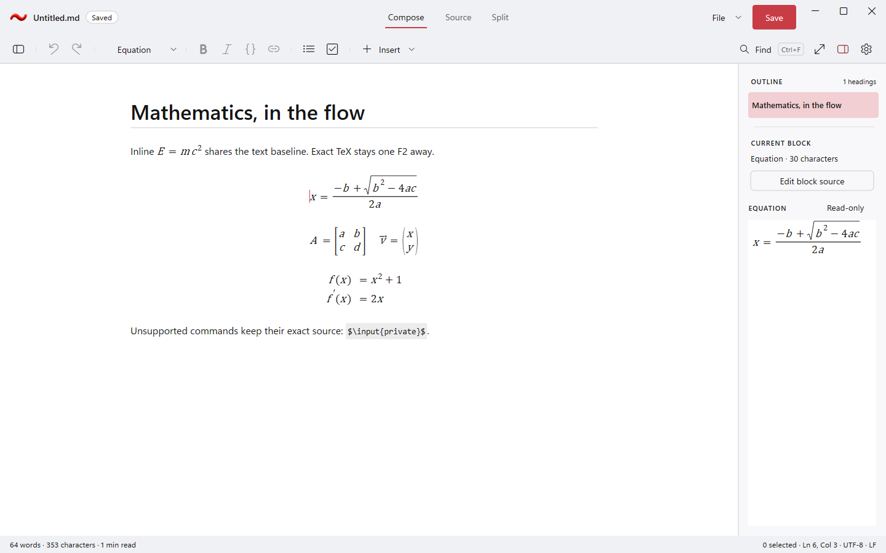

### Bounded Native Mermaid Diagrams

RedTilde renders **eight** bounded Mermaid diagram families directly in native C++ onto the document canvas (and onto paper in Print Preview):

1. **Flowchart** (`flowchart` / `graph` — defaults to top-to-bottom when no direction is specified)
2. **State diagram** (`stateDiagram` / `stateDiagram-v2`)
3. **Class diagram** (`classDiagram`)
4. **Sequence diagram** (`sequenceDiagram` — including `actor` figures, plain aliases, `Note left of`/`right of`/`over`, bare `autonumber`, and solid/dotted/open/headless messages)
5. **Pie chart** (`pie`)
6. **Entity Relationship diagram** (`erDiagram`)
7. **Gantt timeline** (`gantt`)
8. **Mind map** (`mindmap`)

**Security & Static Rendering Boundaries:**
- Diagrams render as **static native vector graphics**—no webview, JavaScript runtime, arbitrary CSS, or `click`/interaction directives ever run.
- Arrow labels automatically add a subtle contrast-aware light or dark backing when crossing lines or low-contrast backgrounds, without modifying your Markdown source.
- Unsupported constructs (such as sequence loops, activation bars, creation/destruction, or unsupported diagram families) keep their exact editable fenced Markdown source rather than drawing a partial diagram.

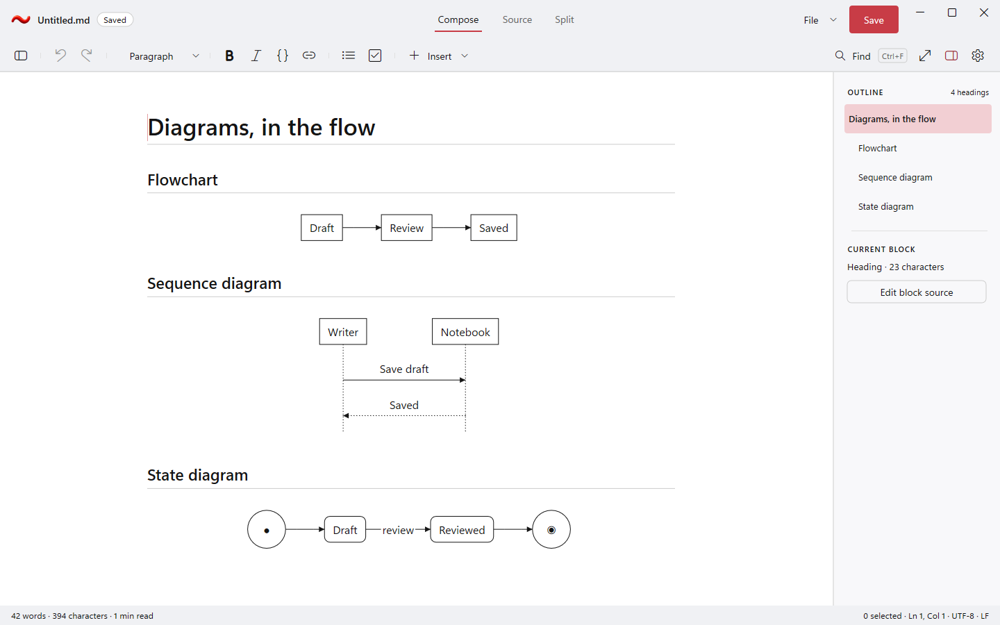

See [examples/mermaid-supported-families.md](examples/mermaid-supported-families.md) and [examples/mermaid-sequence.md](examples/mermaid-sequence.md) for runnable sample documents.

---

## Images, Clipboard Paste & Network Privacy

- **Local Images:** Relative image paths resolve from the saved document's folder (save an untitled document first if you want relative paths). Supported formats—**PNG, JPEG, BMP, GIF (first frame), and TIFF**—decode asynchronously off the UI thread. Modified local image files refresh automatically (up to `32` watched paths across `8` directories).
- **Clipboard Bitmap Paste:** Pasting a bitmap in Compose or Split saves a durable PNG in `%LOCALAPPDATA%\RedTilde\Assets` and inserts its `file://` reference in a single undoable step. When the clipboard contains both Unicode text and an image, **text wins by default**; enable **Settings → Privacy → Prefer images when pasting** to prefer images. Note that copying or moving the `.md` file elsewhere does not automatically copy files out of `Assets`.
- **Network Privacy (Default Off):** Remote `http(s)://` images, UNC network paths, `data:` URIs, and `![[wiki]]` embeds are blocked by default. Documents containing remote images show a non-modal consent bar where you can choose **Allow here** (for that document only) or **Block here**, or enable **Always allow remote images** in Settings. **Allow images from local networks** is a separate opt-in (off by default) for private/loopback addresses and the document's own network share. Remote fetches use direct TLS `1.2`/`1.3` connections with no cookies, redirects, credentials, or proxy auto-discovery.
- **Safe Links:** Ordinary clicks in Compose keep editing. Hold `Ctrl+Click` on a link—or place the caret in a link and choose **Open link** from the context menu—to review the destination in a confirmation prompt before opening `http:`, `https:`, or `mailto:` links in your default app. Local `#heading` links scroll in-document. Markdown HTML and scripts never execute.

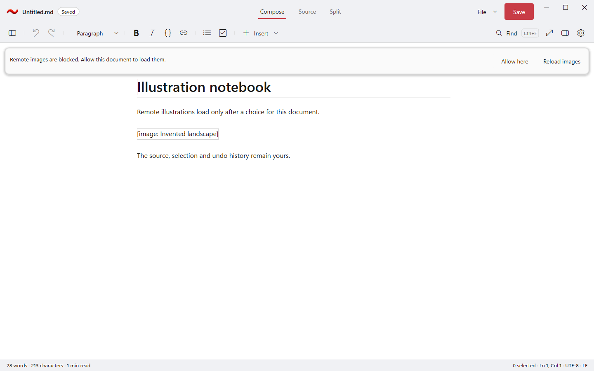

---

## Files Pane, Workspace & Open Documents

- **Files Pane (`Ctrl+Shift+E`):** Choose **File → Open Folder…** (`Ctrl+Shift+O`) to pin a notebook folder root, or **File → Open File…** (`Ctrl+O`) (opening a file when no root is set uses its parent folder). The pane lists `.md` and `.markdown` files (up to `5,000` visited entries and depth `8`), excludes hidden/system items, never traverses reparse points, and supports live filename filtering.
- **Drag-and-Drop:** Drag and drop a `.md`, `.markdown`, or `.txt` file onto the RedTilde window to open it (dropping multiple files or unsupported types reports a clear status without altering your document).
- **Multi-Document Workspace & Open Documents:** RedTilde keeps up to `64` open documents in memory—preserving each document's edits, selection, undo/redo history, and remote-image grant—so clicking between rows in the Files pane switches instantly without prompting. When multiple documents are open, an **Open documents** group appears at the top of the Files tree in opening order (keeping untitled and recovered copies distinct and keeping tree selection on the clicked row).
- **Closing Documents (`Ctrl+W`):** **File → Close document** (or `Ctrl+W`) prompts only if the active document has unsaved changes, then switches to the adjacent open document (or resets to an empty `Untitled.md` if it was the last document). Explicit **Open File**, **Open Folder**, **New**, and window **Close** protect every modified workspace document.

---

## Find & Replace

Press `Ctrl+F` to open the **Find & Replace** bar (and `Esc` to close it):

- Searches the **exact Markdown source** (including hidden syntax) using ordinal Unicode comparison.
- **Match case** toggles case-sensitive vs. case-insensitive search.
- Shows the current/total match counter (`2 of 3`), highlights matches in the document, and displays **per-section match counts** as badges in the Outline sidebar.
- `F3` (Next) and `Shift+F3` (Previous) wrap at document ends and continue to work even after closing the Find bar.
- **Replace** updates the current match as one undoable edit and advances to the next match; **Replace all** replaces all matches in one undoable transaction.

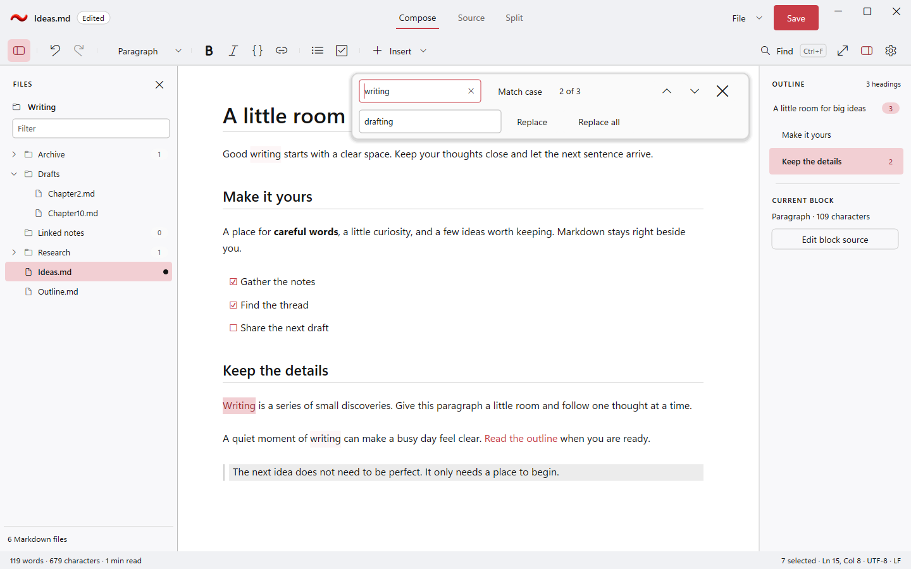

---

## Printing & Print Preview

Choose **File → Print…** or press `Ctrl+P` from Compose, Source, or Split to open the **Print Preview** window:

- Renders formatted dark-ink-on-paper pages independent of the editor's theme, view, or zoom level (including unsaved edits and rendered Mermaid diagrams/equations).
- Select any installed Windows printer or **Microsoft Print to PDF** from the **Printer** dropdown; pagination updates automatically when you switch printers, **Paper size** (e.g., Letter, A4), or **Orientation** (Portrait, Landscape).
- Configure **Pages to print** (blank for all, single pages like `3`, ranges like `4-6`, or lists like `1, 4-6`), **Current page**, **Print sides**, **Copies**, **Collate copies**, and **Print to file** when supported by the selected driver.
- Navigate sheets with `←` / `→`, typing a page number and pressing `Enter`, `Page Up` / `Page Down`, mouse wheel, or **Fit width** / **Fit page**.

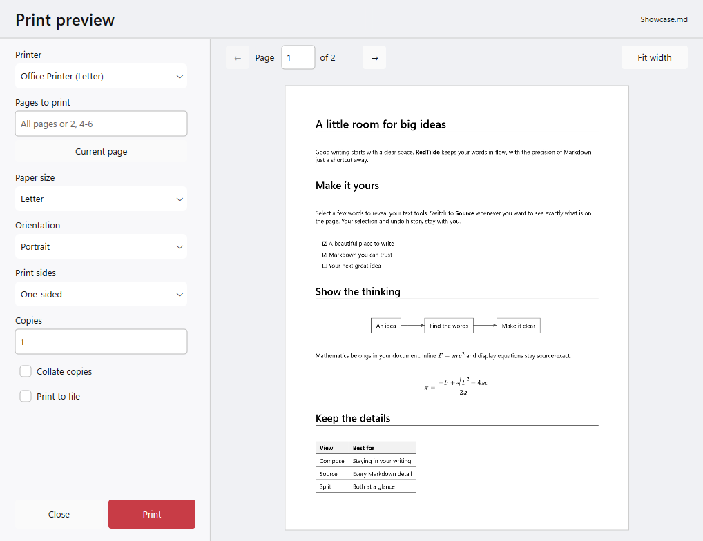

---

## Themes, Typography, Zoom & Accessibility

Open **Settings** from the gear button or `Ctrl+,`:

- **Appearance:** Choose **System** (follows Windows Light/Dark mode), **Light**, **Dark**, or **Paper** (`#EDE6D8` / `#F3EDDF` / `#FFFAEF`), all with immediate preview and live updates. **Windows High Contrast** automatically overrides custom theme colors with system `Window`/`Highlight`/`Hotlight` colors and persistent link underlines.
- **Reading Width & Text Size:** Adjust reading width (`480–1040` DIPs, default `760`) and text scale (`75%–200%`, default `100%`) using the steppers or `Ctrl++` / `Ctrl+-` / `Ctrl+0` / `Ctrl+Mouse Wheel`.
- **Writing & Markdown Syntax:** Toggle **Show outline**, **Focus mode**, **Dim other blocks in focus mode**, **Strike through completed tasks** (visual presentation only; Markdown stays unchanged), and seven optional RichMarkdown syntax switches (`==highlight==`, `^superscript^`, `~subscript~`, `++inserted++`, `[[wiki links]]`, definition lists, and `*[abbr]:` abbreviations).
- **About & Shortcuts:** The bottom of Settings displays the installed version (`RedTilde 0.1.0 experimental`) and a built-in keyboard shortcuts reference.
- **Preferences File & Live Reload:** Settings are stored as UTF-8 JSON5 in `%LOCALAPPDATA%\RedTilde\RedTilde.settings.json` (`RedTilde-debug.settings.json` in debug builds, described by `SettingsStore.schema.json`), with lossless one-time migration from legacy text settings and live reload when edited externally.
- **Outline & Current Block Inspector:** The right sidebar lists ATX headings hierarchically (with collapsible sections), tracks the active section, identifies the **Current block** (e.g., `Heading`, `Bulleted list · 3 items`, `Equation`), and hosts the live read-only **Equation** preview.

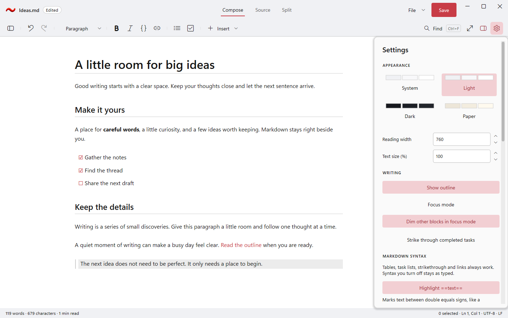

---

## Automatic Crash Recovery & Safe File Saving

- **Session Recovery:** Unsaved edits (including unapplied local drafts and multiple workspace documents) are checkpointed to `%LOCALAPPDATA%\RedTilde\Recovery` after `750 ms` of idle time (or at most every `5` seconds during continuous typing). On the next launch after an unexpected exit, RedTilde shows a source preview with **Restore a copy**, **Discard snapshot**, **Keep for later**, and **Restore all copies** (when multiple snapshots exist). Restored documents open dirty and require **Save as…**, leaving original files untouched. Corrupt or oversized recovery snapshots are quarantined as `.quarantine` instead of failing startup.
- **Atomic & Conflict-Safe Saving:** Saves write to a temporary file in the target folder, flush, and replace atomically while preserving UTF-8 BOM and line endings. If the file changed externally on disk, RedTilde presents one task dialog with **Reload from disk**, **Save as…**, **Overwrite**, and **Cancel**. Files with multiple hardlinks or storage providers that disallow replacement use a recovery-protected in-place write.
- **Close-During-Save Protection:** Closing the window while a save is running hides the window until the write settles; if the write fails, the window restores with the error message and your edits intact.

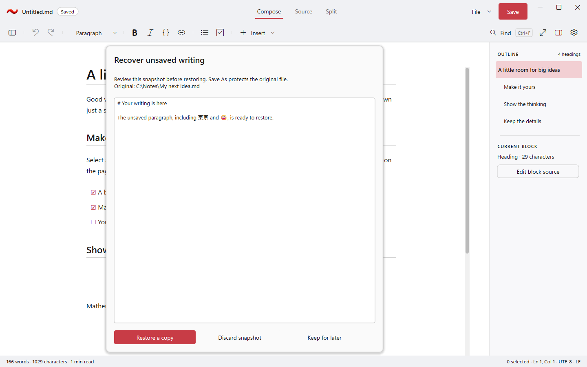

---

## Command-Line Options & Portable Installation

```text
redtilde [<document>]
redtilde --document <document> [--data-dir <path>] [--headless]
redtilde --capture <image.png> --scenario <name> [--document <document>]
         [--capture-dpi <96|144|192>] [--viewport-width <px>] [--viewport-height <px>]
         [--data-dir <path>]
redtilde --version | -v
redtilde --help | -h | /?
```

- `--redmonitor`: Launches or connects diagnostics to an independently installed RedMonitor viewer (see [Diagnostics.md](Diagnostics.md)).
- **Portable & Per-User Installation:** Extract a portable release ZIP anywhere, or run [`Installer/Install-RedTilde.ps1`](../Installer/Install-RedTilde.ps1) to install to `%LOCALAPPDATA%\Programs\RedTilde`, create a Start Menu shortcut, register per-user Uninstall metadata, and optionally register `.md`/`.markdown` file associations (`-RegisterFileAssociation`). See [Portable.md](Portable.md) for full instructions.

---

## Keyboard Shortcuts

| Shortcut | Action |
| --- | --- |
| `Ctrl+N` | New workspace document |
| `Ctrl+O` | Open file |
| `Ctrl+Shift+O` | Open folder in Files pane |
| `Ctrl+S` | Save |
| `Ctrl+Shift+S` | Save As |
| `Ctrl+W` | Close active document |
| `Ctrl+P` | Open Print Preview (and submit Print inside preview) |
| `Ctrl+1` / `Ctrl+2` / `Ctrl+3` | Switch to Compose / Source / Split view |
| `Ctrl+B` / `Ctrl+I` / `Ctrl+E` | Toggle Bold / Italic / Inline code |
| `Ctrl+K` | Insert or edit Link |
| `Ctrl+Z` / `Ctrl+Y` | Undo / Redo |
| `Ctrl+F` | Find & Replace |
| `F3` / `Shift+F3` | Find next / previous match (works when Find bar is closed) |
| `F2` | Edit block source in place (or open local source draft) |
| `Ctrl+Enter` / `Esc` | Apply / cancel local source draft |
| `Ctrl+Shift+E` | Toggle Files pane |
| `Ctrl+,` | Toggle Settings drawer |
| `F11` | Toggle Focus mode (`Esc` exits) |
| `Alt+F10` | Focus selected-text floating toolbar |
| `Ctrl++` / `Ctrl+-` / `Ctrl+0` | Zoom text size +5% / -5% / reset 100% (`Ctrl+Wheel` also zooms) |
| `Page Up` / `Page Down` | Navigate sheets (or pan in Fit width) in Print Preview |
| `Esc` | Dismiss active overlay, floating toolbar, draft, Focus mode, or Files filter/pane |

---

## Related Documentation

- [Portable Usage & Per-User Installer Guide](Portable.md)
- [Diagnostics & RedMonitor Guide](Diagnostics.md)
- [Sample Markdown Documents](examples/README.md) (including [starter example](examples/example.md), [local images](examples/local-images.md), [syntax options](examples/syntax-options.md), and [Mermaid family gallery](examples/mermaid-supported-families.md))
- [Screenshot Provenance & Inventory](screenshots/README.md)
- [Repository Root README](../README.md) · [Markdown & Editor Contract](../Specs/Editor/Editor_Markdown.md) · [Design System](../Specs/UI/UI_DesignSystem.md) · [Capabilities](../capabilities.json)
