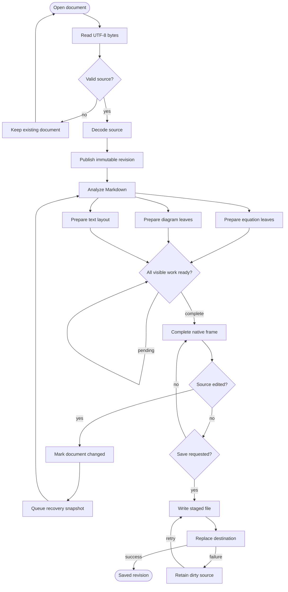
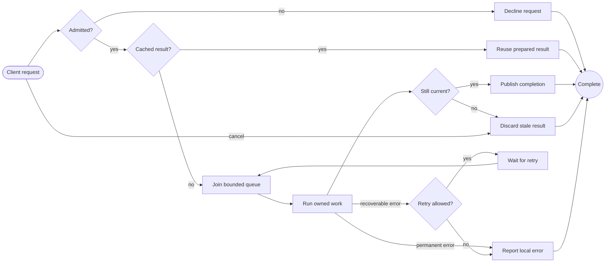
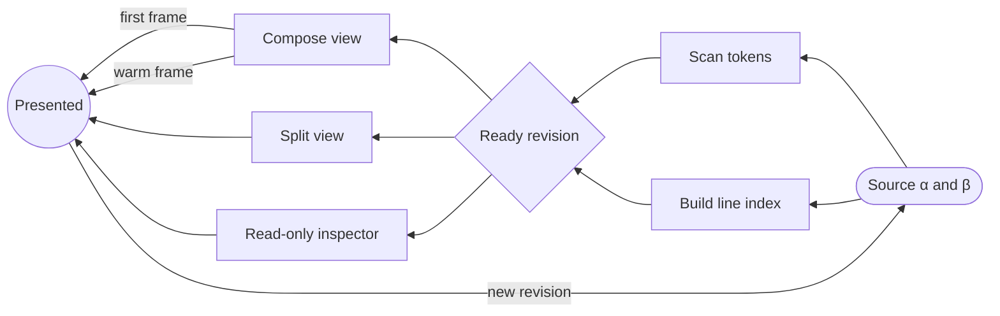
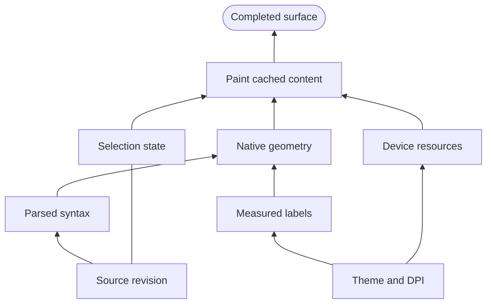

# Complex native flowcharts

These four fixtures target RedTilde's bounded native flowchart profile, without
subgraphs, styling or executable directives. They intentionally combine joins,
cycles and unequal label widths. See the [sample guide](README.md) for checks.

## F01 — Document preparation and recovery, top to bottom

Inspect the readiness self-loop, the recovery back edge and both save outcomes.
The workflow is illustrative; it does not specify the application's internals.

## F02 — Request routing and retries, left to right

Check the exterior retry lane and the two differently labeled edges leaving the
worker. Labels should remain readable over their routes.

## F03 — Grouped endpoints, parallel edges and Unicode, right to left

The two Compose-to-Output edges are distinct. Grouped endpoints must expand to
all intended connections without dropping or duplicating unrelated edges.

## F04 — Dependency ordering, bottom to top

Check the undirected connection and that bottom-to-top orientation does not
reverse arrowheads or exchange node labels. Native routing need not match
Mermaid's browser coordinates.
