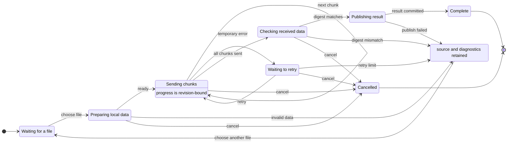
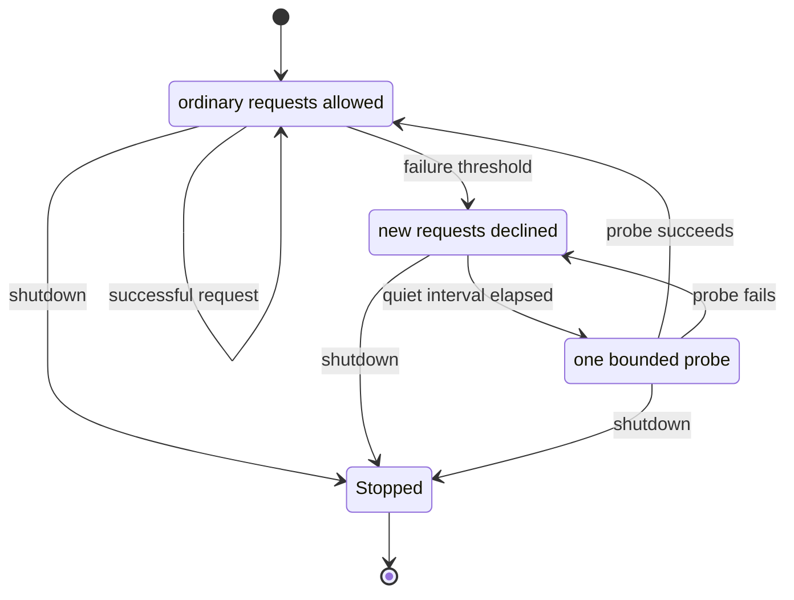
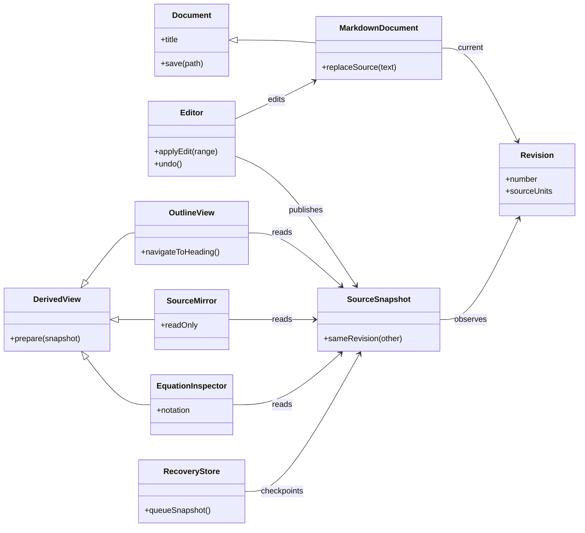
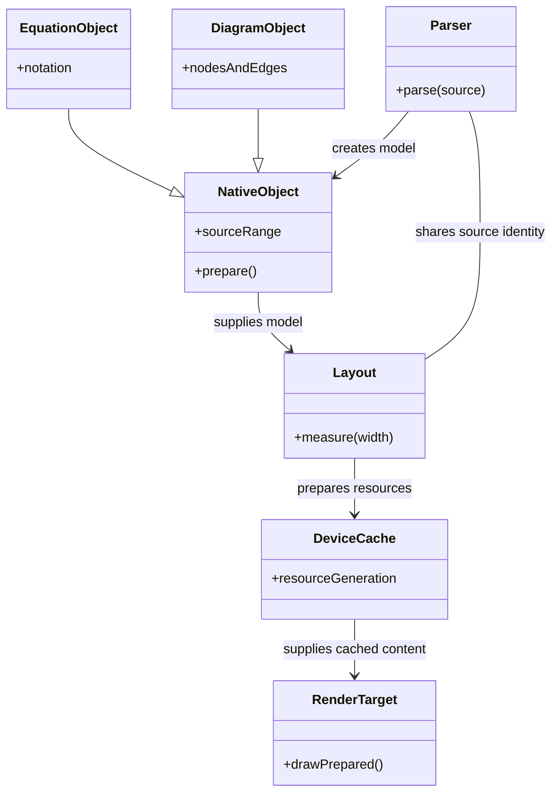

# Complex native state and class diagrams

These flat state machines and colon-member class diagrams target the current
native profiles. Nested states, class blocks, multiplicities and styling are
kept in the separate [fallback examples](rendering-fallback-cases.md).

## S01 — An upload lifecycle with retry and cancellation

Check the appended descriptions, self-transition and shared cancellation target.

## S02 — A circuit breaker, top to bottom

The cycle and repeated shutdown target should remain identifiable when resized.

## C01 — Revision ownership and derived views

This is an illustrative object model. Members are plain labels, and relationships
carry no multiplicity or ownership semantics beyond their written labels.

## C02 — Rendering stages and inheritance in the other arrow direction

Both inheritance directions should use hollow triangles with no line through
their interior. Check member line spacing and association-label placement.
