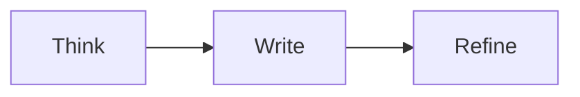

# Your next great idea

Write naturally, keep **Markdown** precise, and switch views whenever you need to.

## A small checklist

- [x] Give the idea a title
- [ ] Find the right words
- [ ] Make something worth sharing

## Show the flow



## An equation

$$
x = \frac{-b + \sqrt{b^2 - 4ac}}{2a}
$$

Place the caret inside the equation to see the native inspector preview.

Press F2 to edit its source in place. The `$$` delimiters must stay on their own lines.

## Details

| View | Purpose |
| --- | --- |
| Compose | Stay in the writing |
| Source | Inspect exact Markdown |
| Split | Keep both visible |

> Simple tools. Thoughtful defaults. Your files stay yours.

## A little code

```cpp
// Keep the example small.
const int ideas = 3;
```

Try the [full showcase](markdown-showcase.md) for more Markdown and code, or open
this examples folder with **File → Open Folder...** to browse every sample.
