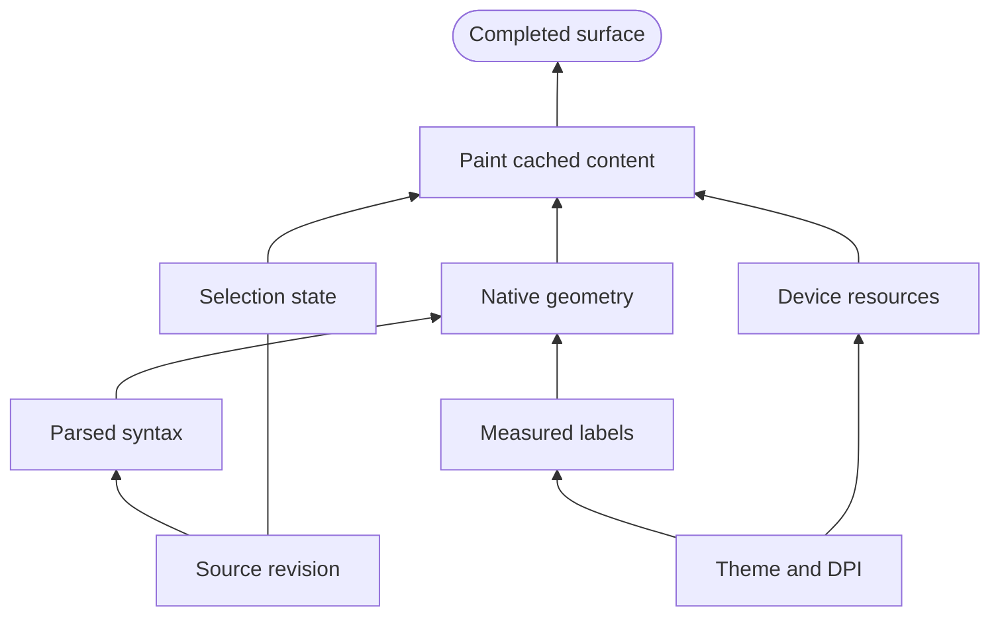
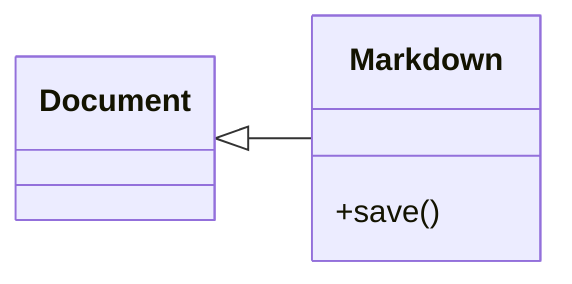

# Layout and mathematical spacing

These examples exercise native layout in Compose and Split. Use Source or F2 to
inspect the exact notation. Try Light, Dark and a narrow window, then Undo an edit.

## Preparation pipeline

Selection state and device resources belong beside native geometry. Each input
has its own attachment at Paint; the longer dependencies use outer lanes.

## Class direction and inheritance

Document belongs on the left and Markdown on the right. The inheritance triangle
points toward Document; its direction does not reverse the placement.

## Accents near the letters

Decorations retain a small visible gap. The wide tilde is one smooth wave, and
the dots remain visible at ordinary reading size.

$$
\widehat{ABC}+\widetilde{XYZ}+\overline{a+b}+\underline{x_i}+\vec{v}+\dot{x}+\ddot{x}
$$

## Gathered vectors and inner product

The second line stays clear of both matrices. Ordinary angle brackets follow the
short inner-product contents; matrix parentheses grow with their own two rows.

$$
\begin{gathered}\mathbf{u}=\begin{pmatrix}u_1\\u_2\end{pmatrix},\quad\mathbf{v}=\begin{pmatrix}v_1\\v_2\end{pmatrix}\\\left\langle\mathbf{u},\mathbf{v}\right\rangle=u_1v_1+u_2v_2\end{gathered}
$$
