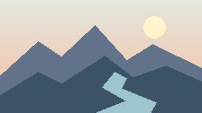
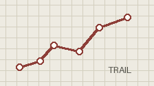
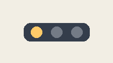

# Redfern field notebook

Each image loads from a relative path beside this document. Open it in Compose
or Split to see the images, then use **File → Print…** to see how they fit on paper.
Preserve the `assets/image-gallery` directory structure when you copy the example.

## PNG with transparency

## JPEG landscape

## BMP trail map

## Animated GIF

RedTilde displays and prints the first frame.

## TIFF chart

