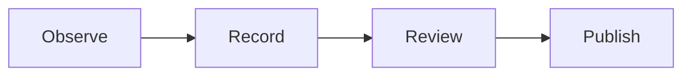

# The Lantern notebook

A compact rendering tour with invented notes from the Lantern observatory. Try
**Compose**, **Source**, and **Split**: each view keeps the same Markdown.

## Words and punctuation

Use **strong emphasis**, *a quieter emphasis*, ~~a retired idea~~, and
`inline_code()`. Escaped \*stars\* stay literal. A link can have a title:
[field notes](https://example.invalid/lantern "An invented reference").

Unicode belongs in ordinary writing: café, naïve, 東京, Ελληνικά, and a small 🌙.

> A useful notebook keeps the observation beside its explanation.
>
> Keep one thought per paragraph, and leave room for the next question.

## A night of observations

- [x] Check the fictional instrument
- [x] Write the first reading
- [ ] Compare the second reading
- [ ] Review the final note

1. Prepare the notebook.
2. Record the conditions.
   - Sky: clear
   - Wind: light
3. Compare both sessions.

## A table that tells a story

| Session | Status | Samples | Mean |
| :--- | :---: | ---: | ---: |
| Evening | Complete | 12 | 4.25 |
| Midnight | Review | 8 | 4.50 |
| Morning | Planned | 0 | — |

## Code with a language

C-like languages, JSON, PowerShell, and diff have bounded native syntax colors.
Other fence languages remain ordinary readable code. The source is unchanged.

```cpp
// Invented observation data
const int samples = 12;
if (samples > 0) {
    return samples;
}
```

```json
{
  "notebook": "Lantern",
  "samples": 12,
  "reviewed": false
}
```

```powershell
# Example content; RedTilde does not execute it.
$session = "Evening"
Write-Output $session
```

```diff
- status: draft
+ status: reviewed
```

## Mathematics beside the notes

An inline estimate is $v=\frac{d}{t}$. Display delimiters stand on their own lines:

$$
\bar{x}=\frac{1}{n}\sum_{i=1}^{n}x_i
$$

$$
A=\begin{bmatrix}4&1\\2&3\end{bmatrix}
$$

## A small process



---

Continue with [syntax options](syntax-options.md), [YAML metadata](front-matter-yaml.md),
[TOML metadata](front-matter-toml.md), or the nested [folder notebook](workspace/README.md).
Links are inert in RedTilde; open the other documents through the Files pane.
