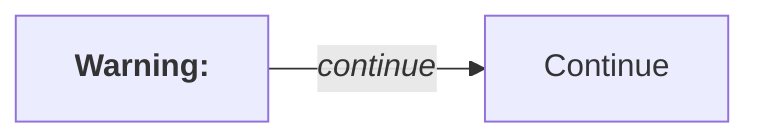
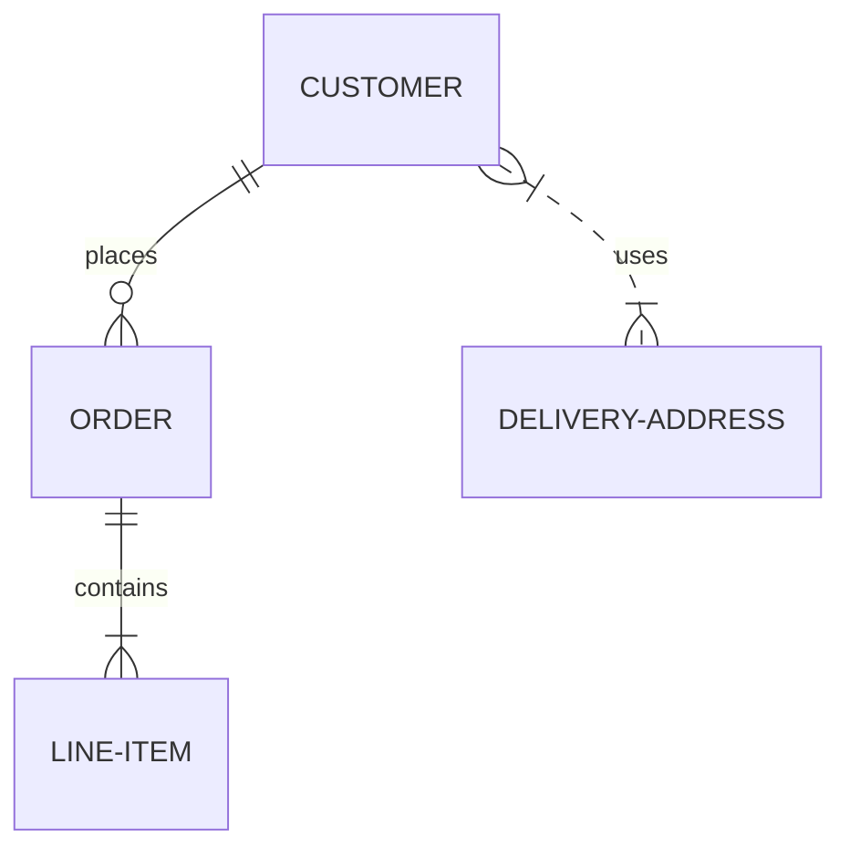
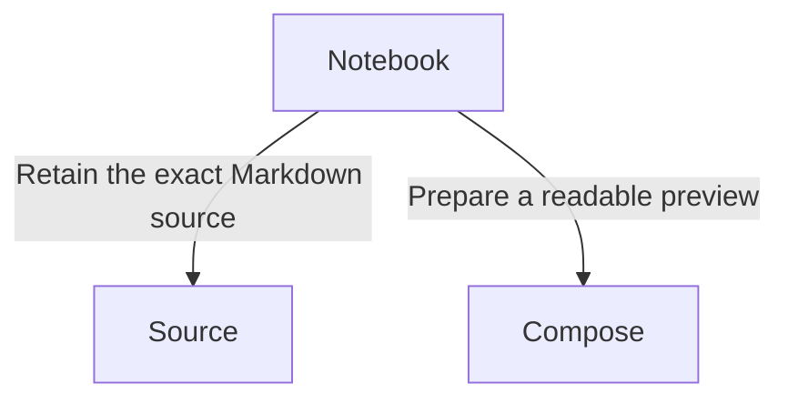
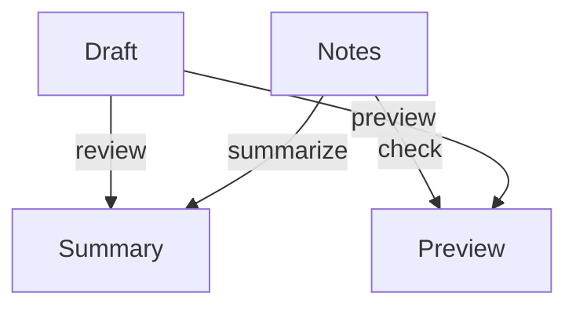
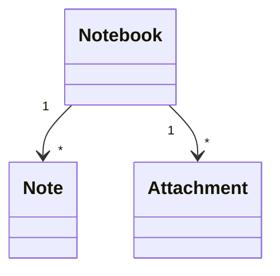

# Shared renderer display regressions

These supported cases cover corrected display defects and layouts that must keep
rendering correctly. Every fence should render while headings and neighboring
prose stay ordinary Markdown.

## Styled labels with trailing spaces



The style ranges follow the trimmed label. The exact spaces and tags remain in
Source and in the F2 editor; displaying the graph does not rewrite them.

## ER relationships from one entity



## Long labels on branches



The boxes and their connecting corridors should leave room for both labels.

## Dense joins keep separate label lanes



Four relationships cross the same rank. Their labels use separate outside lanes
so they cannot occupy the same midpoint.

## Class multiplicities with two outgoing relationships



## One marker per unordered task

- [x] The checkbox is the task marker
- [ ] A second ordinary bullet is unnecessary
- Ordinary list items retain their bullet

1. [x] Ordered tasks retain their number

## Readable code labels and line numbers

```cpp
// The language label and line numbers use foreground text ink.
const int observations = 12;
```

Switch between light, dark and high contrast, and verify source/undo after F2.
