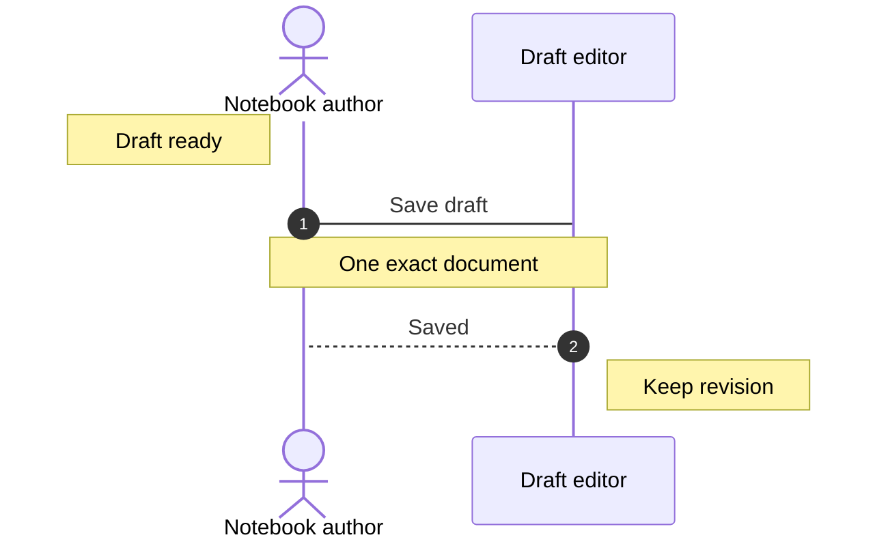
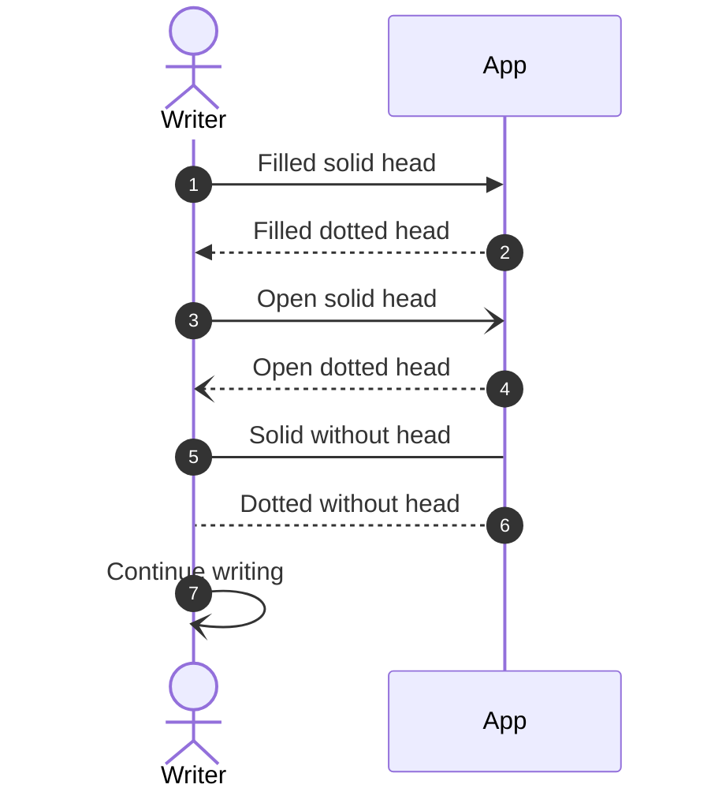
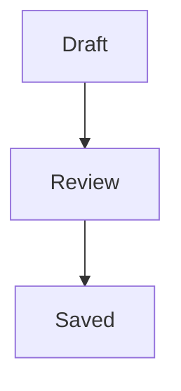

# A notebook conversation

The native sequence renderer supports actor figures, plain aliases, left/right/over
notes, bare automatic numbering and six message arrow styles. These examples use
invented writing data. Inspect the exact Markdown with F2 or Source, then undo an edit.

## Actors and chronological notes

Notes stay in the authored timeline. Numbers count messages, starting at one;
notes do not consume a number. Displayed numbers never enter the Markdown source.
Connections and note frames use readable foreground ink in Light, Dark and high contrast.

## Message styles and a self message

## A default flow direction

Without a direction token, `flowchart` and `graph` use top-to-bottom placement.
Loops, activation bars, creation/destruction, custom numbering arguments and
interaction directives remain outside this bounded profile and preserve their
complete editable fence. They are not represented by a partial native diagram.
