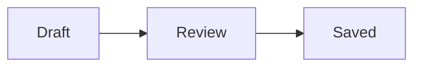
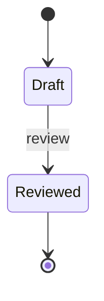
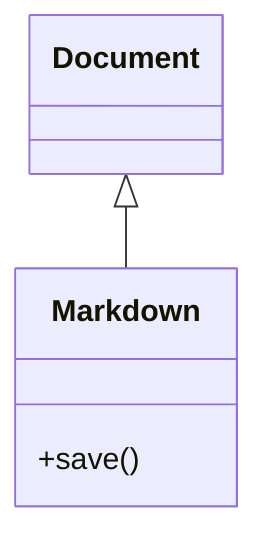
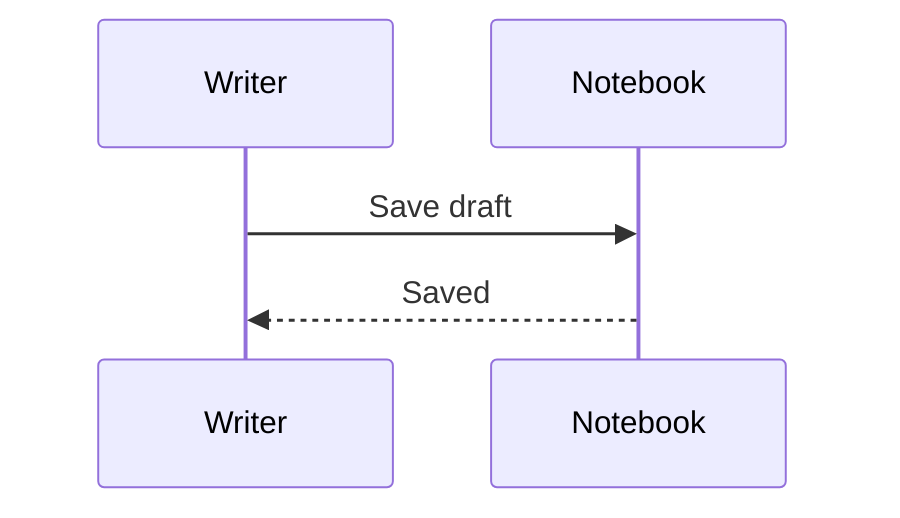
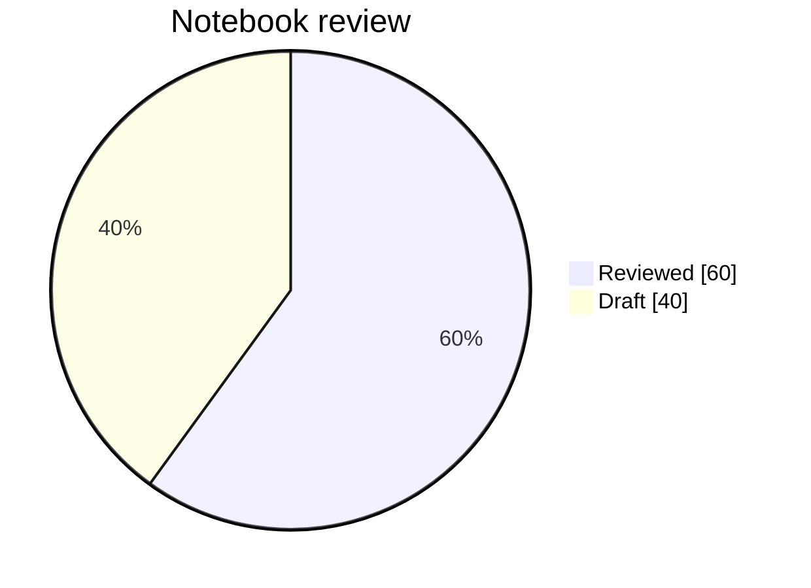
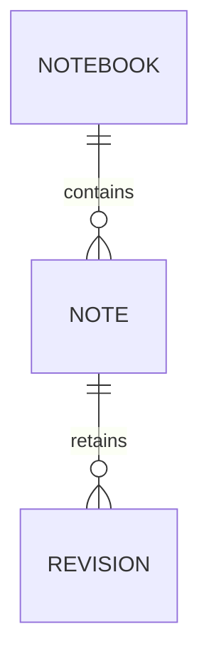
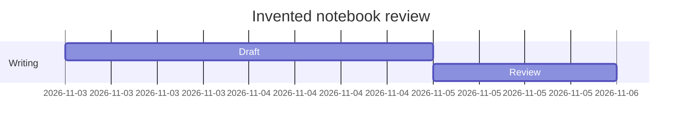
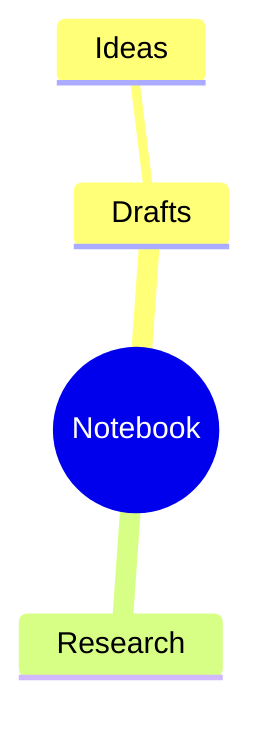

# A gallery of native Mermaid profiles

These eight small examples use the current delivery's bounded native profiles.
The [sequence sample](mermaid-sequence.md) explores the added actor, note and
numbering syntax. These profiles do not claim full Mermaid compatibility. Use F2 to
inspect a fence, then change views or undo an edit without rewriting its source.

## Flowchart

## State diagram

## Class diagram

## Sequence diagram

## Pie chart

## Entity relationships

## Gantt timeline

## Mind map

All names, dates and counts are invented. Unsupported advanced constructs belong
in the separate fallback sample, rather than being presented as missing families.
