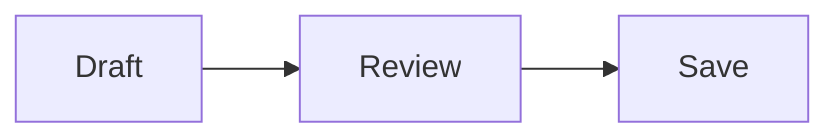
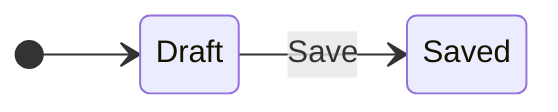
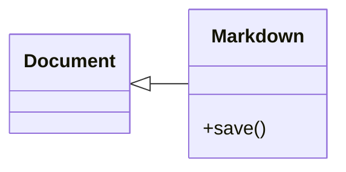

# A fixed writing fixture

Unicode writing: Café, 東京 and 😀. **Bold** and *italic* text stay source-exact.

- [x] One document
- [ ] A pending task

| Component | Purpose |
| --- | --- |
| Source | Exact spelling |
| Compose | Writing |

## Mathematics

Inline $E=mc^2$ and $a_i^2$ in ordinary prose.

$$
x=\frac{-b+\sqrt{b^2-4ac}}{2a}
$$

$$
\begin{bmatrix}a&b\\c&d\end{bmatrix}
$$

## Diagrams

