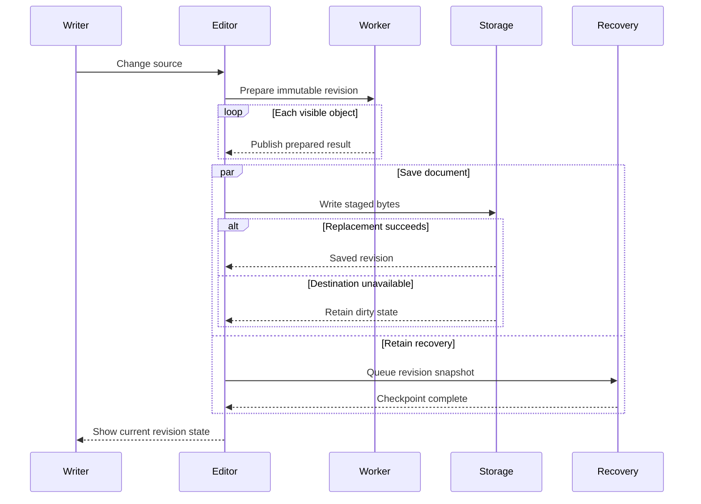
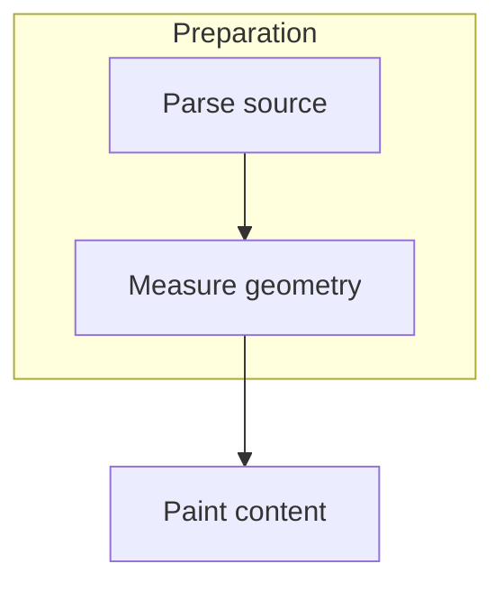
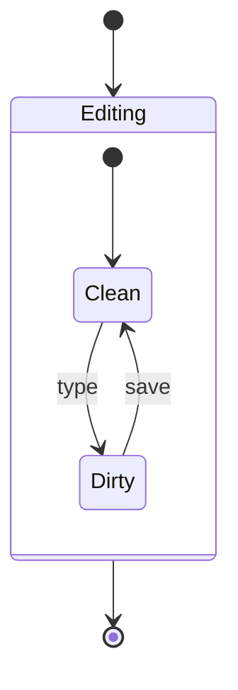
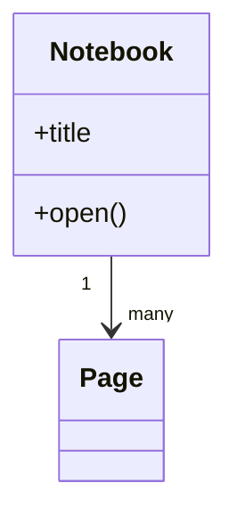
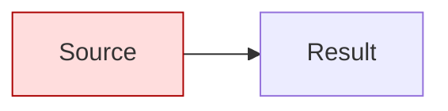
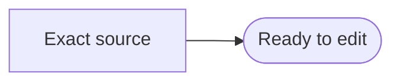

# Intentional math and diagram fallback cases

Every numbered case below is deliberately outside the current native grammar or
malformed. Expected behavior is exact editable literal source with diagnostics,
not a partly rendered approximation. This document is a negative-test specimen,
not a supported-feature demonstration. No package, directive or command executes.

Compare with [supported mathematics](complex-math.md), [flowcharts](complex-flowcharts.md)
and [state/class diagrams](complex-state-and-class-diagrams.md).

## X01 — Unsupported array environment

$$\begin{array}{rcl}x+y&=&3\\x-y&=&1\end{array}$$

Use the supported `aligned` or matrix environments in ordinary documents.

## X02 — Unsupported user-defined macro

$$\newcommand{\sample}[1]{\frac{#1}{2}}\sample{x}$$

## X03 — Unsupported styling command

$$\color{red}{x^2+y^2}$$

## X04 — Unequal matrix column counts

$$\begin{bmatrix}a&b&c\\d&e\end{bmatrix}$$

## X05 — Unmatched scalable delimiter

$$\left(\frac{a+b}{c+d}$$

## X06 — Missing argument and duplicate script

$$\frac{a}$$

$$x_i_j$$

## X07 — Unsupported sequence diagram



## X08 — Unsupported flowchart subgraph



## X09 — Unsupported composite state



## X10 — Unsupported class blocks and multiplicities



## X11 — Unsupported styling directive



## X12 — Malformed edge, followed by a supported neighbor

```mermaid
flowchart TD
Ready -->
```

The supported neighbor below should still render independently:

$$\frac{1}{1+x^2}+\sqrt{1+y^2}$$



Use F2, cancel, then edit and undo one rejected case. Preserve its complete
envelope and verify that the neighboring equation and graph remain independent.
