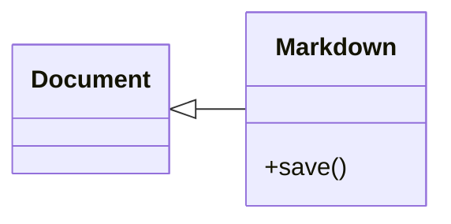

# Technical notes in RedTilde

Inline mathematics stays in the sentence: $E=mc^2$ and $a_i^2$.

## Equations and matrices

$$
x = \frac{-b+\sqrt{b^2-4ac}}{2a}
$$

$$
A = \begin{bmatrix}a&b\\c&d\end{bmatrix}
$$

$$
\begin{aligned}f(x)&=x^2+1\\f'(x)&=2x\end{aligned}
$$

Put the caret in an equation and press F2 to edit its exact source. Apply is one
undoable edit; Esc cancels. Compose, Source and Split keep the same document.

## State diagram

## Class diagram

These are bounded native dialects. Unsupported commands and diagram families
remain editable source. Your Markdown file is never rewritten from the display.

## Recovery

Unsaved writing is checkpointed after a quiet interval. Restart can preview and
restore a copy, keep it for later, or discard it. A restored copy requires Save As
and preserves the original file. An unapplied local draft is included as a
proposed edit in the recovery preview.
