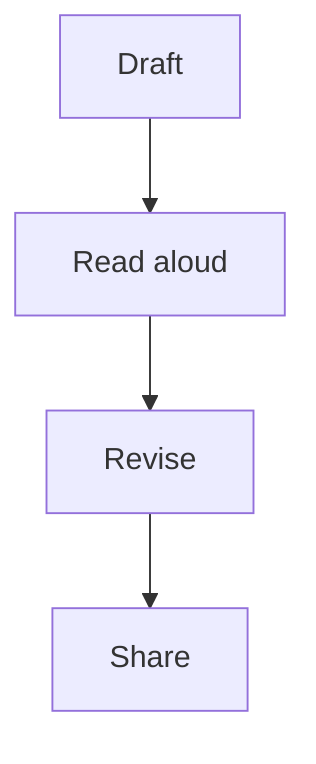

# A short writing guide

Start with one clear observation. Put its evidence close to the sentence that
needs it. Keep headings short and paragraphs focused.

## Review checklist

- [ ] The title names the subject
- [ ] Tables have clear column headings
- [ ] Equations have a sentence of explanation
- [ ] Unsupported notation remains readable in Source

